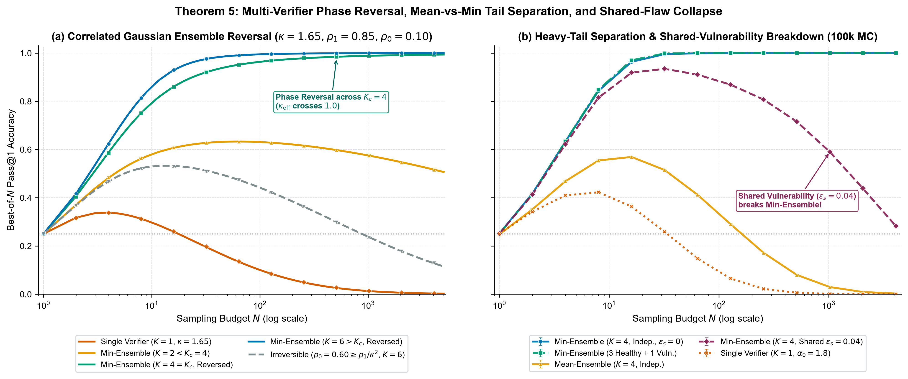
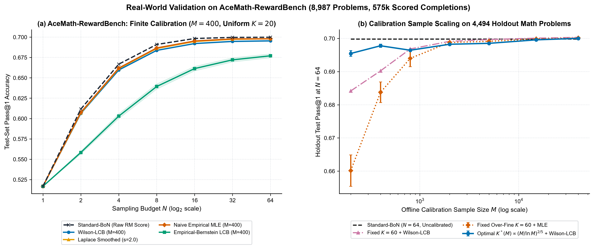

# Test-Time Scaling 相变理论、多裁判逆转与抗坍塌算法库 (`tts-theory`)

面向大语言模型（LLM）推理阶段的**测试时计算缩放（Test-Time Scaling, TTS）极限行为、极值相变机理、多噪声裁判一般融合逆转、有限校准集与有限算力联合标度律、以及题目异质性辛普森悖论**的严格概率论证明与高精度实证验证库。

> **核心结构与演化（V1 $\to$ V4）**：
> - **V1 基础理论与数值基准（定理 1–4）**：对单裁判 Test-Time Scaling 坍塌与校准理论做统一概率测度推导，实现双精度 PIT 数值积分引擎与百万次级流式蒙特卡洛仿真；
> - **V2 & V4 原创理论支柱（定理 5–7）**：
>   - **定理 5（一般异构多裁判集成相变与 Copula 统一重尾理论）**：推导一般非对称协方差矩阵 $(\Sigma_1, \Sigma_0)$ 下的广义特征值最优线性融合（含高错相关下**负权差值反杀**）、基于 Hashorva-Hüsler 正交象限 QP 的严格密度级 `Min-Ensemble` 激活集相变、以及任意相关 **Gaussian-Copula + Student-$t$** 统一剩余尾相依红线 $\alpha_0/\eta_{0,\text{eff}} > \alpha_1/\eta_1$；
>   - **定理 6（有限校准集 $M$ 与有限推理算力 $N$ 联合 Minimax 定理）**：导出含平局组精确条件 BoN 闭式公式，修正并证得 $\beta$-光滑峰最适分桶律 $K^*(M) \asymp (M/\ln M)^{\frac{1}{2\beta+1}}$（二次峰为 **`1/5`**）与匹配对数因子的 **Fano 信息论下界**；提出全有限样本非渐近 **`KL-LCB`**（并量化 `Empirical-Bernstein LCB` 归零崩溃阈值）；建立 $\Theta(N^{-\beta})$ 峰值收敛速率与 $(M, N)$ 联合配比公式 $N_{\text{match}}(M) \asymp M^{\frac{1}{2\beta+1}}(\ln M)^{\frac{2\beta}{2\beta+1}}$；
>   - **定理 7（题目异质性、辛普森伪单调遮蔽与题内标准化）**：分解全局池化后验导数恒等式，揭示“单题必坍塌但全局看似单调”的伪单调遮蔽陷阱，并定量证明题内 Z-Score 标准化在大 $N$ 去混淆与非单调小 $N$ 丢幅反噬之间的双向权衡；
> - **V3 文献排雷审计与真实大模型/RM 实证验证**：系统对比 12 篇截至 2026-11 的 arXiv / 顶会核心文献（[RELATED_WORK.md](RELATED_WORK.md)），并在 `nvidia/AceMath-RewardBench`（8,987 题 × 64 候选 = 575,168 条双 RM 打分）与 `HuggingFaceH4/MATH-500`（`Llama-3.2-1B` / `3B` × 256 候选 = 256,000 条 `RLHFlow-8B-PRM` 轨迹）上完成端到端真实数据验证。

---

## 1. 核心理论七大定理概览

完整严格证明见学术证明稿 [PROOF.md](PROOF.md)，解析实现分别位于 [theorems.py](src/tts_theory/theorems.py)、[ensemble_theory.py](src/tts_theory/ensemble_theory.py)、[calibration_theory.py](src/tts_theory/calibration_theory.py) 与 [heterogeneity_theory.py](src/tts_theory/heterogeneity_theory.py)：

| 阶段 | 定理 | 数学命题与工程意义 | 核心公式 / 判据 | 对应实现 |
| :---: | :---: | :--- | :--- | :--- |
| **V1** | **定理 1** | **连续与含原子 BoN 精确顺序统计量积分** | $P_{\text{BoN}}(N) = \int_0^1 q\big(\bar{F}_{\text{mix}}^{-1}(-\operatorname{expm1}(\tfrac{\ln v}{N}))\big)\,dv$ | `exact_bon_accuracy`, `ContinuousVerifierSpec` |
| **V1** | **定理 2** | **极值坍塌、$C^1$ MLRP 判据与闭式 $N^*$** | $\kappa_c = 1$；远尾 $e^{-\gamma}N^*_0$；Padé $N^*_{\text{saddle}}$（$R^2=0.9989$） | `check_collapse_criterion`, `closed_form_optimal_n` |
| **V1** | **定理 3** | **二元 Verifier 指数饱和律与信息论上界** | $P_{\text{bin}}(N)=\text{PPV}-C(1-q_1)^N$ | `BinaryVerifierSpec`, `binary_optimal_budget` |
| **V1** | **定理 4** | **校准后验与无穷候选有界加权多数决一致性** | 塔性质；$\mathbb{P}(\hat{A}_N\neq a^*)=O(e^{-cN})$ | `CalibratedWeightedBoN`, `TwoStageVerifiedMajority` |
| **V2/V4** | **定理 5** | **一般多裁判线性/QP `Min` 相变与 Copula 统一红线** | $\lambda_{\min}(\Sigma_1^{-1/2}\Sigma_0\Sigma_1^{-1/2})\le 1$；$\gamma_0>\gamma_1$；$\alpha_0/\eta_{0,\text{eff}}>\alpha_1/\eta_1$ | `solve_positive_quadrant_qp`, `optimal_linear_ensemble_criterion`, `GaussianCopulaHeavyTailSpec` |
| **V2/V4** | **定理 6** | **有限校准与算力 Fano Minimax 律、非渐近 `KL-LCB`** | $K^*(M)\asymp(M/\ln M)^{\frac{1}{2\beta+1}}$（$\beta=2 \implies \tfrac{1}{5}$）；$\Theta(N^{-\beta})$；`KL-LCB` | `calibration_minimax_scaling`, `joint_calibration_compute_scaling`, `compute_bin_calibrator_scores(..., method="kl_lcb")` |
| **V4** | **定理 7** | **题目异质性辛普森遮蔽与题内标准化交叉权衡** | $q'_{\text{pool}}=\mathbb{E}[\partial_s q_X\mid S]+\operatorname{Cov}(Y,g_X\mid S)$ | `PromptHeterogeneitySpec`, `diagnose_simpson_confounding`, `evaluate_pooled_vs_within_prompt_calibration` |

---

## 2. 仓库结构

```text
test-time-scaling-theory/
├── LICENSE                                    # MIT 开源许可证
├── pyproject.toml                             # 项目构建与 pytest 配置 (v0.4.0)
├── PROOF.md                                   # 七大核心定理完整严格数学证明稿（V4）
├── RELATED_WORK.md                            # 12 篇 2022–2026 顶会/arXiv 文献排雷与原创边界审计
├── README.md                                  # 项目总览与复现指南
├── src/tts_theory/
│   ├── __init__.py                            # 统一公开 API 导出
│   ├── theorems.py                            # V1 定理 1–4 分布规格与解析公式
│   ├── ensemble_theory.py                     # V2/V4 定理 5 一般 QP / 负权 / Copula 重尾相变
│   ├── calibration_theory.py                  # V2/V4 定理 6 条件公式、KL-LCB 与联合 Minimax 标度
│   ├── heterogeneity_theory.py                # V4 定理 7 题目异质性辛普森遮蔽与题内标准化
│   ├── real_eval.py                           # V3 真实大模型/RM 离线精确池计算与 LaTeX/SymPy 判分引擎
│   ├── integrals.py                           # 双精度 PIT 分段 Gauss-Legendre / quad 引擎
│   ├── simulator.py                           # 低内存流式分块向量化蒙特卡洛仿真器
│   └── algorithms.py                          # StandardBoN, OptimalNStarBoN, EmpiricalScoreCalibrator
│                                              # (支持 wilson/kl/bernstein LCB), CalibratedWeightedBoN, TwoStageVerifiedMajority
├── tests/
│   ├── test_theorems.py                       # 定理 1–4 数值精度与 100k–1.5M MC 交叉验证
│   ├── test_algorithms.py                     # 四大算法与经验校准器单元测试
│   ├── test_extensions.py                     # V2 定理 5 & 定理 6 单元测试
│   ├── test_real_eval.py                      # V3 真实池评估与等价判分单元测试
│   └── test_v4_theory.py                      # V4 定理 5–7 推广、Fano 1/5、KL-LCB、N^{-2} 与辛普森单测
├── scripts/
│   ├── verify_theorems.py                     # 定理 1–4 验证 -> results/theorem_verification.json
│   ├── run_experiments.py                     # V1 参数扫描与五算法对比 -> results/experiment_results.json
│   ├── plot_figures.py                        # V1 图 1–3 绘图 -> results/figures/*.png
│   ├── run_v2_extensions.py                   # V2 实验 E/F/G -> results/v2_extension_results.json
│   ├── plot_v2_figures.py                     # V2 图 4–5 绘图 -> results/figures/*.png
│   ├── run_real_llm_experiments.py            # V3 真实大模型/RM 实验 R1–R4 -> results/real_llm_results.json
│   ├── plot_real_figures.py                   # V3 图 6–7 绘图 -> results/figures/*.png
│   └── verify_v4_theory.py                    # V4 定理 5–7 定量交叉验证 -> results/v4_theory_verification.json
└── results/
    ├── EXPERIMENT_REPORT.md                   # V1–V4 完整实验分析报告
    ├── theorem_verification.json / experiment_results.json
    ├── v2_extension_results.json / real_llm_results.json / v4_theory_verification.json
    ├── param_sweep_summary.csv / algorithm_comparison_summary.csv
    └── figures/
        ├── scaling_collapse_curves.png        # 图 1：异方差与污染尾部下的 BoN 坍塌曲线
        ├── optimal_n_phase_diagram.png        # 图 2：相变相图与闭式/数值 N* 一致性检验
        ├── calibrated_vs_bon.png              # 图 3：校准加权与两阶段多数决消除坍塌对比
        ├── ensemble_phase_reversal.png        # 图 4：多裁判相变逆转与重尾 Mean/Min 分离
        ├── finite_calibration_secondary_collapse.png # 图 5：有限校准二次坍塌与 LCB 收敛标度
        ├── real_llm_theorem6_calibration.png  # 图 6：AceMath-RewardBench 真实 RM 校准验证
        └── real_llm_math500_scaling.png       # 图 7：MATH-500 (Llama-3.2-1B/3B + RLHFlow-8B-PRM) 实证
```

---

## 3. 快速安装与一键复现

本核心理论库仅依赖 `numpy`, `scipy`, `matplotlib`, `pytest`；若复现 V3 真实 Parquet 数据集实验，可安装可选依赖组 `[real]`（`pandas`, `pyarrow`, `sympy`，数据自动缓存于 `.gitignore` 忽略的 `data/` 目录）：

```bash
# 1. 克隆并离线可编辑安装
git clone https://github.com/6Riemann9/test-time-scaling-theory.git
cd test-time-scaling-theory
python -m pip install --no-deps --no-build-isolation -e .

# 2. 运行全量单元测试（V1+V2+V3+V4 共 30 项）
python -m pytest -v

# 3. 运行 V1–V4 实验验证与绘图脚本
python scripts/verify_theorems.py
python scripts/run_experiments.py
python scripts/plot_figures.py
python scripts/run_v2_extensions.py
python scripts/plot_v2_figures.py
python scripts/verify_v4_theory.py

# 4. 运行 V3 真实大模型/RM 实证实验（首次运行将自动从 HuggingFace 缓存约 140MB 数据至 data/）
python scripts/run_real_llm_experiments.py
python scripts/plot_real_figures.py
```

---

## 4. 关键实验结论与学术图表展示

详细量化分析请参阅 [results/EXPERIMENT_REPORT.md](results/EXPERIMENT_REPORT.md)。

### 4.1 核心量化指标摘要
- **V1 定理基准精度**：分段 Gauss-Legendre 与自适应 `quad` 最大偏差 `≤ 3.47e-13`；与 $1.5\times 10^6$ 次 MC 全点误差 `≤ 7.68e-4`；一阶鞍点预算公式 `saddle_refined` 跨 104 组参数 MRE `8.28%`（$R^2 = 0.9989$）；强诱饵 + $\epsilon=0.15$ 污染下 `Two-Stage-Verified-Majority` 将 $N=1000$ 准确率从 `0.00%` 恢复至 `99.983%`。
- **V2 多裁判相变逆转（定理 5 对称基准）**：在 $\kappa=1.65, \rho_1=0.85, \rho_0=0.10$（理论临界 $K_c=4$）下，$K=2$ 在 $N=4096$ 跌至 `51.62%`，跨过 $K=4$ 即刻逆转为 **`99.36%`**；Student-$t$ 重尾下 `Mean (K=4)` 崩溃至 **`0.28%`**，无同源漏洞 `Min (K=4)` 逆转达 **`99.99%`**，注入 4% 同源漏洞后 `Min` 再次跌至 `28.27%`。
- **V4 理论升级全量定量检验（定理 5–7 重构验证）**：
  - **5A 负权差值逆转 & 纯高斯 QP `Min`**：在高错相关（$\rho_1=0, \rho_0=0.85, \kappa=1.2$）下等权 `Mean` 跌至 **`3.16%`** 且全非负组合必坍塌，最优特征向量 $\mathbf{w}^*\propto(1,-1)$ 在 $N=2000$ 逆转为 **`100.00%`**；纯高斯非对称 Active-Set QP 剔除高噪冗余裁判后，将 `Mean`（`27.84%`）逆转为 **`99.91%`**；
  - **5B Copula 统一重尾**：Gaussian-Copula + Student-$t$ 下 $\alpha_0/\eta_0=8.0 > \alpha_1/\eta_1=5.07$ 预测 `Min` 达 **`99.96%`**（`Mean = 4.08%`），注入 6% 同源漏洞后跌回 **`23.02%`**；
  - **6A/6B/6C 修正标度律与非渐近 `KL-LCB`**：修正 $K^*(M)\propto(M/\ln M)^{1/5}$ 在 $M=5\times 10^6$ 将遗憾压低至 `0.00067`（击败错标 `2/5` 的 `0.00088`）；`M=400, K=40` 上 `KL-LCB = 43.44%`、`Wilson-LCB = 43.43%` 全面克服 `Empirical-Bernstein LCB` 过保守崩溃（`25.00%`）；完美校准内点峰值收敛速率在 $N=20{,}000$ 处与闭式 $\frac{C}{2(f^*)^2}N^{-2}$ 之比达 **`0.9997`**；
  - **7A/7B 题目异质性与辛普森遮蔽**：解析导数分解误差仅 `2.26e-10`；强跨题偏移 $N=256$ 下 `Within-Prompt-Z-KL-LCB`（**`57.00%`**）大幅优于坍塌的 `Pooled-KL-LCB`（`34.70%`）与 `Raw-BoN`（`17.80%`），而无偏移非单调 $N=2$ 下 `Pooled-KL-LCB`（**`39.05%`**）反向领先 `Within-Z`（`31.95%`）。
- **V3 文献排雷与真实大模型/RM 实证（83 万+ 真实候选）**：
  - [RELATED_WORK.md](RELATED_WORK.md) 核验 12 篇 2022–2026 arXiv/顶会文献，精准划定 V1 统一重构与 V2/V4 原创定理边界；
  - `AceMath-RewardBench`（8,987 题 × 64 候选 = 575,168 条双 RM 打分）：`RM-B` 在 `college_math` 上因右尾后验倒挂从 $N=16$ (`46.40%`) 坍塌至 $N=64$ (`45.79%`)；在 4,494 题 holdout 上于 $M=200, N=64$ 用 `Optimal K*(M)=9 + Wilson-LCB`（`69.55%`）挽回过细 `Fixed K=60 + MLE` 退化（`66.01%`, **`+3.53%`**）；
  - `HuggingFaceH4/MATH-500`（`Llama-3.2-1B/3B` × 256 候选 = 256,000 条 `RLHFlow-8B-PRM` 轨迹）：4 类 PRM 视图因高错例相关（$\bar{\rho}_0 \approx 0.617\text{--}0.644$）均触发定理 5A `irreversible_collapse`；5-Fold CV 下 `Calibrated-Weighted-BoN (Wilson-LCB)` 在 $N=256$ 将 Pass@1 从 `Standard-BoN` 的 `42.08% / 53.52%` 大幅提升至 **`52.80% / 65.20%`**（**`+10.72% / +11.68%`**）。

### 4.2 核心图表

#### (1) 异方差与 Reward Hacking 极值坍塌曲线


#### (2) 相变相图与闭式最优预算 $N^*$ 一致性检验


#### (3) 后验校准与两阶段多数决彻底消除坍塌


#### (4) V2 定理 5：多裁判高斯相变逆转与重尾 `Mean`/`Min` 分离


#### (5) V2 定理 6：有限校准样本二次坍塌与 Minimax LCB 收敛标度


#### (6) V3 真实验证：`AceMath-RewardBench` 有限校准与 $M$ 标度律


#### (7) V3 真实验证：`MATH-500` (`Llama-3.2-1B / 3B` + `RLHFlow-8B-PRM`) 算法对比与多 PRM 相关性诊断

