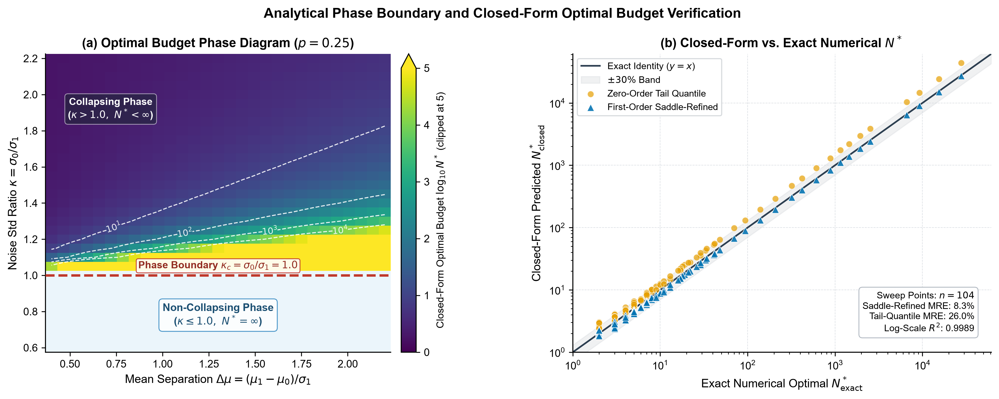
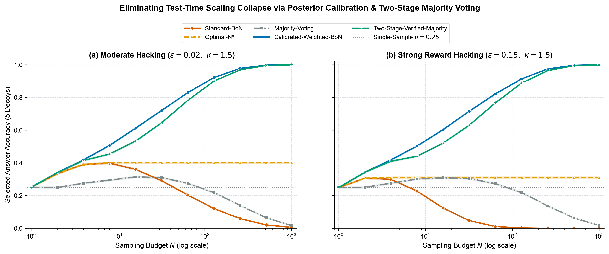
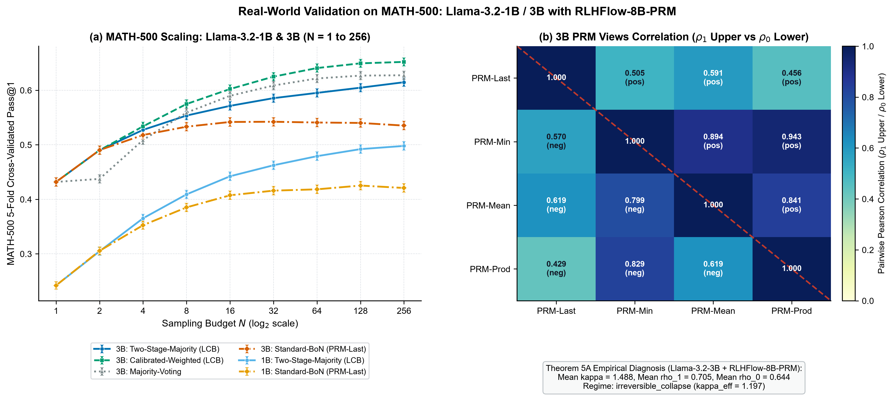
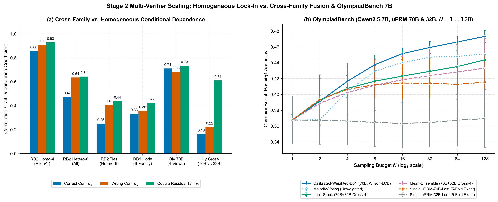
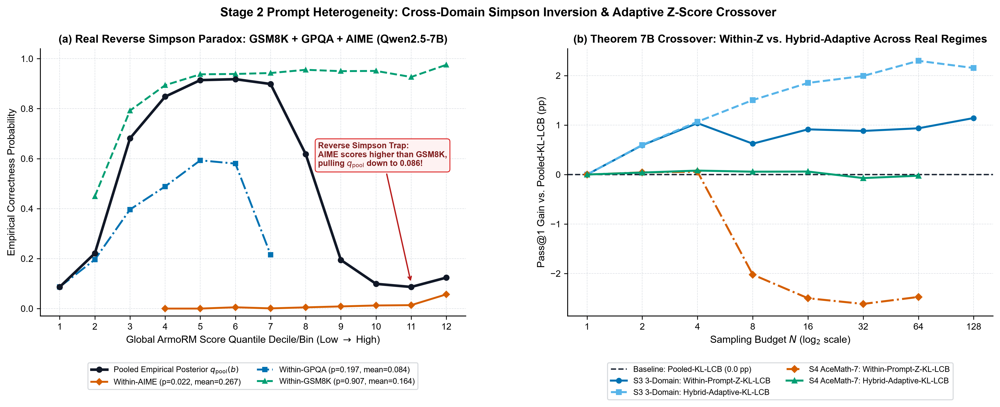

# Test-Time Scaling 相变理论、多裁判融合与校准算法库 (`tts-theory`)

面向大语言模型（LLM）推理阶段的**测试时计算缩放（Test-Time Scaling, TTS）极限行为、多噪声裁判一般融合与 Copula 尾相依、有限校准集与有限算力联合 Minimax 标度律、以及题目异质性辛普森混杂**的概率论证明与数值实证库。

> **架构概览（经 V8 数学边界与统计推断修订）**：
> - **第一部分：预备理论与单裁判基础（定理 1–4）**：在统一层次概率框架下，明确限定定理 1–6 为固定题目 $X=x$（或同质分布）条件下的统计性质，重述顺序统计量积分（含离散平局原子）、$C^0/C^1$ 分离 MLRP 判据、高斯五相分类（含 $\kappa<1,\ \Delta\mu=0$ 初值平局后严格递增边界）、固定峰值高度机制下的 Gumbel $e^{-\gamma}N^*_0$ 定理（附录 A 说明工程 `[1/1]` Padé 拟合）、$\text{PPV}=1$ 边界散度分离以及异质单错类期望权重约束的有界加权多数决（见 [RELATED_WORK.md](RELATED_WORK.md) 文献定位）。
> - **第二部分：多噪声集成、联合 Minimax 与题目异质性理论（定理 5–7）**：
>   - **定理 5（广义线性光谱、QDA 维度律、退化 QP `Min` 与 Copula 重尾）**：推导一般 $(\Sigma_1, \Sigma_0)$ 下广义特征值负权逆转与渐近尾安全约束下最大化 $N=2$ 线性 SNR 的凸化光谱路径 `Safe-Fisher` $\mathbf{w}_\tau=(\Sigma_0-\tau\Sigma_1)^{-1}\Delta\boldsymbol{\mu}$；刻画不可逆相 $\Sigma_0\succ\Sigma_1$ 下 Bayes QDA 天花板与 $N^{-2/K}$ 收敛率；利用本质正乘子集 $I_{+,c}$ 与弱激活正象限常数 $\alpha_{c, I_0}$ 将 `Min-Ensemble` 与 Gaussian-Copula + Student-$t$（$K\ge 2, R_c\succ 0$ 时 $\eta_c \in (0, 1)$，非负相关充分得 $[1/K, 1)$；对数因子 $(\gamma_c - |I_{+,c}|)/2$）推广至含零乘子弱激活边界的任意 SPD 相关矩阵。
>   - **定理 6 & 命题 6.1（一致正则类联合 $(M, N)$ Minimax 标度律、样本分割间距界与非渐近 `KL-LCB`）**：分离逐点渐近类 $\mathcal{F}_\beta^{\text{sep}}$ 与带公共类常数的一致正则分布类 $\mathcal{F}_\beta^{\text{unif}}(C_1, f_{\min}, \eta_0)$；利用三事件离线并界（联合覆盖 + 桶计数 + Hoeffding 下侧偏差）与最近峰在线样本耦合，证明适用于一切 $\beta > 0$ 的 $N$-无关 `KL-LCB` 上界 $O\big((\frac{\ln M}{M})^{\frac{\beta}{2\beta+1}} + N^{-\beta}\big)$ 及匹配的 Fano / Oracle 联合下界，并通过 Rényi–Pyke 顺序统计量 Gamma 间距界（命题 6.1）将未知总体分位数下的经验等频分桶覆盖至一切 $\beta > 0$（消解加性 DKW 界在 $0<\beta\le 0.5$ 的相对误差发散）。
>   - **定理 7 & 命题 7.1（题目异质性、显式辛普森遮蔽与在线样本标准化极值收敛）**：建立池化后验导数协方差分解与闭区间 `[3.5, 4.2]` 上的有限参数二层遮蔽构造、$N=2$ 样本 Z-Score 纯秩非严格上界及严格优势双向序反转充要条件；证明含不可解题原子 $\pi_0>0$ 时总体标准化 $Z^*$ 无条件诱导出右尾极限 $\frac{\pi_1}{\pi_0+\pi_1}$（区分多内点反例 $\kappa_Z \approx 0.3103 < 1$ 与单内点充分条件 $\kappa_Z>1$），并进一步证得实际在线样本标准化满足一致极值收敛 $\max_{1\le i\le N}|Z_{i,N}-Z_i^*(X)| = O_p(\sqrt{(\ln N)/N}) \xrightarrow{p} 0$ 从而继承渐近上限损失（定理 7C(4)）及三分支留出门控选择遗憾界（命题 7.1）。
> - **文献溯源与实证验证**：[RELATED_WORK.md](RELATED_WORK.md) 梳理 19 篇文献（涵盖 Romano 1988 非参数众数估计、Bubeck et al. 2011 连续臂 Bandit、Hashorva & Hüsler 2003、Tankov 2016、Das & Fasen-Hartmann 2024 等经典统计与极值文献及 Huang et al. ICML 2025 等 TTS 文献），并在 7 组公开 LLM/RM 基准池上（报告独立题目数 $P$、三分支对称嵌套交叉验证 `Hybrid-Adaptive`、2,000 次 Paired Cluster Bootstrap 95% CI 及 10,000 次 Phipson–Smyth 符号翻转置换检验 $p$ 值）验证理论行为与局限边界。

---

## 1. 核心定理概览

详细证明见 [PROOF.md](PROOF.md)，核心解析与仿真实现位于 [theorems.py](src/tts_theory/theorems.py)、[ensemble_theory.py](src/tts_theory/ensemble_theory.py)、[calibration_theory.py](src/tts_theory/calibration_theory.py) 与 [heterogeneity_theory.py](src/tts_theory/heterogeneity_theory.py)：

| 层次 | 定理 | 数学命题与主要适用范围 | 核心公式 / 判据 | 对应实现 |
| :---: | :---: | :--- | :--- | :--- |
| **预备** | **定理 1** | **连续与含原子 BoN 精确顺序统计量积分** | $P_{\text{BoN}}(N) = \int_0^1 q\big(\bar{F}_{\text{mix}}^{-1}(-\operatorname{expm1}(\tfrac{\ln v}{N}))\big)\,dv$ | `exact_bon_accuracy`, `ContinuousVerifierSpec` |
| **预备** | **定理 2** | **$C^1/C^0$ MLRP 判据、固定峰值高度 $e^{-\gamma}$ 与附录 Padé** | $\kappa_c = 1$；固定峰高 $\lim N^*_{\text{exact}}/N^*_0 = e^{-\gamma}$ | `check_collapse_criterion`, `closed_form_optimal_n` |
| **预备** | **定理 3** | **二元缩放律、$\text{PPV}=1$ 边界散度与闭式预算** | $P_{\text{bin}}(N)=\text{PPV}-C(1-q_1)^N$；$\beta=0$ 给 $\text{TV}$ 与反向 $\text{KL}$ | `BinaryVerifierSpec`, `binary_bon_divergence_bounds` |
| **预备** | **定理 4** | **校准后验 & 单错类条件权重约束加权多数决** | $\Delta_{\min}=p\mu_{w,+}-\sup_j(p_j\mu_{w,j})>0$ 致 $O(e^{-cN})$ | `weighted_majority_convergence_bound`, `TwoStageVerifiedMajority` |
| **核心 1** | **定理 5** | **$N=2$ `Safe-Fisher`、QDA $N^{-2/K}$、含退化 QP `Min` 与 Copula** | $\mathbf{w}_\tau=(\Sigma_0-\tau\Sigma_1)^{-1}\Delta\boldsymbol{\mu}$；$(\gamma_c - \|I_{+,c}\|)/2$ | `solve_positive_quadrant_qp`, `pareto_linear_ensemble_frontier`, `bayes_qda_multi_verifier_analysis` |
| **核心 2** | **定理 6 & 命题 6.1** | **$\mathcal{F}_\beta^{\text{unif}}$ 联合 $(M,N)$ Minimax 与全 $\beta>0$ 经验间距界** | $N$-无关 $K^*(M)$ 匹配 $\Omega((\frac{\ln M}{M})^{\frac{\beta}{2\beta+1}}+N^{-\beta})$；$\hat{\pi}_k\in[\frac{1}{2K},\frac{2}{K})$ | `tight_joint_minimax_scaling`, `empirical_quantile_spacings_bounds` |
| **核心 3** | **定理 7 & 命题 7.1** | **显式辛普森遮蔽、$N=2$ 纯秩界与在线样本 $Z_{i,N}$ 极值收敛** | $\max_i\|Z_{i,N}-Z_i^*\|=O_p(\sqrt{\frac{\ln N}{N}})$；三分支留出门控 | `diagnose_simpson_confounding`, `verify_sample_zscore_extremal_convergence` |

---

## 2. 仓库结构

```text
test-time-scaling-theory/
├── LICENSE                                    # MIT 开源许可证
├── pyproject.toml                             # 项目构建与 pytest 配置 (v0.8.0)
├── PROOF.md                                   # 预备定理 1–4 与核心定理 5–7（含命题 6.1 / 7.1）证明稿
├── RELATED_WORK.md                            # 19 篇 TTS 及经典多元极值/Copula/众数估计/Bandit 文献对照
├── README.md                                  # 项目总览与复现指南
├── src/tts_theory/
│   ├── __init__.py                            # 统一公开 API 导出
│   ├── theorems.py                            # 定理 1–4 分布规格、散度边界与异质权重接口
│   ├── ensemble_theory.py                     # 定理 5 Safe-Fisher/QDA/含零乘子 QP/Copula 统一模块
│   ├── calibration_theory.py                  # 定理 6 KL-LCB、一致正则类、Gamma 间距界与联合 Minimax 模块
│   ├── heterogeneity_theory.py                # 定理 7 辛普森遮蔽、纯秩上界与样本 Z_{i,N} 极值收敛诊断
│   ├── real_eval.py                           # 真实候选池评估、三分支嵌套留出及 Cluster Bootstrap / 置换检验引擎
│   ├── integrals.py                           # 双精度 PIT 分段 Gauss-Legendre / quad 引擎
│   ├── simulator.py                           # 流式分块向量化蒙特卡洛仿真器
│   └── algorithms.py                          # StandardBoN, OptimalNStarBoN, EmpiricalScoreCalibrator,
│                                              # CalibratedWeightedBoN, TwoStageVerifiedMajority
├── tests/
│   ├── test_theorems.py                       # 定理 1–4 数值精度与 100k–1.5M MC 交叉验证
│   ├── test_algorithms.py                     # 推理选择算法与经验校准器单元测试
│   ├── test_extensions.py                     # 定理 5 & 定理 6 基础单元测试
│   ├── test_real_eval.py                      # 真实池评估与等价判分单元测试
│   ├── test_stage2_real_eval.py               # 异构多 RM / 8-SOTA / 辛普森异质性 API 单元测试
│   ├── test_v4_theory.py                      # 定理 5–7 推广、Fano 1/5、KL-LCB、N^{-2} 与辛普森单测
│   ├── test_v5_rigor.py                       # 边界条件与极端构造回归验证（9 项）
│   ├── test_v6_theory.py                      # 定理 5A-III (Safe-Fisher/QDA)、6C 等频检验与 7C 单测（6 项）
│   ├── test_v7_counterexamples.py             # V7 审稿反例复现、零乘子精确积分与聚类统计推断单测（5 项）
│   └── test_v8_rigor.py                       # V8 二审边界、beta<=0.5 间距界、样本 Z 收敛与三分支门控单测（7 项）
├── scripts/
│   ├── verify_theorems.py                     # 定理 1–4 验证 -> results/theorem_verification.json
│   ├── run_experiments.py                     # 参数扫描与五算法对比 -> results/experiment_results.json
│   ├── plot_figures.py                        # 图 1–3 绘图 -> results/figures/*.png
│   ├── run_v2_extensions.py                   # 实验 E/F/G -> results/v2_extension_results.json
│   ├── plot_v2_figures.py                     # 图 4–5 绘图 -> results/figures/*.png
│   ├── run_real_llm_experiments.py            # 真实大模型/RM 实验 R1–R4 -> results/real_llm_results.json
│   ├── plot_real_figures.py                   # 图 6–7 绘图 -> results/figures/*.png
│   ├── run_stage2_experiments.py              # Stage 2 跨领域大池实证 S1–S4 -> results/stage2_real_results.json
│   ├── plot_stage2_figures.py                 # Stage 2 图 8–10 绘图 -> results/figures/*.png
│   ├── verify_v4_theory.py                    # 定理 5–7 定量交叉验证 -> results/v4_theory_verification.json
│   ├── verify_v6_theory.py                    # 定理 5A-III / 6C 等频 / 7C 验证 -> results/v6_theory_verification.json
│   ├── verify_v7_rigor.py                     # V7 反例数值校验 -> results/v7_rigor_verification.json
│   └── verify_v8_rigor.py                     # V8 数学核验与三分支嵌套留出真实异质性重算 -> results/v8_rigor_verification.json
└── results/
    ├── EXPERIMENT_REPORT.md                   # 全套实验与理论验证分析报告（含 V7/V8 统计推断与反例校验）
    ├── theorem_verification.json / experiment_results.json / v2_extension_results.json
    ├── real_llm_results.json / v4_theory_verification.json / v6_theory_verification.json
    ├── v7_rigor_verification.json / v8_rigor_verification.json
    ├── stage2_real_results.json / stage2_summary.csv / param_sweep_summary.csv / algorithm_comparison_summary.csv
    └── figures/
        ├── scaling_collapse_curves.png        # 图 1：异方差与污染尾部下的 BoN 坍塌曲线
        ├── optimal_n_phase_diagram.png        # 图 2：相变相图与闭式/数值 N* 一致性检验
        ├── calibrated_vs_bon.png              # 图 3：校准加权与两阶段多数决对比
        ├── ensemble_phase_reversal.png        # 图 4：多裁判相变逆转与重尾 Mean/Min 分离
        ├── finite_calibration_secondary_collapse.png # 图 5：有限校准二次坍塌与 LCB 收敛标度
        ├── real_llm_theorem6_calibration.png  # 图 6：AceMath-RewardBench 真实 RM 校准验证
        ├── real_llm_math500_scaling.png       # 图 7：MATH-500 (Llama-3.2-1B/3B + RLHFlow-8B-PRM) 实证
        ├── stage2_heterogeneous_multi_rm.png  # 图 8：Stage 2 异构多 RM 相关性破局、噪声免疫与 70B PRM 增益
        ├── stage2_joint_mn_and_sota_calibrators.png # 图 9：Stage 2 8 类 SOTA 校准器横评与二维 (M, N) 联合标度
        └── stage2_real_simpson_and_cross_domain.png # 图 10：Stage 2 真实跨域辛普森悖论逆转与 Hybrid 自适应边界
```

---

## 3. 快速安装与一键复现

核心库依赖 `numpy`, `scipy`, `matplotlib`, `pytest`；若复现真实 Parquet 与 HuggingFace 数据集实验，可安装可选依赖组 `[real]`（`pandas`, `pyarrow`, `sympy`, `huggingface_hub`, `requests`，数据自动缓存于 `.gitignore` 忽略的 `data/` 目录）：

```bash
# 1. 克隆并离线可编辑安装
git clone https://github.com/6Riemann9/test-time-scaling-theory.git
cd test-time-scaling-theory
python -m pip install --no-deps --no-build-isolation -e .

# 2. 运行全量单元测试（共 61 项，含 V7/V8 反例与数学边界专项单测）
python -m pytest -v

# 3. 运行理论实验与 V7/V8 反例及统计校验脚本
python scripts/verify_theorems.py
python scripts/run_experiments.py
python scripts/plot_figures.py
python scripts/run_v2_extensions.py
python scripts/plot_v2_figures.py
python scripts/verify_v4_theory.py
python scripts/verify_v6_theory.py
python scripts/verify_v7_rigor.py
python scripts/verify_v8_rigor.py

# 4. 运行真实大模型/RM 实证实验（首次运行将自动缓存数据至 data/）
python scripts/run_real_llm_experiments.py
python scripts/plot_real_figures.py
python scripts/run_stage2_experiments.py --stages all
python scripts/plot_stage2_figures.py
```

---

## 4. 核心实证结果与统计推断摘要

详细量化分析请参阅 [results/EXPERIMENT_REPORT.md](results/EXPERIMENT_REPORT.md)。以下报告基于独立题目数 $P$ 与配对整群自助法（Paired Cluster Bootstrap）的实测结论：

### 4.1 关键实测指标与 V7/V8 审稿修补核验
- **预备定理数值基准精度**：分段 Gauss-Legendre 与自适应 `quad` 最大偏差 `≤ 3.47e-13`；与 $1.5\times 10^6$ 次 MC 全点误差 `≤ 7.68e-4`；`saddle_refined` 跨 104 组内点参数 MRE `8.28%`（$R^2 = 0.9989$）；强诱饵 + $\epsilon=0.15$ 下 `Two-Stage-Verified-Majority` 在 $N=1000$ 达 `99.983%`。
- **多裁判线性光谱与 QP/Copula 退化核验**：
  - 3D 耦合实例 $N=4096$ 下 `Fisher (kappa=1.507)` 跌至 `28.99%`，$N=2$ 尾安全解 `Safe-Fisher (tau*=0.2843, kappa=1.000)` 达 `95.79%`；真实 `RB2 hetero6 (P=1,723, N=4)` 上 `Fisher=88.28%`, `QDA=87.93%`, `Safe-Fisher=81.66%`, `GenEig=39.29%`（实证说明 `Safe-Fisher` 针对 $N=2$ 而非 $N>2$ 精确最优化）。
  - $\Sigma_0\succ\Sigma_1$ 下 QDA 天花板随 $K=1\to 2\to 3$ 增至 `0.3957 < 0.5316 < 0.6538`，$K=1$ ($N^{-2}$) 与 $K=2$ ($N^{-1}$) 观测/理论遗憾比收敛至 `0.9998` 与 `0.9530–1.1654`。
  - **QP/Copula 反例与精确边界核验**：4×4 块对角负相关矩阵给 `eta=6/23 > 1/4`（证非负相关仅充分不必要），$K=3, \rho=0.99$ 给 `eta=0.99333 < 1`（证 $K\ge 2, R_c\succ 0 \implies \eta_c\in(0,1)$）；3×3 零乘子弱激活矩阵 (`I_+=[0,1], I_0=[2]`) 经 2D 数值积分在 $t=500$ 处与修正阶 $\frac{1}{4\pi}t^{-2}e^{-t^2}$ 比值达 **`1.0022`**。
- **有限校准集、$N$-无关等频分桶与 $\beta \le 0.5$ 间距浓缩**：
  - `Opt 1/5 + KL-LCB` 在 `AceMath (M=100, N=64)` 上以 **`69.21%`** 优于过细 `Fixed-60 MLE`（`63.82%`）；在 `M=50,000, N=8`（显式 **`binning="quantile"`**）上 $N$-无关 `K=8`（**`44.44%`**）击败截断基线 `K=2`（`37.95%`, **`+6.49 pp`**）。
  - **窄峰反例与全 $\beta>0$ 经验间距核验**：无公共曲率约束的 $q_h(s)=\frac{1}{4}+\frac{1}{2}e^{-s^2/h^2}$ 在 $N=10, h=0.005$ 下遗憾达 `0.4827`（验证限定于 $\mathcal{F}_\beta^{\text{unif}}(C_1, f_{\min}, \eta_0)$ 的必要性）；在 $\beta=0.25 \le 0.5$（$M=2.5\times 10^6, K=3065$）下，加性 DKW 相对误差界达 `8.924 > 1` 失效，而样本分割 Gamma 间距界满足 $d_{\min}=407 \ge 378.52$（失效上界 `6.74e-4`）。
- **跨领域真实题目异质性与三分支嵌套留出推断（2,000× Cluster Bootstrap + 10,000× Phipson–Smyth 置换检验）**：
  - **`S3 GSM8K+GPQA+AIME` ($P=2,798, N=128$)**：`Pooled-KL-LCB = 48.68% ± 0.88%`，`Within-Z = 49.82% ± 0.88%`，`Standard-BoN = 51.12% ± 0.92%`，三分支 `Hybrid-Adaptive` 达 **`50.83% ± 0.91%`**（优于 `Pooled` **`+2.15 pp`**, 95% CI `[+1.35, +2.96] pp`, $p_{\text{perm}} = 1.0\times 10^{-4}$；相对 `Standard-BoN` 为 `-0.29 pp`, $p_{\text{perm}} = 0.1298$ 无显著差异）；`S1a RB2 ($P=1,855, N=4$)` 上 `Hybrid` 5/5 折选中 `Standard-BoN` 达 **`87.23% ± 0.75%`**（优于 `Pooled` **`+2.09 pp`**, $p_{\text{perm}} = 1.0\times 10^{-4}$）。
  - **`S4 AceMath ($P=8,987, N=64$)` & `S2 OlympiadBench ($P=674, N=128$)`**：`Within-Z` 相对 `Pooled` 净损 `-2.47 pp / -2.67 pp / -7.66 pp`（均 $p_{\text{perm}} = 1.0\times 10^{-4}$），三分支 `Hybrid` 在全部 15 个折叠上 `0` 次误选 `Within-Z`，与最优单分支无统计显著差异（$p_{\text{perm}} \in [0.51, 1.00]$）。
  - **在线样本 $Z_{i,N}$ 一致极值收敛核验（定理 7C(4)）**：在 $N \in \{16, 64, 256, 1024, 4096\}$ 扫描下，$\mathbb{E}[\max_{i\le N}|Z_{i,N}-Z_i^*|] / \sqrt{(\ln N)/N}$ 稳定于 `1.115 → 0.967`，在线样本 $Z_{i,N}$ Oracle 准确率在 $N=4096$ 达 `43.12%`，收敛至总体 $Z^*$ 理论上限 `42.70%`（低于 `Standard-BoN` `45.00%`）。

### 4.2 核心图表

#### (1) 异方差与 Reward Hacking 极值坍塌曲线


#### (2) 相变相图与闭式最优预算 $N^*$ 一致性检验


#### (3) 后验校准与两阶段多数决消除坍塌


#### (4) 定理 5：多裁判高斯相变逆转与重尾 `Mean`/`Min` 分离


#### (5) 定理 6：有限校准样本二次坍塌与 Minimax LCB 收敛标度


#### (6) 真实池验证：`AceMath-RewardBench` 有限校准与 $M$ 标度律


#### (7) 真实池验证：`MATH-500` (`Llama-3.2-1B / 3B` + `RLHFlow-8B-PRM`) 算法对比与多 PRM 相关性诊断


#### (8) Stage 2 实证：异构多 RM 相关性破局、噪声免疫与 `OlympiadBench` PRM 校准增益


#### (9) Stage 2 实证：8 类 SOTA 校准器横评与二维 $(M, N)$ 联合标度前沿


#### (10) Stage 2 实证：真实跨域辛普森悖论逆转与 `Hybrid-Adaptive` 自适应边界

