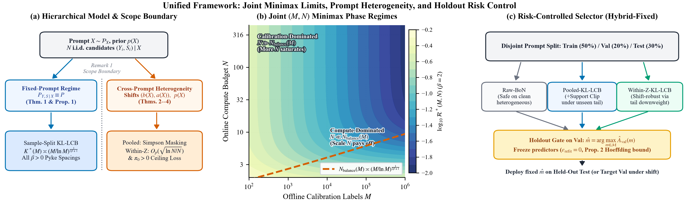
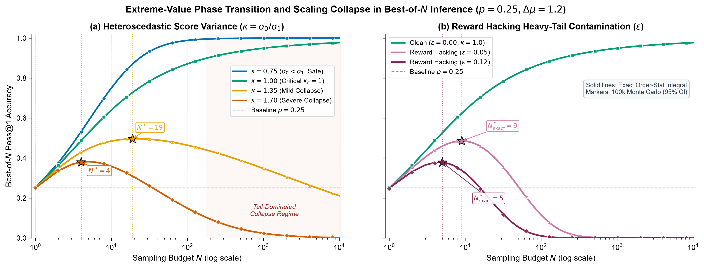
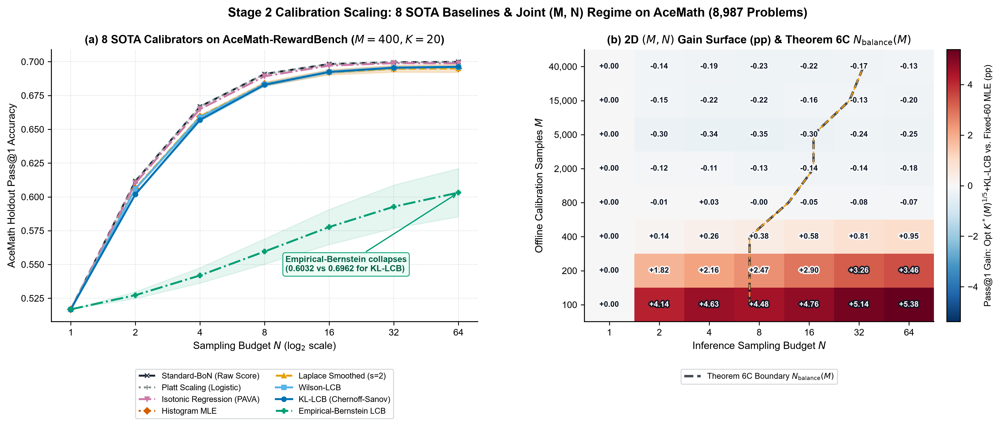

# 测试时计算缩放的联合校准—算力极限：Minimax 理论与裁判选择 (`tts-theory`)

[](https://doi.org/10.5281/zenodo.24563692)
[](https://doi.org/10.5281/zenodo.24563479)
[](https://orcid.org/0009-0007-5524-7050)
[](LICENSE)

面向大语言模型（LLM）推理阶段的**测试时计算缩放（Test-Time Scaling, TTS；*Joint Calibration–Compute Limits of Test-Time Scaling: Minimax Theory and Verifier Selection*）**概率论证明与数值实证库，聚焦有限校准集与在线算力的联合 Minimax 极限、跨题异质性下的在线样本标准化边界与风险控制裁判选择，以及异构多裁判融合相变。

> **架构概览（v1.0.0 顶会投稿优化版：NeurIPS 格式、全矢量图表与全量文献核验）**：
> - **主定理 I：有限校准集 $M$ 与在线算力 $N$ 的联合 Minimax 理论（[PROOF.md](PROOF.md) §2：定理 6 & 命题 6.1）**：严格分离逐分布渐近类 $\mathcal{F}_\beta^{\text{sep}}$ 与一致正则分布类 $\mathcal{F}_\beta^{\text{unif}}(C_1, f_{\min}, \eta_0)$；利用三事件离线并界与最近峰在线候选耦合，证明 $N$-无关等频 `KL-LCB` 在一切 $\beta > 0$ 上达到无 $(\ln N)^\beta$ 损失的双阶段解耦率 $\Theta\big((\frac{\ln M}{M})^{\frac{\beta}{2\beta+1}} + N^{-\beta}\big)$，导出**校准—算力预算平衡律 $N_{\text{balance}}(M) \asymp (\frac{M}{\ln M})^{\frac{1}{2\beta+1}}$**；并通过样本分割顺序统计量紧 Cramér 间距界（命题 6.1，统计惩罚常数放大 $2$ 倍，在完整 $\delta=\frac{1}{4M}$ 下直接非空成立）在零额外无标签数据下覆盖一切 $\beta > 0$。
> - **主定理 II：跨题异质性、在线样本标准化尾反转与风险控制门控（[PROOF.md](PROOF.md) §3：定理 7 & 命题 7.1）**：建立池化后验导数协方差分解及闭区间 `[3.5, 4.2]` 上的**无网格纯解析二层辛普森遮蔽证明**；给出 $N=2$ 样本 Z-Score 纯秩非严格界及双向序反转充要条件；严格跟踪原始分数仿射坐标变换 $S_i = b(X) + a(X)\tilde{S}_i$，证明含不可解题原子 $\pi_0>0$ 时在线样本标准化满足 $\max_{1\le i\le N}|Z_{i,N}-Z_i^*(X)| = O_p(\sqrt{(\ln N)/N}) \xrightarrow{p} 0$ 从而继承总体 $Z^*$ 的渐近准确率上限损失；同时给出覆盖全体 $N \ge 2$ 的三分支留出门控风险控制不等式与重拟合漂移分解（命题 7.1）。
> - **补充理论：异构多裁判集成相变、帕累托光谱与 Copula 尾相依（[PROOF.md](PROOF.md) §4：定理 5）**：建立一般 $(\Sigma_1, \Sigma_0)$ 广义特征值负权逆转、渐近尾约束下 $N=2$ 线性 SNR 光谱路径 `Safe-Fisher`、不可逆相 $\Sigma_0\succ\Sigma_1$ 下 Bayes QDA 天花板与 $N^{-2/K}$ 收敛阶，以及含零乘子弱激活退化的多元高斯 `Min` 与 Gaussian-Copula + Student-$t$ 精确对数修正因子 $(\ln t)^{(\gamma_c - |I_{+,c}|)/2}$。
> - **预备基础与文献溯源（[PROOF.md](PROOF.md) §1 & 附录 A–B；[RELATED_WORK.md](RELATED_WORK.md)）**：将单裁判预备定理 1–4 完整推导归入附录 A（附录 B 说明 `[1/1]` Padé 工程插值）；[RELATED_WORK.md](RELATED_WORK.md) 梳理并逐篇外部核验全部 **27 篇**文献（含 Belitser et al. 2012、Minsker 2013 被动非参数回归最大化，Jin et al. 2021 离线悲观主义，Romano 1988，Bubeck et al. 2011，Hashorva & Hüsler 2003，Tankov 2016，Das & Fasen-Hartmann 2024 及 NeurIPS/ICML/ICLR TTS 文献），诚实界定 $N=\infty$ 重合面与有限候选池耦合增量。

---

## 1. 核心定理与模块概览

详细证明见 [PROOF.md](PROOF.md)，核心解析与评估实现位于 [calibration_theory.py](src/tts_theory/calibration_theory.py)、[heterogeneity_theory.py](src/tts_theory/heterogeneity_theory.py)、[ensemble_theory.py](src/tts_theory/ensemble_theory.py)、[real_eval.py](src/tts_theory/real_eval.py) 与 [theorems.py](src/tts_theory/theorems.py)：

| 论文层次 | 模块 | 数学命题与适用范围 | 核心公式 / 判据 | 对应实现 |
| :---: | :---: | :--- | :--- | :--- |
| **主定理 I** | **定理 6 & 命题 6.1** | $\mathcal{F}_\beta^{\text{unif}}$ 联合 $(M,N)$ Minimax、平衡律 $N_{\text{balance}}$ 与全 $\beta>0$ 紧间距界 | $\mathcal{R}\asymp (\frac{\ln M}{M})^{\frac{\beta}{2\beta+1}}+N^{-\beta}$；$\hat{\pi}_k\in[\frac{1}{2K},\frac{143}{72K})$ | `tight_joint_minimax_scaling`, `empirical_quantile_spacings_bounds`, `evaluate_finite_calibration_on_real_pools` |
| **主定理 II** | **定理 7 & 命题 7.1** | 纯解析辛普森遮蔽、仿射不变样本 $Z_{i,N}$ 极值收敛与三分支门控 | $q_X(b+a[\tilde{\mu}+\tilde{\sigma}z])\equiv \tilde{q}_X(\tilde{\mu}+\tilde{\sigma}z)$；$\Delta_N=O_p(\sqrt{\frac{\ln N}{N}})$ | `diagnose_simpson_confounding`, `verify_sample_zscore_extremal_convergence`, `evaluate_single_split_prompt_heterogeneity` |
| **补充理论** | **定理 5** | $N=2$ `Safe-Fisher`、QDA $N^{-2/K}$、含零乘子 QP `Min` 与 Copula | $\mathbf{w}_\tau=(\Sigma_0-\tau\Sigma_1)^{-1}\Delta\boldsymbol{\mu}$；$(\gamma_c - \|I_{+,c}\|)/2$ | `solve_positive_quadrant_qp`, `pareto_linear_ensemble_frontier`, `bayes_qda_multi_verifier_analysis` |
| **附录 A 预备** | **定理 1–4** | 含原子顺序统计量积分、$C^1/C^0$ MLRP、固定峰高 $e^{-\gamma}$、二元与多数决 | $\kappa_c=1$；$\lim N^*_{\text{exact}}/N^*_0=e^{-\gamma}$；$\Delta_{\min}>0 \implies O(e^{-cN})$ | `exact_bon_accuracy`, `check_collapse_criterion`, `binary_bon_divergence_bounds`, `TwoStageVerifiedMajority` |

---

## 2. 仓库结构

```text
test-time-scaling-theory/
├── LICENSE                                    # MIT 开源许可证
├── pyproject.toml                             # 项目构建与 pytest 配置 (v1.0.0)
├── PROOF.md                                   # 主定理 6–7、补充定理 5 与附录 A 预备定理 1–4 证明稿
├── RELATED_WORK.md                            # 27 篇 TTS 及被动/主动非参数极值估计、离线悲观、极值与统计检验文献审计
├── README.md                                  # 项目总览与复现指南
├── paper/
│   ├── main.tex                               # 正式英文 LaTeX 论文（NeurIPS 2026 样式、§1–§8、Algorithm 1–2 + 附录 A–E + 16 项 Checklist）
│   ├── main.pdf                               # 本地 Tectonic 0.17.0 编译产物（正文及全部图表严格 <= 9 页，总计 21 页）
│   ├── references.bib                         # 逐篇外部核验的 27 篇 BibTeX 参考文献库
│   ├── neurips_2026.sty                       # NeurIPS 2026 官方排版样式（支持 [preprint] 与双盲匿名模式）
│   ├── Makefile                               # 论文一键编译脚本
│   ├── REVIEW_AUDIT.md                        # 多工具联合质量审计与修正对照备忘录（含第五轮 9/9 整改台账）
│   └── figures/                               # 论文主图（fig1–fig4 矢量 .pdf 与 300 DPI .png）
├── src/tts_theory/
│   ├── __init__.py                            # 统一公开 API 导出 (v1.0.0)
│   ├── calibration_theory.py                  # 主定理 6：KL-LCB、一致正则类、平衡点 N_balance 与紧 Gamma 间距界
│   ├── heterogeneity_theory.py                # 主定理 7：辛普森遮蔽、非退化纯秩界与仿射不变样本 Z_{i,N} 极值收敛
│   ├── ensemble_theory.py                     # 补充定理 5：Safe-Fisher/QDA/含零乘子 QP/Copula 统一模块
│   ├── real_eval.py                           # 三种分桶协议（带防呆校验）、单次划分 (50/20/30) 配对 t 检验与嵌套 CV 引擎
│   ├── theorems.py                            # 预备定理 1–4 分布规格、散度边界与异质错类权重接口
│   ├── integrals.py                           # 双精度 PIT 分段 Gauss-Legendre / quad 引擎
│   ├── simulator.py                           # 流式分块向量化蒙特卡洛仿真器
│   └── algorithms.py                          # StandardBoN, OptimalNStarBoN, EmpiricalScoreCalibrator,
│                                              # CalibratedWeightedBoN, TwoStageVerifiedMajority
├── tests/                                     # 全套 12 个离线测试模块（共 76 项测试）
│   ├── test_theorems.py / test_algorithms.py / test_extensions.py
│   ├── test_real_eval.py / test_stage2_real_eval.py
│   ├── test_v4_theory.py / test_v5_rigor.py / test_v6_theory.py
│   ├── test_v7_counterexamples.py / test_v8_rigor.py / test_v9_consolidation.py
│   └── test_v10_release.py                    # 四/五审收官：正交边界、均匀破平局、Bonferroni、分布内漂移与同 K 消融（9 项）
├── scripts/
│   ├── verify_theorems.py / run_experiments.py / plot_figures.py
│   ├── run_v2_extensions.py / plot_v2_figures.py
│   ├── run_real_llm_experiments.py / plot_real_figures.py
│   ├── run_stage2_experiments.py / plot_stage2_figures.py
│   ├── verify_v4_theory.py / verify_v6_theory.py / verify_v7_rigor.py / verify_v8_rigor.py
│   ├── verify_v9_consolidation.py             # 三种分桶协议、单次划分 50/20/30 主表与受控尾污染压力测试
│   ├── verify_v10_release.py                  # 同 K 公平消融、四相分布漂移矩阵与自然坍塌子集审计 -> v10_release_verification.json
│   ├── plot_paper_figures.py                  # 生成论文主图 fig1–fig4（矢量 .pdf + 300 DPI .png）至 paper/figures/
│   └── audit_paper_artifacts.py               # 论文静态 LaTeX、标签引用、数值防回归与跨文档一致性自动审计脚本
└── results/
    ├── EXPERIMENT_REPORT.md                   # 全套实验与风险控制实证报告（含 §13 V9 与 §14 V10 收官核验）
    ├── v9_consolidation_verification.json / v10_release_verification.json
    ├── theorem_verification.json / experiment_results.json / v2_extension_results.json
    ├── real_llm_results.json / v4_theory_verification.json / v6_theory_verification.json
    ├── v7_rigor_verification.json / v8_rigor_verification.json
    ├── stage2_real_results.json / stage2_summary.csv / param_sweep_summary.csv / algorithm_comparison_summary.csv
    └── figures/*.png                          # 图 1–10 全部可视化图表
```

---

## 3. 快速安装与一键复现

核心库依赖 `numpy`, `scipy`, `matplotlib`, `pytest`；复现真实 Parquet 与 HuggingFace 数据集实验可安装可选依赖组 `[real]`（`pandas`, `pyarrow`, `sympy`, `huggingface_hub`, `requests`，数据缓存于 `.gitignore` 忽略的 `data/` 目录）：

```bash
# 1. 克隆并离线可编辑安装
git clone https://github.com/6Riemann9/test-time-scaling-theory.git
cd test-time-scaling-theory
python -m pip install --no-deps --no-build-isolation -e .

# 2. 运行全量单元测试（共 76 项离线测试）
python -m pytest -v

# 3. 运行理论校验与 V9/V10 协议对齐、公平消融及分布漂移验证脚本
python scripts/verify_theorems.py
python scripts/verify_v4_theory.py
python scripts/verify_v6_theory.py
python scripts/verify_v7_rigor.py
python scripts/verify_v8_rigor.py
python scripts/verify_v9_consolidation.py
python scripts/verify_v10_release.py

# 4. 运行真实大模型/RM 全量实验、绘图与论文质量静态审计
python scripts/run_real_llm_experiments.py
python scripts/run_stage2_experiments.py --stages all
python scripts/plot_stage2_figures.py
python scripts/plot_paper_figures.py
python scripts/audit_paper_artifacts.py
```

---

## 4. 核心实证结果与统计推断摘要

详细量化分析请参阅 [results/EXPERIMENT_REPORT.md](results/EXPERIMENT_REPORT.md)（重点见 §9 与 §13）：

### 4.1 主定理与协议对齐实测要点
- **定理 6 & 命题 6.1（三种等频分桶协议同预算对照与完整 $\delta=\frac{1}{4M}$ 间距界）**：
  - **三种分桶协议真实池核验**：在 `AceMath RM-B`（$P_{\text{test}}=4{,}494, N=64$）上，严格零额外无标签数据的 **`Sample-Split KL-LCB`**（$M_1=M/2$ 边界 + $M_2=M/2$ 估计）在 $M=100 / 200 / 400$ 处分别达 **`68.64% / 68.77% / 69.14%`**，稳定击败同预算过细 `Sample-Split Fixed-60 MLE`（`64.11% / 64.57% / 65.69%`，领先 **`+4.53 pp / +4.20 pp / +3.45 pp`**），且在 $M \ge 400$ 后与 `In-Sample`（`69.14%`）及 `Semi-Supervised`（`69.21%`）差距收敛至 `≤ 0.14 pp`（`GPQA-Qwen7B` 于 $M=5{,}000$ 处三者为 `30.63% / 30.65% / 30.81%`）。
  - **完整 $\delta = \frac{1}{4M}$ 紧 Cramér 间距核验**：在粗糙峰 $\beta = 0.25 \le 0.5$ 下，当 $M = 10^6, K = 1{,}737$（$\delta = 2.5\times 10^{-7}$）与 $M = 2.5\times 10^6, K = 3{,}065$（$\delta = 10^{-7}$）时，$d_{\min} = 287 \ge 218.84$ 与 $d_{\min} = 407 \ge 232.34$ 直接满足完整命题条件（失效上界 `2.43e-11` 与 `7.20e-17`；同期加性 DKW 相对误差界达 `13.85` 与 `15.90 > 1` 失效），统计惩罚常数放大倍数精确为 `2.0`。
- **定理 7 & 命题 7.1（独立单次划分主检验、仿射不变性与同预算污染压力测试）**：
  - **互不相交单次划分 `50% Train / 20% Val / 30% Held-Out Test` + 零重拟合 `Hybrid-Fixed` + 双侧配对 $t$ 检验**：在跨领域混池 `S3 3-Domain`（$P_{\text{test}}=839, N=128$）与 `S1a RB2 Skywork`（$P_{\text{test}}=556, N=4$）上，`Hybrid-Fixed` 分别达到 **`51.59% ± 1.71%`** 与 **`85.92% ± 1.43%`**，统计显著优于受辛普森混杂拖累的 `Pooled-KL-LCB`（**`+2.41 pp`, $p_t = 0.0050$**；**`+1.83 pp`, $p_t = 0.0120$**）；在低偏移域 `AceMath RM-A/B`（$P_{\text{test}}=2{,}695$）与 `OlympiadBench`（$P_{\text{test}}=202$）上完全规避 `Within-Prompt-Z` 的统计显著下跌（`-2.91 pp / -3.17 pp / -9.16 pp`），与 `Pooled-KL-LCB` 无统计显著差异（$p_t \in [0.14, 0.68]$），经验重拟合漂移 $\hat{\varepsilon}_{\text{refit}} \in [0.0006, 0.0074]$。
  - **同等预算下的受控 Reward Hacking 压力测试**：在完全相同的 `AceMath RM-B` 50/20/30 划分与 $N=64$ 预算下，向错误轨迹注入 `6%` 右尾高分假阳性后，`Standard-BoN` 从 `63.06%`（$N=4$）坍塌至 **`28.65% ± 0.89%`**（$N=64$），而 `Hybrid-Fixed-KL-LCB` 自动切换至校准分支并保持 **`70.89% ± 0.86%`**（领先 `Standard-BoN` **`+42.24 pp`**, 95% CI `[+40.23, +44.11] pp`, $p_t < 10^{-300}$），清晰验证跨相区风险控制定位。
  - **OOD vs 分布内漂移失效边界、离散 `Algorithm 1` 对齐与多重比较审计**：在 `AceMath RM-B` 未知漂移矩阵中，越界截断 `Support-Clipped` 可拦截 OOD 尖峰（`71.08%`，严格离散 `Algorithm 1` 为 `71.01%`），但在未越 `99.8%` 分位帽的分布内 `[q_0.90, q_0.985]` 高分污染下退化为 `36.29%` / `37.85%`（与 `Raw-BoN` `36.27%` 同构），唯有经目标验证集触发 `Within-Prompt-Z` 仍可挽回至 `69.07%`（`+32.80 pp`）。对公开 14 组子集的多重检验表明 `college_math RM-B` 仅属探索性候选（14 组 Bonferroni/Holm `p=0.2908`，留出切分 `p_t=0.1810`）。
  - **原始坐标仿射不变性与无网格解析遮蔽**：在极端题间仿射变换 $b=(-250, 1000), a=(0.25, 6.0)$ 下，定理 7C(4) 后验恒等式偏差 `3.28e-15`，在线样本 $Z_{i,N}$ 选择准确率差 `2.78e-16`；定理 7A(2) 在闭区间 `[3.5, 4.2]` 上纯解析下界给出 $q'_{\text{pool}}(s) \ge +7.044\times 10^{-3} > +7.03\times 10^{-3} > 0$。
- **定理 5（异构多裁判相关性破局与退化 QP/Copula 边界）**：
  - 真实 `RB2 hetero6`（$P=1{,}723, N=4$）上 `Fisher=88.28%`, `QDA=87.93%`, `Safe-Fisher=81.66%`, `GenEig=39.29%`（印证 `Safe-Fisher` 针对 $N=2$ 目标权衡）；3×3 零乘子弱激活矩阵（$|I_+|=2, I_0=\{3\}$）于 $t=500$ 处与修正阶 $\frac{1}{4\pi}t^{-2}e^{-t^2}$ 数值积分比达 **`1.0022`**。

### 4.2 代表性可视化结果

#### (1) 论文核心理论框架与风险控制全景（Figure 1）


#### (2) 异方差与 Reward Hacking 极值坍塌曲线


#### (2) Stage 2 实证：异构多 RM 相关性破局与 `OlympiadBench` PRM 校准增益


#### (3) Stage 2 实证：8 类 SOTA 校准器横评与二维 $(M, N)$ 联合标度前沿


#### (4) Stage 2 实证：真实跨域辛普森悖论逆转与三分支门控边界


---

## 5. 引用方式（Citation）

如果您在研究或工程中使用本工作的理论推导或开源复现库，推荐按以下方式引用（另见 [CITATION.cff](CITATION.cff)）：

- **论文预印本（Zenodo Preprint PDF）**：[`10.5281/zenodo.24563692`](https://doi.org/10.5281/zenodo.24563692)
- **开源代码与测试套件归档（GitHub Release v1.0.0）**：[`10.5281/zenodo.24563479`](https://doi.org/10.5281/zenodo.24563479)

```bibtex
@misc{zhang2026tts,
  author       = {Zhang, Xinkang},
  title        = {Joint Calibration--Compute Limits of Test-Time Scaling: Minimax Theory, Prompt Heterogeneity, and Risk-Controlled Verifier Selection},
  year         = {2026},
  version      = {v1.0.0},
  publisher    = {Zenodo},
  doi          = {10.5281/zenodo.24563692},
  url          = {https://doi.org/10.5281/zenodo.24563692},
  note         = {Code and reproducibility archive DOI: 10.5281/zenodo.24563479}
}
```
