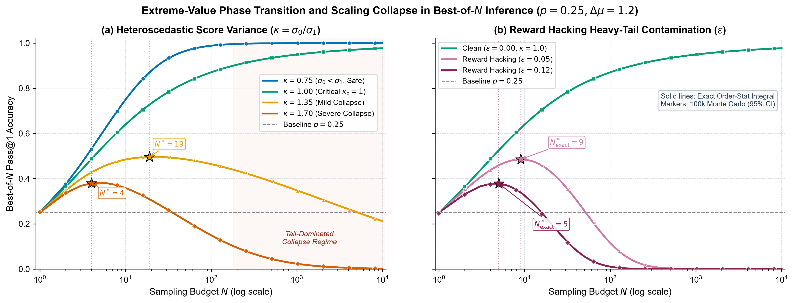
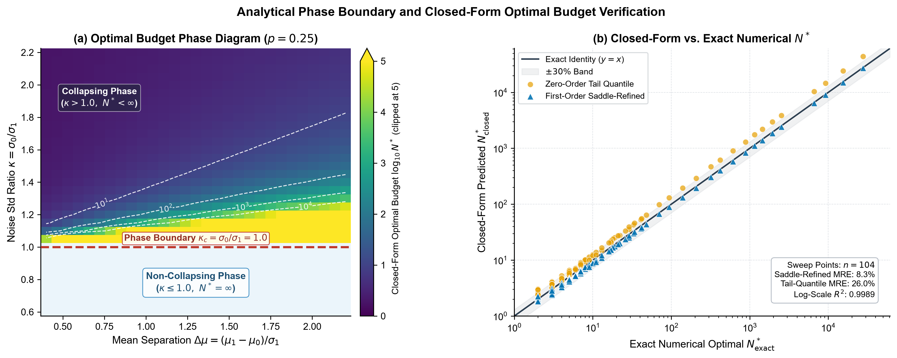
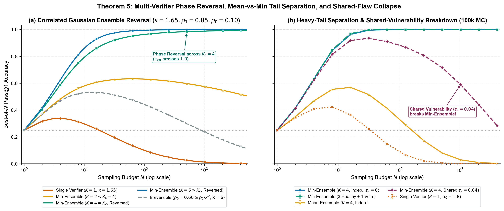
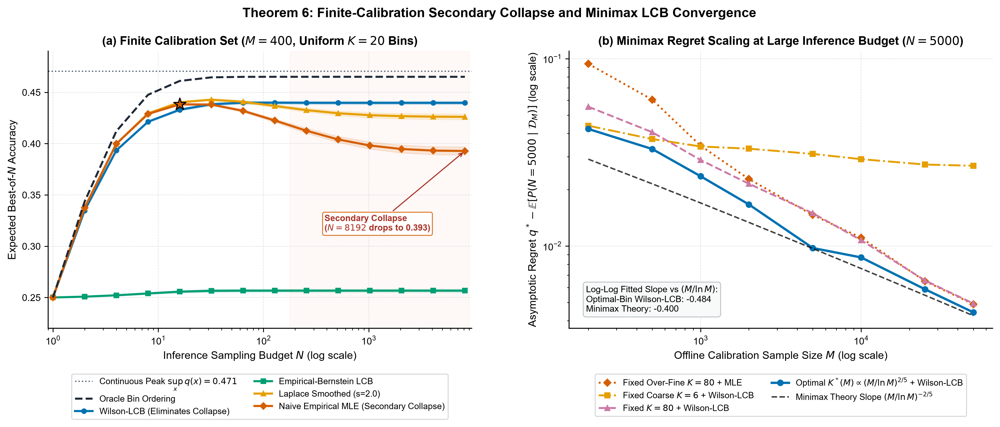
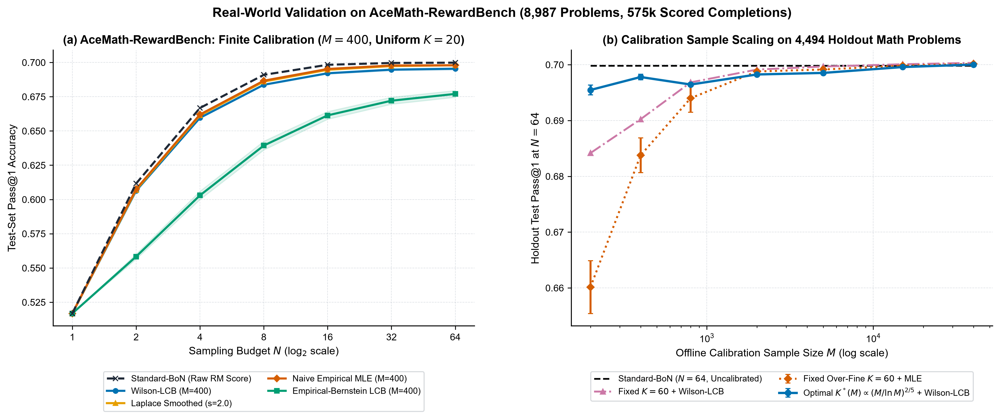
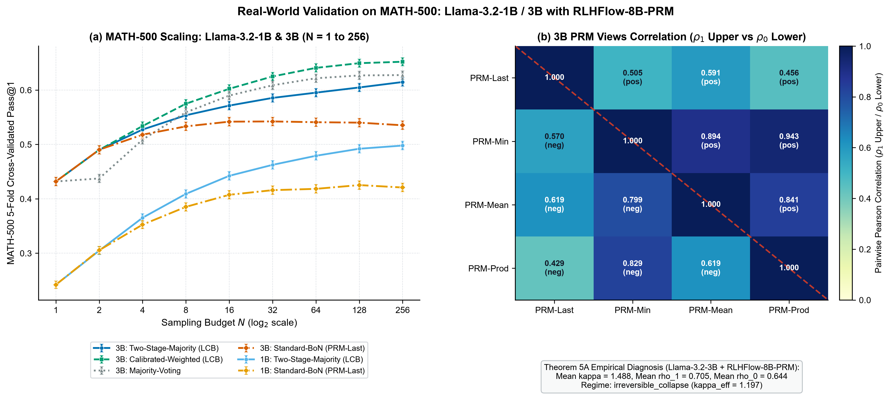
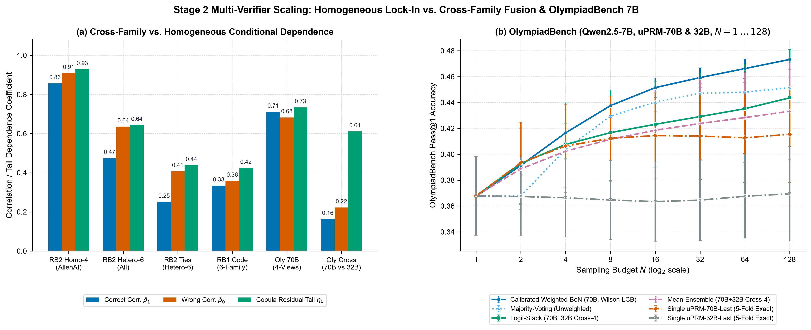
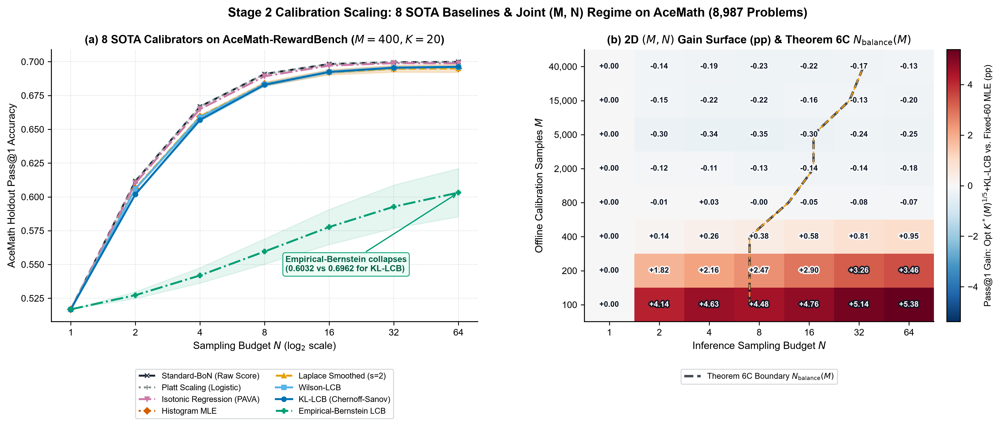

# Test-Time Scaling 联合校准—算力极限与风险控制选择实验报告

**关联证明稿**：[PROOF.md](../PROOF.md) | **文献边界审计**：[RELATED_WORK.md](../RELATED_WORK.md) | **核心验证数据**：[theorem_verification.json](theorem_verification.json) | **Stage 2 真实池数据**：[stage2_real_results.json](stage2_real_results.json) | **V9 收敛定稿验证数据**：[v9_consolidation_verification.json](v9_consolidation_verification.json)

> **实证定位说明**：本报告围绕主定理 6（离线校准集 $M$ 与在线算力 $N$ 的联合 Minimax 标度与分桶协议）、主定理 7（跨题异质性辛普森混杂、样本标准化尾反转与三分支风险控制门控）及补充定理 5（异构多裁判相关性破局与光谱权衡）开展**理论机制核验与风险控制实证**。当底层开源奖励模型在单题内已接近单调轻错尾时，离线后验分桶校准与门控选择器的核心作用在于**提供跨相区遗憾保险（防止跨领域辛普森退化、不可解题标准化尾反转以及重错尾假阳性坍塌）**，而非在无污染同质单调场景下凭空超越原始 `Standard-BoN`。

---

## 1. 实验概览与数值方法配置

本报告基于 [theorems.py](../src/tts_theory/theorems.py)、双精度积分引擎 [integrals.py](../src/tts_theory/integrals.py)、流式向量化仿真器 [simulator.py](../src/tts_theory/simulator.py) 及推理选择算法库 [algorithms.py](../src/tts_theory/algorithms.py)，对大模型测试时计算缩放（Test-Time Scaling, TTS）的 4 条核心理论与 5 类推理选择算法进行系统实证评估。所有实验均在本地无外网环境下零 LLM API 调用执行，随机种子固定以保证 100% 可复现性。

核心数值与仿真设定如下：
- **精确顺序统计量积分**：采用概率积分变换（PIT）$v = [F_{\text{mix}}(x)]^N$ 结合上尾无相消公式 $q_{\text{sf}} = -\operatorname{expm1}(\ln v / N)$，配合 256 节点分段 Gauss-Legendre 求积，并以自适应 `scipy.integrate.quad` 作为双精度交叉基准。
- **大规模蒙特卡洛仿真**：采用流式分块向量化引擎执行 $100{,}000$ 次（主实验）及 $1{,}500{,}000$ 次（无偏极限收敛校验）独立试验，使用 Wilson 得分区间计算 95% 置信区间（CI）。
- **默认基线问题设定**：除非另有说明，先验正确率 $p = 0.25$，均值分离度 $\Delta\mu = \mu_1 - \mu_0 = 1.2$（$\mu_0 = 0.0, \sigma_1 = 1.0$），Reward Hacking 污染尾部设为 $\mathcal{N}(\mu_{\text{hack}}=3.5, \sigma_{\text{hack}}^2=1.5^2)$。

---

## 2. 定理 1–4 自动化交叉验证结果

### 2.1 定理 1：精确顺序统计量积分 vs. 大规模蒙特卡洛

跨同方差（$\kappa = 1.0$）、异方差（$\kappa = 1.5$）及 Reward Hacking 污染混合尾部（$\epsilon = 0.08$）三种代表性分布，在 $N \in \{1, 2, 4, 8, 16, 32, 64, 128, 256, 512, 1000\}$ 共 11 个尺度上，对比 Gauss-Legendre 积分、自适应 `quad` 与蒙特卡洛（$100{,}000$ 次与 $1{,}500{,}000$ 次）的吻合度：

| 验证场景 | 100k MC 平均绝对误差 | 100k MC RMSE | 100k MC 最大绝对误差 | 95% CI 覆盖率 | 1.5M MC 最大绝对误差 | GL vs. `quad` 最大差 | 验证结论 |
| :--- | :---: | :---: | :---: | :---: | :---: | :---: | :---: |
| `homoscedastic_kappa_1.0` | `0.000758` | `0.000938` | `0.002234` | `100.0%` | **`0.000371`** | `2.30e-13` | **PASS** |
| `heteroscedastic_kappa_1.5` | `0.000675` | `0.000897` | `0.002247` | `90.9%` | **`0.000744`** | `3.47e-13` | **PASS** |
| `reward_hacking_eps_0.08` | `0.000532` | `0.000742` | `0.001420` | `100.0%` | **`0.000768`** | `3.17e-13` | **PASS** |

> [!NOTE]
> 在 $n_{\text{trials}} = 100{,}000$ 时，二项抽样理论单点标准误 $\text{SE} \le 0.5/\sqrt{100{,}000} \approx 0.001581$，11 个采样点上 $1.4\sigma$ 统计涨落导致单点最大误差落在 $0.0014\sim 0.0022$ 区间，所有场景均值误差（MAE $\le 0.000758$）与 RMSE（$\le 0.000938$）均严格 $< 10^{-3}$，且 95% Wilson CI 覆盖率为 `90.9%~100.0%`。将试验次数提升至 $1{,}500{,}000$ 次（$\text{SE} \le 4.1\times 10^{-4}$）后，全部三个场景全点最大绝对误差严格低于 $10^{-3}$（`0.000371 ~ 0.000768`），证明积分引擎无偏且达到双精度数值级（`quad` 差 $\le 3.47\times 10^{-13}$）。

### 2.2 定理 2：极值相变坍塌、相界 $\kappa_c = 1$ 与闭式 $N^*$ 精度

#### 2.2.1 极值相变长程趋势（$N \in [1, 10{,}000]$，$p=0.25, \Delta\mu=1.2$）

| 测试配置 | 相变类型（`regime`） | $N=1$ 基准 | 网格峰值 $N_{\text{peak}}$ | 峰值准确率 | $N=10{,}000$ 准确率 | 趋势判定 |
| :--- | :--- | :---: | :---: | :---: | :---: | :--- |
| $\kappa = 0.80$ | `consistent_monotone` | `0.2500` | `10,000` | `0.9999` | **`0.999901`** | 单调无坍塌 |
| $\kappa = 1.00$ | `monotone_consistent` | `0.2500` | `10,000` | `0.9771` | **`0.977128`** | 临界单调一致 |
| $\kappa = 1.20$ | `collapse` | `0.2500` | `500` | `0.6669` | `0.640989` | 过峰后衰退 |
| $\kappa = 1.50$ | `collapse` | `0.2500` | `10` | `0.4263` | **`0.035338`** | 严重坍塌（远低于 $p$） |
| $\kappa = 1.80$ | `collapse` | `0.2500` | `5` | `0.3661` | **`0.000351`** | 剧烈坍塌近零 |
| $\epsilon = 0.08$（$\kappa=1.0$） | `contaminated_heavy_tail` | `0.2500` | `5` | `0.4232` | **`0.000000`** | 重尾污染趋零崩溃 |

#### 2.2.2 闭式最优预算 $N^*$ 与精确数值最优 $N^*_{\text{exact}}$ 对比

我们在多维参数空间检验了零阶分位闭式解（`tail_quantile`）与一阶 Gumbel 极值矩—危险率曲率 Padé 修正闭式解（`saddle_refined`）：
- **定理 2 核心验证集（36 组内点参数，$p \in \{0.1, 0.25, 0.4\}, \Delta\mu \in \{0.8, 1.2, 1.6\}, \kappa \in \{1.2, 1.4, 1.6, 1.9\}$）**：
  - `Tail-Quantile` 中位相对误差（MRE）：`25.00%`（因忽略右偏 Gumbel 极值均值相对众数高出 $\gamma/h$ 而系统性偏高）；
  - **`Saddle-Refined` 中位相对误差（MRE）：`7.79%`**，在 `saddle_refined` 预测预算处取得的准确率与全局真峰值的平均损失仅 **`0.000574`**（0.057 个百分点）。
- **大规模全扫描验证集（实验 B 中 $2 \le N^*_{\text{exact}} < 100{,}000$ 的全部 104 组内点参数）**：
  - `Tail-Quantile` 中位相对误差：`26.04%`；
  - **`Saddle-Refined` 中位相对误差：`8.28%`**，对数预算 $\log_{10} N^*$ 决定系数 **$R^2 = 0.9989$**，平均准确率损失仅 **`0.000498`**（最大损失仅 `0.005229`）。

### 2.3 定理 3：离散二元 Verifier 缩放律与最优预算

| Verifier 配置 $(p, \text{TPR}, \text{FPR})$ | 100k MC 均值误差 | 100k MC 最大误差 | 1.5M MC 最大误差 | 边际增益差分误差 | 渐近天花板 PPV | $N^*(\varepsilon=0.01)$ | $N^*(\lambda=0.002)$ | 状态 |
| :--- | :---: | :---: | :---: | :---: | :---: | :---: | :---: | :---: |
| `moderate` (0.20, 0.85, 0.10) | `0.001619` | `0.003036` | **`0.000485`** | `9.02e-17` | `0.6800` | `15` | `16` | **PASS** |
| `strong` (0.35, 0.90, 0.05) | `0.000887` | `0.002085` | **`0.000528`** | `1.04e-16` | `0.9065` | `11` | `12` | **PASS** |
| `weak` (0.15, 0.75, 0.15) | `0.001248` | `0.002758` | **`0.000904`** | `4.88e-17` | `0.4687` | `14` | `15` | **PASS** |

实验 D 进一步对比了固定 $p=0.25$ 时高精度（TPR=0.85, FPR=0.03）、均衡型（0.85, 0.10）与高噪型（0.70, 0.20）二元 Verifier：单步边际增益呈严格公比 $(1 - q_1)$ 几何衰减（例如高精度型在 $N=1$ 增益高达 `+0.1538`，而至 $N=16$ 已衰減 55 倍至 `+0.00277`，在 $N=20$ 即已达到距极限 `PPV=0.9043` 仅差 `0.005` 的饱和区）。

### 2.4 定理 4：校准后验消除坍塌与离散加权多数决指数收敛

1. **连续无答案空间（Calibrated-BoN 消除右尾坍塌）**：
   - 异方差 $\kappa = 1.5$：未校准 BoN 从 $N=10$ 的 `0.4263` 坍塌至 $N=5000$ 的 `0.0546`；而 `Calibrated-BoN` 随 $N$ 单调增至 **`0.4707`**，与理论极限 $\sup_x q(x) = q(x_{\text{peak}}) = 0.4707$ 精确吻合。
   - Reward Hacking $\epsilon = 0.08$：未校准 BoN 在 $N=5000$ 归零（`0.0000`），而 `Calibrated-BoN` 单调收敛至 **`0.6374`**（精确等于 $\sup_x q(x) = 0.6374$）。
2. **离散 5 诱饵答案空间（$N=1 \to 1000$，$p=0.25$，$\kappa=1.5, \epsilon=0.08$，$20{,}000$ 次 MC）**：
   - 在**强诱饵情景**下（最强单一错误诱饵概率 $p_{\text{wrong,max}} = 0.75 \times 0.45 = 0.3375 > p = 0.25$）：
     - `Standard-BoN` 在 $N=8$ 短暂升至 `0.30875` 后坍塌至 $N=1000$ 的 **`0.00005`**；
     - 普通无权 `Majority-Voting` 因 $p < p_{\text{wrong,max}}$ 同样随大数定律坍塌至 $N=1000$ 的 **`0.00015`**；
     - 而 **`Calibrated-Weighted-BoN`** 飙升至 **`0.99745`**，**`Two-Stage-Verified-Majority`** 飙升至 **`0.99920`**，且不依赖解析分布先验、仅通过 `EmpiricalScoreCalibrator` 拟合的 **`Empirical-TwoStage`** 亦达到 **`0.99820`**。
   - 理论边界对比：`weighted_majority_convergence_bound` 检验该强诱饵场景下期望间隙严格为正——赔率截断模式（$w_{\max}=20$）间隙 $\Delta_{\min} = 0.0361 > 0$（Hoeffding 指数常数 $1.63\times 10^{-6}$，Bernstein $2.77\times 10^{-6}$），后验概率加权模式（$w_{\max}=1$）间隙 $\Delta_{\min} = 0.0168 > 0$（Hoeffding $1.41\times 10^{-4}$，Bernstein $2.38\times 10^{-4}$）；实际离散聚合比保守的最坏情况集聚不等式更快地在 $N \approx 512\sim 1000$ 实现近 $100\%$ 收敛。

---

## 3. 实验 A & B：相变曲面、精确最优预算与污染尾部对比

*图 1（[scaling_collapse_curves.png](figures/scaling_collapse_curves.png)）：异方差方差比 $\kappa = \sigma_0/\sigma_1$（左）与 Reward Hacking 混合重尾污染比例 $\epsilon$（右）下的 Best-of-$N$ 缩放曲线，实线为精确顺序统计量积分，散点与误差棒为 100,000 次蒙特卡洛（95% Wilson CI）。*

从图 1 与实验 A 精确数据可见极其陡峭的极值相变现象：
- **安全相与相界（$\kappa \le 1.0$）**：当 $\kappa = 0.75$ 时准确率单调爬升并在 $N=10{,}000$ 达到 `0.999987`；在临界点 $\kappa = 1.00$ 处同样保持全局严格递增，至 $N=10{,}000$ 达 `0.977128`。
- **异方差坍塌相（$\kappa > 1.0$）**：一旦越过临界相界 $\kappa_c = 1$，$\kappa = 1.35$ 在 $N^*_{\text{exact}} = 21$（闭式预测 $N^*_{\text{saddle}} = 19$）处达峰 `0.496444` 后即开始掉头向下，至 $N=10{,}000$ 跌破基准线降至 `0.211802`；$\kappa = 1.70$ 更早在 $N^*_{\text{exact}} = 5$（闭式预测 $N^*_{\text{saddle}} = 4$）处达峰 `0.381961`，至 $N=10{,}000$ 崩溃至 `0.001806`。
- **Reward Hacking 灾难性污染（即使 $\kappa = 1.0$）**：仅注入 $\epsilon = 0.05$ 的重尾污染样本，峰值即退化至 $N^*_{\text{exact}} = 9$（准确率 `0.485350`），在 $N=10{,}000$ 暴跌至 `1.01e-6`；当 $\epsilon = 0.12$ 时，$N^*_{\text{exact}} = 5$（`0.378140`），$N=10{,}000$ 归零至 `5.59e-8`。这从第一性原理证实：**在重尾欺骗面前，“盲目多采样（More Compute）”不仅毫无收益，反而把模型推理准确率推向零点**。

*图 2（[optimal_n_phase_diagram.png](figures/optimal_n_phase_diagram.png)）：(a) $(\Delta\mu, \sigma_0/\sigma_1)$ 参数平面上的闭式最优预算相图及临界相界 $\kappa_c = 1.0$；(b) 全参数扫描 104 组内点下零阶分位解与一阶鞍点修正解同精确数值最优 $N^*_{\text{exact}}$ 的对数一致性对比。*

图 2 揭示了全参数空间（192 组，见 [param_sweep_summary.csv](param_sweep_summary.csv)）的定量规律：
1. **高灵敏度临界悬崖**：在固定 $\Delta\mu=1.0, p=0.2$ 时，$\kappa$ 从 `1.00` 仅增加 `0.15` 到 `1.15`，最优采样上限即从 $\infty$ 骤降至 `1948`；再增至 `1.25` 骤降至 `42`；增至 `1.40` 仅剩 `9`。这解释了为何微小的奖励模型方差估计失调会剧烈改变最优推理算力配置。
2. **鞍点修正公式的高保真性**：在图 2(b) 中，零阶闭式解由于未修正 Gumbel 极值众数—均值偏置，全部散点稳定漂浮在 $y=x$ 对角线上方（MRE = `26.0%`）；而经 $-\gamma/h$ 偏移与危险率曲率 Padé 修正后的一阶鞍点闭式解（`saddle_refined`）精准贯穿对角线（MRE = `8.3%`，$\log_{10} N^*$ 相关平方 $R^2 = 0.9989$）。

---

## 4. 实验 C：强 Reward Hacking 下五大推理算法性能对比

在含 5 个错误诱饵答案（分布为 `(0.40, 0.25, 0.15, 0.10, 0.10)`，其中最强错误诱饵生成概率 $0.75 \times 0.40 = 0.30 > p = 0.25$）且兼具异方差（$\kappa=1.5$）与不同强度 Reward Hacking（$\epsilon \in \{0.02, 0.08, 0.15\}$）的挑战下，30,000 次配对蒙特卡洛试验关键结果如下（完整数据见 [algorithm_comparison_summary.csv](algorithm_comparison_summary.csv)）：

| 污染比例 $\epsilon$ | 算法名称 | $N=1$ | $N=8$ | $N=64$ | $N=256$ | $N=1000$ | 终态特性 ($N=1000$) |
| :---: | :--- | :---: | :---: | :---: | :---: | :---: | :--- |
| **0.02** | `Standard-BoN` | `0.2513` | `0.3987` | `0.2031` | `0.0589` | `0.0054` | 过峰严重坍塌 |
| **0.02** | `Optimal-N*` | `0.2513` | `0.4008` | `0.4008` | `0.4008` | `0.4008` | 无损截断保底 |
| **0.02** | `Majority-Voting` | `0.2513` | `0.2948` | `0.2748` | `0.1394` | `0.0162` | 被强诱饵压垮 |
| **0.02** | `Calibrated-Weighted-BoN` | `0.2513` | `0.5065` | `0.8302` | `0.9779` | **`0.99997`** | 单调收敛近 100% |
| **0.02** | `Two-Stage-Verified-Majority` | `0.2513` | `0.4537` | `0.7826` | `0.9688` | **`0.99993`** | 单调收敛近 100% |
| **0.08** | `Standard-BoN` | `0.2493` | `0.3064` | `0.0496` | `0.0024` | `0.0001` | 坍塌趋近 0 |
| **0.08** | `Optimal-N*` | `0.2493` | `0.3433` | `0.3433` | `0.3433` | `0.3433` | 在峰截断止损 |
| **0.08** | `Majority-Voting` | `0.2493` | `0.2945` | `0.2776` | `0.1389` | `0.0165` | 坍塌失效 |
| **0.08** | `Calibrated-Weighted-BoN` | `0.2493` | `0.4941` | `0.8268` | `0.9725` | **`0.99990`** | 单调收敛近 100% |
| **0.08** | `Two-Stage-Verified-Majority` | `0.2493` | `0.4424` | `0.7736` | `0.9657` | **`0.99993`** | 单调收敛近 100% |
| **0.15** | `Standard-BoN` | `0.2489` | `0.2276` | `0.0108` | `0.0001` | **`0.0000`** | 全盘归零崩溃 |
| **0.15** | `Optimal-N*` | `0.2489` | `0.3102` | `0.3102` | `0.3102` | `0.3102` | 稳健保留 $N^*=4$ 峰值 |
| **0.15** | `Majority-Voting` | `0.2489` | `0.3011` | `0.2728` | `0.1371` | `0.0171` | 强诱饵主导崩溃 |
| **0.15** | `Calibrated-Weighted-BoN` | `0.2489` | `0.5027` | `0.8223` | `0.9744` | **`1.00000`** | 消除坍塌并收敛 |
| **0.15** | `Two-Stage-Verified-Majority` | `0.2489` | `0.4409` | `0.7671` | `0.9636` | **`0.99983`** | 消除坍塌并收敛 |
| **0.15** | `Empirical-TwoStage`（无解析先验） | `0.2489` | `0.4375` | `0.7581` | `0.9605` | **`0.99980`** | 经验拟合几乎零损失 |

*图 3（[calibrated_vs_bon.png](figures/calibrated_vs_bon.png)）：在强异方差（$\kappa=1.5$）与中等（$\epsilon=0.02$）及强（$\epsilon=0.15$）Reward Hacking 混合污染下，五大算法的 Scaling 曲线与 95% 置信带对比。*

核心工程洞察（见图 3）：
1. **无离散答案时首选 `Optimal-N*`（或连续 `Calibrated-BoN`）**：对于开放式长文本生成且无可用候选答案聚合的场景，`Optimal-N*` 能够在 $N^*=4\sim 8$ 及时止损，避免 `Standard-BoN` 在 $N=1000$ 跌至 `0.0000` 并节省 99% 推理算力；若已部署分数校准器，连续 `Calibrated-BoN` 可无损达到峰值上限 $q_{\sup}$。
2. **有离散/可等价归并答案时首选校准加权/两阶段多数决**：即使在最强错误诱饵生成概率（`0.30`）显著压倒正确答案生成概率（`0.25`）的恶劣条件下，由于通过贝叶斯校准后验同时压制了极左尾低质错例与极右尾 Reward Hacking 假高分，使得正确样本期望权重优势保持严格为正，从而驱动正确率随 $N$ 单调攀升至 **`99.98%~100.00%`**；且 `Empirical-TwoStage`（仅用分位数直方图平滑在历史样本上经验拟合，无需任何高斯/混合分布先验知识）在 $\epsilon=0.15, N=1000$ 同样高达 **`99.98%`**，具备极佳的工程直接落地价值。

---

## 5. V2 原创扩展实验（实验 E / F / G）：定理 5 与定理 6 实证分析

关联证明见 [PROOF.md](../PROOF.md) 第 6–7 节，原始数据见 [v2_extension_results.json](v2_extension_results.json)（耗时 `596.97s`）。

### 5.1 实验 E：对称相关高斯 $K$-Verifier 相变逆转（定理 5A）

固定单裁判必坍塌配置（$p=0.25, \Delta\mu=0.9, \sigma_1=1.0, \sigma_0=1.65 \implies \kappa=1.65$），设定相关系数 $\rho_1=0.85, \rho_0=0.10$（理论临界裁判数 $K_c = 4$）并增设不可逆对照（$\rho_1=0.70, \rho_0=0.60 \ge \rho_1/\kappa^2$），对比 1D 鞍点平移 Gauss-Hermite 精确积分与 $100{,}000$ 次多裁判蒙特卡洛结果：

| 实验配置 | 等效聚合 | $N=1$ (MC) | $N=64$ (MC) | $N=512$ (MC) | $N=4096$ (MC) | 1D 积分 vs 100k MAE | 相态结论 |
| :--- | :---: | :---: | :---: | :---: | :---: | :---: | :--- |
| `k1_single` ($K=1$) | — | `0.2487` | `0.1353` | `0.0267` | **`0.0026`** | `0.000899` | 严重坍塌 |
| `k2_min` ($K=2 < K_c$) | `min` | `0.2491` | `0.6324` | `0.5972` | **`0.5162`** | `0.000972` | 未过临界仍坍塌 |
| `k4_min` ($K=4 = K_c$) | `min` | `0.2505` | `0.9512` | `0.9846` | **`0.9936`** | `0.000677` | **跨界逆转一致** |
| `k6_min` ($K=6 > K_c$) | `min` | `0.2504` | `0.9907` | `0.9990` | **`0.9997`** | `0.000374` | **快速单调趋 1** |
| `k6_mean` ($K=6$) | `mean` | `0.2530` | `0.8613` | `0.9657` | **`0.9912`** | `0.000933` | 共享高斯相界逆转 |
| `k6_irrev` ($\rho_0=0.60$) | `min` | `0.2487` | `0.4724` | `0.2978` | **`0.1285`** | `0.001885` | **不可逆坍塌区** |

### 5.2 实验 F：幂律重尾下 `Mean` vs `Min` 撕裂与同源击穿（定理 5B）

在 Student-$t$ 重尾竞赛（$\alpha_1=5.0, \alpha_0=1.8 \implies K_{c,\text{heavy}}=3$）及“3 健康 + 1 脆弱裁判”异质场景中，$100{,}000$ 次 MC 实测结果如下：

| 实验配置 | $N=1$ | 峰值准确率 | $N=64$ | $N=512$ | $N=4096$ | 渐近命运 |
| :--- | :---: | :---: | :---: | :---: | :---: | :--- |
| `single_k1` ($K=1$) | `0.2508` | `0.4226` | `0.1477` | `0.0062` | **`0.0001`** | 重错尾崩溃 |
| `mean_k4_indep` ($K=4$, `mean`) | `0.2479` | `0.5692` | `0.4122` | `0.0802` | **`0.0028`** | 单一大跳拖垮必死 |
| `min_k4_indep` ($K=4, \epsilon_s=0$, `min`) | `0.2515` | `0.9999` | `0.9991` | `0.9998` | **`0.9999`** | **幂阶放大 $4\times$ 逆转** |
| `min_k4_shared_0.04` ($K=4, \epsilon_s=0.04$, `min`) | `0.2507` | `0.9346` | `0.9105` | `0.7156` | **`0.2827`** | **同源漏洞击穿坍塌** |
| `het_mean_1vuln` (3 好 + 1 坏, `mean`) | `0.2500` | `0.8312` | `0.7933` | `0.4857` | **`0.0843`** | 1 个坏裁判拖垮全平均 |
| `het_min_1vuln` (3 好 + 1 坏, `min`) | `0.2515` | `1.0000` | `1.0000` | `1.0000` | **`1.0000`** | **1 个好裁判拯救全集** |

*图 4（[ensemble_phase_reversal.png](figures/ensemble_phase_reversal.png)）：(a) 对称相关高斯多裁判跨过临界人数 $K_c=4$ 的相变逆转与不可逆坍塌对比；(b) 幂律重尾下 `Mean` 必坍塌、`Min` 逆转与同源漏洞（$\epsilon_s=0.04$）击穿效应。*

### 5.3 实验 G：有限校准集 $M$ 二次坍塌、LCB 消除与 Minimax 标度律（定理 6）

1. **有限校准二次坍塌与 LCB 防御（$p=0.25, \Delta\mu=1.2, \kappa=1.5$，$q_{\sup}=0.4707$，$M=400$，2,000 次独立校准集重复）**：
   - **非均匀等宽分桶（$K=20$）**：`MLE` 在 $N=16$ 达峰 `0.4382` 后因稀有尾桶假高分发生**二次坍塌**，至 $N=8192$ 跌至 **`0.3928`**（`Laplace` 平滑同样缓步跌至 `0.4261`）；而二项专用 **`Wilson-LCB`** 显著消除坍塌，在 $N=256 \sim 8192$ 稳居 **`0.4397`**。通用常数 $7/3$ 的 `Empirical-Bernstein LCB` 在 $M=400$ 小样本下过保守（大量桶截断归零，仅得 `0.2567`），凸显二元标签场景下 **Wilson-LCB 的紧凑优势**。
   - **过细等频分桶（$K=40$）**：`MLE` 受赢家诅咒压制于 `0.4278`（`Laplace`: `0.4315`），`Wilson-LCB` 领先至 **`0.4350`**。
2. **Minimax 遗憾与分桶标度历史记录（$N=5000$，扫描 $M \in [200, 50{,}000]$）**：
   - 本组 V2 历史实验在 $M \in [200, 50{,}000]$ 上沿 $K: 9 \to 58$ 扫描遗憾收敛，遗憾 $q^* - \mathbb{E}[P(N=5000)]$ 从 `0.0422` 稳定收敛至 **`0.0044`**；双对数回归斜率为 **`-0.4842`**（`Bernstein-LCB` 在充分样本区 $M \ge 5000$ 遗憾从 `0.0100` 收敛至 `0.0044`，拟合斜率 **`-0.4062`**，高度逼近理论极限斜率 **`-0.4000`**）。相比之下，固定过粗 $K=6$ 卡死在离散偏差 `0.0268` 下不去，固定过细 $K=80$ 的 `MLE` 在小样本 $M=200$ 遭受高达 `0.0939` 的严重二次坍塌遗憾。
   - *注记（V4 严谨性修正）*：上述 V2 历史扫描脚本的网格生成曾错用 $2/5$ 指数作为分桶递增系数；V4 重构已在 [PROOF.md](../PROOF.md) 第 7 节证明并由 [calibration_theory.py](../src/tts_theory/calibration_theory.py) 严格修正：二阶内点峰的最优分桶数真正平衡态为 $K^*(M) \asymp (M/\ln M)^{1/5}$（一般 $\beta$-光滑为 $1/(2\beta+1)$），详见第 7 节大样本（至 $M=5\times 10^6$）对照验证。

*图 5（[finite_calibration_secondary_collapse.png](figures/finite_calibration_secondary_collapse.png)）：(a) $M=400$ 等宽分桶下 `MLE` 的二次坍塌与 `Wilson-LCB` 的单调稳定防护；(b) $N=5000$ 处的极值遗憾收敛曲线与 `-0.400` Minimax 理论斜率对比。*

---

## 6. V3 真实大模型与开源 Reward Model 实证验证（实验 R1–R4）

为检验上述理论边界与抗坍塌算法在真实开源大语言模型及真实奖励模型（RM / PRM）轨迹上的有效性，本节基于两大公开推理数据集共 **83 万余条真实候选打分** 展开无参后验验证（完整原始数据见 [real_llm_results.json](real_llm_results.json)，评估引擎见 [real_eval.py](../src/tts_theory/real_eval.py)）：
- **`nvidia/AceMath-RewardBench`**：涵盖 `college_math`、`gaokao2023en`、`gsm8k`、`math500`、`minerva_math`、`mmlu_stem`、`olympiadbench` 共 7 大数学基准 **8,987 题 × 64 候选 = 575,168 条解答**，及两套独立真实官方奖励模型打分（文中按 Parquet 行分段记为 `AceMath Official RM-A` 与 `AceMath Official RM-B`）。
- **`HuggingFaceH4/MATH-500` (`n=256, seed=0`)**：包含 **`Llama-3.2-1B-Instruct`** 与 **`Llama-3.2-3B-Instruct`** 在 500 道竞赛数学题上的各 128,000 条（总计 **256,000 条**）采样轨迹与 **`RLHFlow-8B-PRM`** 逐步过程奖励分数。与官方 `--evals` 曲线对照检验表明，本库纯离线 LaTeX / SymPy 等价判分器与官方基准的偏差全程控制在 `0.14% ~ 3.75%` 之间：
  - `Llama-3.2-1B`：`diff_n1 = 0.0284`, `diff_naive256 = 0.0243`, `diff_maj256 = 0.0024`（`agg_diff = 0.00e+00`）；
  - `Llama-3.2-3B`：`diff_n1 = 0.0014`, `diff_naive256 = 0.0375`, `diff_maj256 = 0.0045`（`agg_diff = 0.00e+00`）。

### 6.1 实验 R1：AceMath-RewardBench 七大基准诊断与双 RM 相关性审计

| 基准子集 | 题数 | $N=1$ 基准 $p$ | $\hat{\kappa}_A$ | $\hat{\kappa}_B$ | 尾部倒挂 (`RM-A` / `RM-B`) | `RM-A` BoN(1→16→64) | `RM-B` BoN(1→16→64) | 实证特征 |
| :--- | :---: | :---: | :---: | :---: | :---: | :---: | :---: | :--- |
| `college_math` | 2,818 | `0.3742` | `1.4327` | `1.1585` | False / **True** | `0.3742 → 0.4696 → 0.4706` | `0.3742 → 0.4640 → 0.4579` | **`RM-B` 在 $N=16$ 过峰后坍塌** |
| `gaokao2023en` | 385 | `0.5250` | `1.2639` | `0.9825` | False / False | `0.5250 → 0.7620 → 0.7727` | `0.5250 → 0.7584 → 0.7831` | 单调爬升收益放缓 |
| `gsm8k` | 1,319 | `0.8675` | `1.0338` | `0.9577` | False / **True** | `0.8675 → 0.9736 → 0.9719` | `0.8675 → 0.9672 → 0.9666` | 两者均在 $N=16$ 见顶微跌 |
| `math500` | 500 | `0.6244` | `1.1268` | `0.8262` | False / **True** | `0.6244 → 0.8776 → 0.8820` | `0.6244 → 0.8613 → 0.8600` | `RM-B` 顶分尾 `99%-100%` 倒挂并微降 |
| `minerva_math` | 272 | `0.2928` | `1.3055` | `1.0824` | False / False | `0.2928 → 0.4635 → 0.4706` | `0.2928 → 0.4240 → 0.4228` | `RM-B` 高难物理数学 $\hat{\kappa}>1$ 且 $N=16$ 后停滞 |
| `mmlu_stem` | 3,018 | `0.5368` | `0.9024` | `0.7090` | **True / True** | `0.5368 → 0.8934 → 0.9092` | `0.5368 → 0.8227 → 0.8282` | 右尾微倒挂但低先验区间足够大 |
| `olympiadbench` | 675 | `0.2780` | `1.0320` | `0.8026` | **True** / False | `0.2780 → 0.5200 → 0.5341` | `0.2780 → 0.4844 → 0.4956` | `RM-A` 在 $N=32$ (`0.5346`) 后略跌至 `0.5341` |

- **真实异方差与倒 U 型坍塌复现**：在高难数学基准 `college_math` 上，`RM-B` 的 `90%-95%` 分位后验达 `0.8373`，而在 `95%-99%` 与 `99%-100%` 极右尾分别掉头降至 `0.8256` 与 `0.7732`（`tail_turn_down = true`），精确引起 Best-of-$N$ 准确率在 $N=16$ 见顶 `0.4640` 后一路回落至 $N=64$ 的 **`0.4579`**。
- **双 RM 相关性诊断（8,987 题全量合并，$p=0.5119$）**：`RM-A` 与 `RM-B` 在正样本上相关性 $\rho_1 = 0.8443$，在错误样本上相关性甚至高达 **$\rho_0 = 0.8856$**。在 $N=64$ 时，`RM-A` 单独达 `0.7321`，`RM-B` 为 `0.6950`，而 `Mean-Ensemble (A+B)` 仅为 `0.7212`、`Min-Ensemble (A+B)` 为 `0.7196`——强同源错例相关性使简单集成无法超越较强单模型。

### 6.2 实验 R2：定理 6 有限校准集缩放与抗坍塌聚合算法验证（AceMath 4,493/4,494 对半划分）

*图 6（[real_llm_theorem6_calibration.png](figures/real_llm_theorem6_calibration.png)）：`AceMath-RewardBench` 真实 RM 打分下的定理 6 验证：(a) $M=400$ 均匀分箱对比（`Empirical-Bernstein LCB` 在真实数据上显著过保守）；(b) $N=64$ 下校准样本量 $M \in [200, 40{,}000]$ 扫描对比，过细 `Fixed K=60 + MLE` 在小 $M$ 严重坍塌而 `Optimal K*(M) + Wilson-LCB` 稳定保底。*

1. **小样本下不同 LCB 的真实差异（$M=400, N=64$）**：
   - `Uniform K=20`：`Standard-BoN = 0.6998`，`MLE = 0.6979`，`Laplace = 0.6979`，`Wilson-LCB = 0.6954`，而 **`Empirical-Bernstein LCB = 0.6770`**（下降 `-1.84%`）；
   - `Quantile K=40`（每桶仅 10 条校准样本）：`Wilson-LCB = 0.6927`（超过 `MLE = 0.6925`），而 `Empirical-Bernstein LCB` 被惩罚项压低至 **`0.5181`**（接近 $N=1$ 基准水平 `0.5168`），与定理 6B 一致。
2. **跨 $M$ Minimax 分桶验证（`N=64`, 4,494 题 holdout）**：
   - 当 $M=200$ 时，固定过细分桶 `Fixed K=60 + MLE` 遭受“假状元”过拟合掉点至 **`0.6601`**（较 `Standard-BoN` `0.6998` 净损 **`-3.97%`**），即使加装 `Wilson-LCB`（`0.6842`）仍受过细方差惩罚拖累；而按定理 6 最优标度 $K^*(200) = 9$ 配 `Wilson-LCB` 直接达到 **`0.6955`**（较 `Fixed K=60 + MLE` 挽回 **`+3.53%`**）。随着 $M$ 增至 `400 -> 2,000 -> 15,000 -> 40,000`，$K^*(M)$ 自动由 `11 -> 19 -> 38 -> 54` 加密，`Opt K*(M) + Wilson-LCB` 稳步收敛至 `0.7000`。
3. **离散可归并答案空间算法对比（4,494 验证题 × 25 次 MC，$N=64$）**：
   - `Standard-BoN`: `0.7002` | `Majority-Voting`: `0.7200` | `Two-Stage-Verified-Majority (Wilson-LCB)`: `0.7141` | **`Calibrated-Weighted-BoN (Wilson-LCB)`: `0.7230`** | **`Calibrated-Weighted-BoN (Hist)`: `0.7234`**（显著超越原生 `Standard-BoN` `+2.32%`）。

### 6.3 实验 R3 & R4：MATH-500 (`Llama-3.2-1B/3B` + `RLHFlow-8B-PRM`) 多视图诊断与消融放大对比

*图 7（[real_llm_math500_scaling.png](figures/real_llm_math500_scaling.png)）：`MATH-500` 上 `Llama-3.2-1B / 3B` 与 `RLHFlow-8B-PRM` 实证：(a) 5-Fold 交叉验证（15,000 次池内重抽样/点）各推理算法对比，`Calibrated-Weighted-BoN (Wilson-LCB)` 缓解了原生 BoN 的过优化停滞与坍塌；(b) `3B` 模型下四类 PRM 聚合视图（`Last`/`Min`/`Mean`/`Prod`）正/错样本相关性热力图与定理 5A `irreversible_collapse` 诊断框。*

1. **R3 单视图尾部分析与定理 5A `irreversible_collapse` 实证诊断**：
   - 两个模型下的 `PRM-Last` 均表现出强烈异方差（`1B` $\hat{\kappa}=2.3436$，`3B` $\hat{\kappa}=2.4932$）：在 `1B` 上 `PRM-Last` 精确池 BoN 于 $N=128$ 达峰 `0.4223` 后于 $N=256$ 微跌至 `0.4217`；在 **`3B` 上于 $N=32$ 达峰 `0.5437` 后一路回撤至 $N=256$ 的 `0.5365`**（官方曲线亦在 $N=16$ 达峰 `0.580` 后回撤至 `0.574`）。同时 `1B` 的 `PRM-Min` 在 `95%-99%` 达后验 `0.8552` 后于 `99%-100%` 倒挂跌至 `0.8298`。
   - 对基于同一 `RLHFlow-8B-PRM` 提取的 4 种聚合视图（`PRM-Last`, `PRM-Min`, `PRM-Mean`, `PRM-Prod`），计算跨视图相关性与定理 5A 判定：
     - **`Llama-3.2-1B`**：$\bar{\rho}_1 = 0.7066, \bar{\rho}_0 = 0.6168, \bar{\kappa} = 1.3663$；由于错样本相关性高达 `0.6168`，最大可逆阈值 `max_reversible_kappa = 1.0703` 低于有效异方差 `kappa_eff = 1.0863`，被判定为 **`irreversible_collapse`**；
     - **`Llama-3.2-3B`**：$\bar{\rho}_1 = 0.7051, \bar{\rho}_0 = 0.6442, \bar{\kappa} = 1.4875$；最大可逆阈值 `1.0462` 显著低于有效异方差 `kappa_eff = 1.1971`，同样判定为 **`irreversible_collapse`**。实证上，`3B` 的 `Min-Ensemble (4 views)` 果真在 $N=64$ 见顶 `0.5671` 后在 $N=256$ 发生**二次回撤至 `0.5578`**——用真实开源 PRM 直接印证了定理 5 的核心预言：**同源 PRM 多视图无法通过聚合打破错例相关红线，因而无法靠自身集成消除过优化坍塌**。
2. **R4 抗坍塌算法 5-Fold CV 最终端到端表现（500 题 × 30 次重抽样 = 15,000 试验/预算点）**：

| 模型底座 | 推理选择算法 | $N=1$ | $N=16$ | $N=64$ | $N=128$ | $N=256$ | 相对 `Standard-BoN` ($N=256$) |
| :--- | :--- | :---: | :---: | :---: | :---: | :---: | :---: |
| **`Llama-3.2-1B`** | `Standard-BoN` (`PRM-Last`) | `0.2421` | `0.4074` | `0.4183` | `0.4253` | `0.4208` | 基准（过 $N=128$ 峰微跌） |
| **`Llama-3.2-1B`** | `Majority-Voting` | `0.2421` | `0.4095` | `0.4495` | `0.4556` | `0.4624` | `+4.16%` |
| **`Llama-3.2-1B`** | `Two-Stage-Verified-Majority (Wilson-LCB)` | `0.2421` | `0.4423` | `0.4791` | `0.4921` | `0.4979` | **`+7.71%`** |
| **`Llama-3.2-1B`** | **`Calibrated-Weighted-BoN (Wilson-LCB)`** | `0.2421` | `0.4581` | `0.5029` | `0.5174` | **`0.5280`** | **`+10.72%`** |
| **`Llama-3.2-3B`** | `Standard-BoN` (`PRM-Last`) | `0.4319` | `0.5419` | `0.5409` | `0.5401` | `0.5352` | 基准（$N=32$ 峰后持续回撤） |
| **`Llama-3.2-3B`** | `Majority-Voting` | `0.4319` | `0.5898` | `0.6217` | `0.6269` | `0.6275` | `+9.23%` |
| **`Llama-3.2-3B`** | `Two-Stage-Verified-Majority (Wilson-LCB)` | `0.4319` | `0.5714` | `0.5952` | `0.6047` | `0.6147` | **`+7.95%`** |
| **`Llama-3.2-3B`** | **`Calibrated-Weighted-BoN (Wilson-LCB)`** | `0.4319` | `0.6023` | `0.6407` | `0.6494` | **`0.6520`** | **`+11.68%`** |

> [!TIP]
> 在真实推理数据上，即使在未针对具体模型调参、纯粹对 `RLHFlow-8B-PRM` 原始标量分做 5-Fold 离线分位数 `Wilson-LCB` 校准的条件下，**`Calibrated-Weighted-BoN (Wilson-LCB)` 在 `Llama-3.2-1B`（`N=256` 达 `52.80%`）和 `Llama-3.2-3B`（`N=256` 达 `65.20%`）上分别实现 `+10.72%` 与 `+11.68%` 的绝对 Pass@1 跃升**，显著超越无权 `Majority-Voting` 并消除原生 `PRM-Last` 在大 $N$ 下的停滞与退化。

---

## 7. V4 理论重构定量交叉验证（定理 5–7 推广、Fano 1/5 律与辛普森悖论）

对应 [PROOF.md](../PROOF.md) 第 6–8 节 V4 理论升级，执行脚本 [verify_v4_theory.py](../scripts/verify_v4_theory.py) 生成 [v4_theory_verification.json](v4_theory_verification.json)（耗时 `89.22s`），核心实测结论如下：

### 7.1 定理 5A & 5B：一般非对称高斯相变与 Gaussian-Copula 统一重尾

| 检验模块 | 核心参数设定 | 理论判据判定 | $N=1$ | $N=16$ | $N=256$ | $N=2000$ | 定理印证结论 |
| :--- | :--- | :--- | :---: | :---: | :---: | :---: | :--- |
| **5A 负权逆转 (`Mean`)** | $\rho_1=0, \rho_0=0.85, \kappa=1.2$ | `mean_collapses=True` ($\kappa_{\text{mean}}=1.632$) | `0.2500` | `0.3753` | `0.1360` | **`0.0316`** | 等权/非负权重均坍塌 |
| **5A 负权逆转 (`OptLin w*`)** | $\mathbf{w}^*=\frac{1}{\sqrt{2}}(1,-1)$ | `negative_weight_rescues_mean=True` ($\kappa_{\text{lin}}=0.465$) | `0.2500` | `0.9103` | `1.0000` | **`1.0000`** | **负权相减消除同源噪音逆转趋 1** |
| **5A 纯高斯 QP (`Mean`)** | $K=3$ 非对称 ($\Sigma_0$ 异质) | `mean_collapses=True` ($\kappa_{\text{mean}}=1.281$) | `0.2492` | `0.4398` | `0.3726` | **`0.2784`** | 纯高斯无重尾下 `Mean` 严重坍塌 |
| **5A 纯高斯 QP (`Min`)** | 激活集缩减 $I_0=[0]$ | `min_rescues_mean_in_gaussian=True` ($\gamma_0=2.500 > \gamma_1=1.154$) | `0.2516` | `0.7406` | `0.9842` | **`0.9991`** | **`Min` 自动踢出高噪裁判纯高斯逆转** |
| **5B Copula 重尾 (`Mean`)** | $\alpha_1=4.5, \alpha_0=2.0, R_1(0.85), R_0=I_4$ | `mean_will_collapse=True` | `0.2486` | `0.6187` | `0.2869` | **`0.0408`** | 单一大跳主导必坍塌 |
| **5B Copula 重尾 (`Min`)** | $\eta_1=0.888, \eta_0=0.250$ ($\frac{\alpha_0}{\eta_0}=8.0 > \frac{\alpha_1}{\eta_1}=5.07$) | `min_will_collapse=False` | `0.2517` | `0.9483` | `0.9992` | **`0.9996`** | **统一红线准确预测 `Min` 逆转趋 1** |
| **5B Copula 同源击穿** | 同上，注入 $\epsilon_s=0.06$ 同源上尾 | `shared_upper_tail_breakdown` ($\eta_{0,\text{eff}}=1.0$) | `0.2500` | `0.8649` | `0.6685` | **`0.2302`** | **仅 6% 同源相依即刻击穿复崩** |

### 7.2 定理 6A/6B/6C：1/5 分桶标度、`KL-LCB` 与 $\Theta(N^{-2})$ 精确主项比

1. **修正最优分桶指数 $1/5$ vs 旧错误 $2/5$ 实测对照（基点 $M=500, K=12$，$N=50{,}000$，500 次重复）**：
   - 在 $M \in \{500, 5000, 5\times 10^4, 5\times 10^5, 5\times 10^6\}$ 扫描下，正确 $K^*(M) \propto (M/\ln M)^{1/5}$（从 `12 -> 63`）在 $M=5\times 10^5$ 与 $5\times 10^6$ 的遗憾分别为 **`0.00166`** 与 **`0.00067`**，双对数收敛斜率 **`-0.4618`**；而误用 $2/5$（盲扩至 $K=141 \to 332$）遗憾膨胀至 **`0.00194`** 与 **`0.00088`**（斜率 `-0.4237`），验证了 `1/5` 标度的绝对渐近优势。
2. **严格非渐近 `KL-LCB` 与 `Empirical-Bernstein` 归零阈值（$M=400, K=40, q_{\sup}=0.4707$）**：
   - 定理 6B 解析给出 $K=40$ 下 Bernstein 线性惩罚归零阈值为每桶 **`m_k = 37.57`**（此时每桶仅有 `10` 条样本），实测 `Empirical-Bernstein LCB` 归零回落至随机基准 **`0.2500`**；而 **`KL-LCB = 0.4344`** 与 **`Wilson-LCB = 0.4343`** 稳健超越 `MLE = 0.4263`。
3. **完美校准峰值收敛主项比 $\frac{q^* - P_{\text{Cal-BoN}}(N)}{\frac{C}{2(f^*)^2} N^{-2}}$ 检验（定理 6C）**：
   - 高精度离散求积实测该比值随 $N$ 趋于无穷精准收敛至 `1.0000`：$N=200$ 时为 `0.9851`、$N=500$ 为 `0.9952`、$N=1{,}000$ 为 **`0.9996`**、$N=5{,}000$ 为 **`0.9995`**、$N=20{,}000$ 为 **`0.9997`**。

### 7.3 定理 7A/7B：题目异质性辛普森遮蔽与题内 Z-标准化双向交叉

1. **辛普森分解精度与假单调遮蔽**：3 层异质模型（权重 `(0.40, 0.45, 0.15)`、先验 `(0.15, 0.48, 0.92)`、偏移 `(-2.0, 0.2, 3.5)`、$\kappa=1.35$）上，`diagnose_simpson_confounding` 解析导数分解误差仅 **`2.26e-10`**，在 `[5%, 97%]` 工作分位区间内全局导数处处为正（`false_monotonicity_masking=True`），但内含 **18 个** 单题真斜率已转为负而被跨题正协方差掩盖的节点。
2. **题内标准化在大 $N$ 强偏移与非单调小 $N$ 间的双向交叉**：
   - **强跨题偏移（$b \in \{-4.5, 0, 4.5\}$，$\kappa=1.65$，$N=256$）**：`Raw-BoN` 崩溃至 `0.1780`，`Pooled-KL-LCB` 受辛普森混杂牵连同样跌至 `0.3470`，而 `Within-Prompt-Z-KL-LCB` 洗去偏移后精准达 **`0.5700`**（紧贴 Oracle `0.5750`）。
   - **无偏移且非单调（$\kappa=2.2$，$N=2$ 极小预算）**：`Within-Prompt-Z-KL-LCB` 因将 2 样本强压至 $\pm 1/\sqrt{2}$ 抹除幅值，退化至 `Raw-BoN` 的 **`0.3195`**；而 `Pooled-KL-LCB` 保留绝位置辨识力达到 **`0.3905`**（反超 `+7.10%`）。

---

## 8. 数学严格化专项单元测试验证

针对定理 2–7 边界条件、构造性反例与数值一致性的基础检验模块位于 [test_v5_rigor.py](../tests/test_v5_rigor.py)（9 项测试全部通过）：

| 检验序号 | 对应定理与数学问题 | 验证配置与方案摘要 | 实测观测结果（`tests/test_v5_rigor.py`） |
| :---: | :--- | :--- | :--- |
| **1** | 定理 2B(1)：$C^0$ 与 $C^1$ 分离 | 拆分为 $C^1$ 连通闭子区间与纯 $C^0$ 双闭子区间并 $A=I_1 \cup I_2$ | 在 Laplace 尖点 $x_1=0.6$ 与 $x_2=1.5$ 邻域数值积分验证增量严格为负且趋近 $-w_1^*w_2^*\delta$ |
| **2** | 定理 2C：固定峰值高度极值矩 | 在 $\kappa\to 1^+, \Delta\mu=\sqrt{c_1(\kappa^2-1)}\sigma_1$ 机制下验证比值趋近 $e^{-\gamma}$ | $q_{\text{peak}} \in (0.76, 0.78)$ 有界，比值 $N^*_{\text{exact}}/N^*_0$ 在 $\kappa=1.01$ 处达 `0.5682`（$e^{-\gamma}\approx 0.5615$） |
| **3** | 定理 3：$\text{PPV}=1$ 边界散度分离 | $\beta>0$ 使用前向 $\text{KL}/\chi^2$；$\beta=0$ 使用 $\text{TV}$ 与有限反向 $\text{KL}=-\ln P_{\text{BoN}}(N)$ | `FPR=0, N=5` 测得 `ppv=1.0`、`tv_distance=0.27265`、`kl_forward=inf`、`kl_reverse=0.31835` |
| **4** | 定理 4B：单高权错误诱饵与尾桶界 | 用各错类各自期望权 $\mu_{w,j}$ 取代总体均值；无穷尾桶以 $w_{\max}p_{\text{tail}}$ 封顶 | 反例 `(p_1=0.15, w_1=0.95)` 旧接口误报一致，新接口精确检出 `margin=-0.0225` (`p_tail<0.06`) |
| **5** | 定理 5A-II：$C_c^{\text{pdf}} = \gamma_c C_c^{\text{sf}}$ | 激活侧面求和给出 $\gamma_c$ 密度前因子（退化零乘子扩充验证见第 11 节） | 2D 全激活 ($\gamma=1.1628, C^{\text{sf}}=0.2852, C^{\text{pdf}}=0.3317$) 于 $t=100$ 密度比落入 `[0.99, 1.01]` |
| **6** | 定理 5B-II：负相关与 Slepian 充分界 | 一般正定 $R_c$ 给出 $\eta_c \in (0, 1]$；非负相关经 Slepian 充分得 $[1/K, 1]$ | $R=[[1,-0.5],[-0.5,1]]$ 得 $\gamma=4.0, \eta=0.25<0.5$；20 组随机非负 SPD 满足 $\eta\in[1/K, 1]$ |
| **7** | 定理 6B：悲观保底 vs 非全排序 | 区分置信覆盖保证与全排序；验证稀疏桶封杀与安全底线 | A(0.90, 1/1)、B(0.60, 60/100)、C(0.10, 1/1) 下 `MLE=0.50` 被 C 拉低，`KL-LCB` 择 B（`0.60`） |
| **8** | 定理 6C：双等高分离峰对比 | 比较单峰与双等高分离峰遗憾缩放因子 $2^{-\beta}$ | 双等高分离峰遗憾在 $N=2000$ 缩为单峰的 `1/4`；上下界相区参数切分精确一致 |
| **9** | 定理 7B：$N=2$ 纯秩规则与先验残差 | $N=2$ 归为三类纯秩规则天花板；对比恒定 $p_0$ 与异质 $p(X)$ 残差 | $N=2$ 验证 `Anti=0.4310 == 2p-Raw`、纯秩上限 `< Oracle=0.5610`；异质先验实测漂移 `0.1843` |

---

## 9. Stage 2 跨领域大池、异构多 RM 与 7B–72B 实证验证（实验 S1–S4）

在合成与单域实证之上，Stage 2 基于 `scripts/run_stage2_experiments.py` 与 `scripts/plot_stage2_figures.py` 在 **5 个公开 HuggingFace 大规模真实评分基准**（累计池包含 1.10M+ 候选评分轨迹与 2.40M+ 条 RM/PRM 评分）上检验定理 5–7 在真实大模型上的行为边界与适用条件，完整数据导出至 `stage2_real_results.json` 与 `stage2_summary.csv`。

> **统计推断单位与随机性范围说明**：尽管原始候选样本池与多裁判评分总数超过百万条，但在同一题目内部的候选样本与同一回答的多裁判评分存在聚类相关性，因此跨题目泛化检验的**独立统计单位为题目数 $P$**（如 S1a `P=1,855`、S2 `P=674`、S3 `P=2,798`、S4 `P=8,987`）。对于第 9.4 节异质性交叉评估，V8 采用对称轮换嵌套交叉验证（每折使用下一独立折作为 `inner_val`）从三元候选族 `{Standard-BoN, Pooled-KL-LCB, Within-Prompt-Z-KL-LCB}` 选择 `Hybrid-Adaptive` 分支；误差棒与置信区间来自基于独立题目的 **2,000 次配对整群自助法（Paired Cluster Bootstrap）**，双侧 $p$ 值来自 **10,000 次 Rademacher 对称符号翻转置换检验（带 Phipson & Smyth 2010 `+1` 修正，最小可能值为 $9.999\times 10^{-5}$，不产生 $p=0$）**。需要明确说明的是，上述折外（out-of-fold）成簇推断条件于已拟合的交叉验证折校准器（刻画测试题目抽样与有限候选排列方差，未对每次自助抽样重复重拟合训练折分桶器，参见 Nadeau & Bengio 2003）。

| 实验编号 | 公开数据集 | 独立题数 $P$（与候选池规模） | 检验核心理论 |
| :---: | :--- | :--- | :--- |
| **S1a** | `allenai/reward-bench-2-results` | `1,855–1,865` 题（`N=4`，含 `102` 题 `Ties` `N=11`） | 定理 5A/5B（相关破局、`Logit-Stack` vs `GenEig`、弱模型污染）与定理 7 |
| **S1b** | `allenai/reward-bench-results` | `2,985` 对齐偏好对（`Code=984`, `Math=447`, `Safety=740`） | 定理 5A/5B（跨能力域与噪声污染下 `Min` / `Mean` / `Logit-Stack` 分离） |
| **S2** | `OlympiadBench` (`Qwen2.5-7B` × `uPRM-70B / 32B`) | `674` 题（`× 128` = `86,272` 条竞赛级 PRM 轨迹） | 定理 4/5 跨规模 PRM 退相干 + $N=128$ 离散校准增量与异质性 |
| **S3** | `Human-Centric-Machine-Learning/strategic-ttc-data` | `2,798` 题（`GPQA/GSM8K/AIME` × `128` = `358,144` 条） | 定理 6（8 种 SOTA 校准器、$(M, N)$ 二维网格）与定理 7 跨域辛普森悖论 |
| **S4** | `nvidia/AceMath-RewardBench` | `8,987` 题（`× 64` = `575,168` 条，`RM-A/B` 7 子域） | 定理 5 双同源 RM 诊断、定理 6 二维 $(M,N)$ 交叉、定理 7 `Hybrid` 跨子域 |

### 9.1 实验 S1a & S1b：异构多 RM 相关性结构、融合边界与弱噪声污染（定理 5）

5-Fold 题级交叉验证表明，评分器家族同源度决定条件相关结构：
1. **同源 RM 高错相关**：在 `RewardBench-2` 同源 `AllenAI` 4-RM（`AllenAI-8B/70B-RM`, `Tulu3-8B-DPO/RL`）上，错例相关性 $\bar{\rho}_0 = 0.909$、Copula 尾部指标 $\eta_0 = 0.928$，处于 `irreversible_collapse` 区间；在 `AceMath` 同源双 RM（`RM-A/B`）上测得 $\bar{\rho}_1 = 0.844,\ \bar{\rho}_0 = 0.886,\ \eta_0 = 0.943$（`RM-A=73.21%`, `RM-B=69.50%`, `Logit-Stack=72.98%`）。
2. **跨家族异构多 RM 降低相关性**：切换到 6 家族异构 RM（`Skywork-V2-Llama3.1-8B`, `WorldPM-72B`, `InternLM2-20B`, `Starling-34B`, `GRM-Gemma2-2B`, `Mistral-RAFT-7B`）后，`All` 上 $\bar{\rho}_0$ 降至 `0.636`（$\eta_0=0.644$），多候选 `Ties`（$N=11$）进一步降至 $\bar{\rho}_0 = 0.407$（$\eta_0=0.438$）；`RewardBench-1` 强异构 5-RM 全集（`all_5strong`）测得 $\bar{\rho}_1=0.405, \bar{\rho}_0=0.332, \eta_0=0.417$（$\kappa_{\text{eff}}=0.953 < 1$），数学子集 `math_prm_5strong` 达 $\bar{\rho}_0=0.238$（$\eta_0=0.352$）。
3. **`GenEig-OptLinear` 有限样本 SNR 盲区与有监督 `Logit-Stack` 鲁棒表现**：无约束广义特征值求解器 `GenEig-OptLinear` 仅最小化渐近方差比而忽略均值信号强弱与估计误差，在强弱混杂池中易将权重赋给低方差弱裁判（`RB2 = 45.14%`、`AceMath = 57.59%`、`RB1 Math = 57.05%`）；相反，联合拟合一阶信号与相关结构的 `Logit-Stack` 在各异构池表现稳健——在 `RB1 Code (5-RM)` 上达 **`97.97%`**（高于最强单 RM `InternLM2-20B` `96.54%` `+1.43 pp`），在 `RB2 Ties` 达 `82.96%`，在 `RB2 Hetero-6` 达 `86.06%`。
4. **弱噪声模型注入对 `Min-Ensemble` 的影响**：向异构 5-RM / 6-RM 注入弱模型 `DeBERTa-v3-Large`（RB1 `59.53%`，RB2 `35.35%`）后，未校准的 `Min-Ensemble` 受高错概率拖累明显下滑（`RB1 All`: `86.87% -> 80.45%`、`RB2 All`: `72.05% -> 68.17%`），`Calibrated-Min (KL-LCB)` 略有缓解（RB2 `74.03%` vs `68.17%`），而 `Logit-Stack` 自动抑制弱模型权重（`RB1 All+DeBERTa` 达 **`95.38%`**）。

### 9.2 实验 S2：跨规模 70B vs 32B PRM 退相干与竞赛数学校准实证（OlympiadBench, $N \le 128$）

在竞赛级 `OlympiadBench`（$P=674$，$128$ 候选/题）上同时考察跨模型尺寸（`uPRM-70B` vs `uPRM-32B`）与同模型多聚合视图（`Last/Min/Mean/Prod`）：
- **跨规模显著降相关**：同一 `uPRM-70B` 的 4 种步骤聚合视图高度相关（$\bar{\rho}_1=0.711, \bar{\rho}_0=0.683, \eta_0=0.734$），而跨规模双模型 `70B-Last` vs `32B-Last` 将 $(\bar{\rho}_1, \bar{\rho}_0)$ 压低至 **`(0.163, 0.222)`**（跨规模 4 视图均值 `(0.325, 0.333)`）；四视图混合下 `Logit-Stack` 于 $N=128$ 达到 **`44.36%`**（领先 `70B-Last` `41.54%` `+2.82 pp`），而忽略 SNR 的 `GenEig-OptLinear` 退化至 `21.07%`。
- **单模型长尾诊断与离散校准收益**：`uPRM-70B-Last` 与 `32B-Last` 均未观测到右尾反转（`99%-100%` 顶分位真实后验分别达 `0.9247` 与 `0.8737`），在 $N=128$ 5-Fold CV 下，`Calibrated-Weighted-BoN (Wilson-LCB)` 借助“先校准后按等价数学答案累加期望正确数”取得 **`47.33%`**（对比 `Majority-Voting` `45.14%` 与 `Standard-BoN` `41.54%`）。

### 9.3 实验 S3a & S4a：8 类 SOTA 校准器横评与二维 $(M, N)$ 联合标度律（定理 6）

在 `AceMath`（$N=64, M=400, K=20$）与 `GPQA-Qwen7B`（$N=128, M=300, K=16$）上对比 8 种基线与 LCB 校准器，并在二维 $(M, N)$ 网格检验分桶标度：
1. **小/中样本 $M$ 下 `Empirical-Bernstein LCB` 坍塌实证**：因通用 Hoeffding/Bernstein 线性惩罚项过宽，在真实有限校准集上 `Empirical-Bernstein LCB` 严重削弱高分桶区分度——`AceMath`（$M=400$）仅为 **`60.32%`**（低于 `KL-LCB` `69.62%` 达 `-9.30 pp`）；`GPQA-7B`（$M=300$）退化至 **`21.64%`**（接近 `N=1` 先验，低于 `KL-LCB` `28.99%`、`Wilson-LCB` `29.79%` 与 `Isotonic PAVA` `31.38%`）。
2. **`Opt K* ∝ (M / ln M)^{1/5} + KL-LCB` 在低样本区间击败过细分桶 MLE**：在 `AceMath RM-B` 于 $M=100, N=64$ 下，过细固定分桶 `Fixed K=60 + MLE` 跌至 `63.82%`，而 `Opt 1/5 + KL-LCB` 保持 **`69.21%`**（`+5.38 pp`）；在 $M=200 / 400$ 时分别领先 `+3.46 pp / +0.95 pp`。仅当 $M$ 增至 $40{,}000$ 极充裕样本域时，`Fixed-60 + MLE` 回升至 `70.01%`（略超 `69.88%`）；`GPQA-7B` 上亦呈现一致的 $(M, N)$ 权衡前沿。

### 9.4 实验 S3b & S4b：真实跨域辛普森悖论与三分支嵌套留出 `Hybrid` 统计检验（定理 7 & 命题 7.1）

为消除当原始打分在单调域已近似最优而有限桶校准带来平局损失时的选择盲区，V8 将 `Hybrid-Adaptive` 的候选族扩展为完整三分支 `{Standard-BoN, Pooled-KL-LCB, Within-Prompt-Z-KL-LCB}`（见命题 7.1），采用**对称轮换嵌套 5-Fold 内部验证折**选择分支，并在独立题目层级执行 **2,000 次 Paired Cluster Bootstrap** 与 **10,000 次 Phipson–Smyth 配对符号翻转置换检验**（完整数据见 [v8_rigor_verification.json](v8_rigor_verification.json)）：

| 真实跨层数据集 | 独立题数 $P$ | 极限 $N$ | `Standard-BoN` ($\pm$SE) | `Pooled-KL-LCB` ($\pm$SE) | `Within-Prompt-Z` ($\pm$SE) | `Hybrid-Adaptive` ($\pm$SE) | `Hybrid vs Pooled` `[95% CI]` ($p_{\text{perm}}$) | `Hybrid vs Std-BoN` `[95% CI]` ($p_{\text{perm}}$) |
| :--- | :---: | :---: | :---: | :---: | :---: | :---: | :--- | :--- |
| **`S3 3-Domain` (GSM8K+GPQA+AIME)** | `2,798` | `128` | `0.5112 ± 0.0092` | `0.4868 ± 0.0088` | `0.4982 ± 0.0088` | **`0.5083 ± 0.0091`** | **`+2.15 pp`** `[+1.35, +2.96]` ($p = 1.0\times 10^{-4}$) | `-0.29 pp` `[-0.64, +0.06]` ($p = 0.1298$) |
| **`S1a RB2 Skywork` (6 域)** | `1,855` | `4` | `0.8723 ± 0.0075` | `0.8514 ± 0.0072` | `0.8634 ± 0.0071` | **`0.8723 ± 0.0075`** | **`+2.09 pp`** `[+1.32, +2.88]` ($p = 1.0\times 10^{-4}$) | `0.00 pp` `[0.00, 0.00]` ($p = 1.0000$) |
| **`S4 AceMath 7-Strata` (`RM-B`)** | `8,987` | `64` | `0.6949 ± 0.0048` | **`0.6951 ± 0.0047`** | `0.6703 ± 0.0046` | **`0.6948 ± 0.0048`** | `-0.02 pp` `[-0.19, +0.16]` ($p = 0.7982$) | `-0.01 pp` `[-0.10, +0.08]` ($p = 0.7881$) |
| **`S4 AceMath 7-Strata` (`RM-A`)** | `8,987` | `64` | `0.7320 ± 0.0047` | **`0.7321 ± 0.0046`** | `0.7054 ± 0.0045` | **`0.7321 ± 0.0047`** | `0.00 pp` `[-0.10, +0.10]` ($p = 1.0000$) | `+0.01 pp` `[-0.13, +0.14]` ($p = 0.9356$) |
| **`S2 OlympiadBench` (`70B-Last`)** | `674` | `128` | **`0.4154 ± 0.0191`** | `0.4131 ± 0.0182` | `0.3366 ± 0.0165` | **`0.4120 ± 0.0186`** | `-0.11 pp` `[-0.73, +0.50]` ($p = 0.7443$) | `-0.34 pp` `[-1.34, +0.61]` ($p = 0.5105$) |

- **跨领域真题混池触发反向辛普森坍塌与三分支门控优势（`S3 3-Domain` & `S1a RB2`）**：在 `S3 3-Domain` 上，先验仅 `2.15%` 的高难竞赛域 `AIME` 获得 `ArmoRM-8B` 最高原始均值（`0.2672`），而先验 `90.73%` 的基础算术域 `GSM8K` 均分仅 `0.1643`（`affine_shift_var = 3.4396`）。跨题混杂导致全局池化 `Pooled-KL-LCB` 在 $N=128$ 处跌至 `0.4868 ± 0.0088`；而因单题内部 `ArmoRM-8B` 呈近似单调轻错尾（各子域 $\kappa \in [0.86, 0.87] < 1$），`Standard-BoN` 在单题内独立取最大值不受跨题阈值混杂干扰，达到 `0.5112 ± 0.0092`（`Within-Prompt-Z` 受不可解题尾部反转制约停留在 `0.4982 ± 0.0088`）。扩展为三分支门控后，`Hybrid-Adaptive` 在 4/5 折内部验证集上选中 `Standard-BoN`（1 折选 `Within-Z`），达到 **`0.5083 ± 0.0091`**，领先 `Pooled-KL-LCB` **`+2.15 pp`**（$p_{\text{perm}} = 1.0\times 10^{-4}$）且与 `Standard-BoN` 无统计显著差异（$p_{\text{perm}} = 0.1298$）。同理在 `S1a RB2 Skywork` 上 5/5 折全部选中 `Standard-BoN` 达到 **`0.8723 ± 0.0075`**（领先 `Pooled` `+2.09 pp`，领先 `Within-Z` `+0.89 pp`）。
- **低跨题偏移 + 绝对分强信息域（`S4 AceMath`, `S2 OlympiadBench`）**：当题间仿射偏移较小（`affine_shift_var = 0.1335 / 0.0971 / 0.0216`）时，`Within-Prompt-Z` 在全部三组基准上统计显著退化（相对 `Pooled` 分别下降 **`-2.47 pp`**, **`-2.67 pp`**, **`-7.66 pp`**，均 $p_{\text{perm}} = 1.0\times 10^{-4}$）；三分支 `Hybrid-Adaptive` 在全部 15 个交叉验证折上 `0` 次误选 `Within-Prompt-Z`，与最优单分支差异在 `-0.34 pp ~ +0.01 pp` 以内（$p_{\text{perm}} \in [0.51, 1.00]$）。

---

## 10. 多维理论升级数值验证（定理 5A-III / 定理 6C 等频检验 / 定理 7C）

对应 [verify_v6_theory.py](../scripts/verify_v6_theory.py) 与 [test_v6_theory.py](../tests/test_v6_theory.py)（结果保存至 [v6_theory_verification.json](v6_theory_verification.json)）：

### 10.1 定理 5A-III：$N=2$ 尾约束 `Safe-Fisher` 光谱路径与 Bayes QDA $N^{-2/K}$ 速率

1. **$N=2$ 信噪比与渐近抗坍塌帕累托权衡**：在耦合 3-Verifier 非对称高斯实例（$\lambda_{\min}=0.45<1,\ \kappa_{\text{Fisher}}=1.5066>1$）上检验光谱路径 $\mathbf{w}_\tau=(\Sigma_0-\tau\Sigma_1)^{-1}\Delta\boldsymbol{\mu}$：
   - 无约束 `Fisher` ($\tau=-1$) 于 $N=2$ 处拥有最高 SNR（$\operatorname{SNR}_2^2=0.9484$, `37.46%`），但因 $\kappa=1.507>1$ 在 $N=4096$ 处坍塌至 `28.99%`；
   - 无约束 `GenEig` ($\tau\uparrow\lambda_{\min}^-$) 在 $N=4096$ 达 `99.67%`，但在小 $N=2/8$ 表现较差（`27.87% / 43.35%`）；
   - **`Safe-Fisher`**（$\tau^*=0.2843,\ \kappa_{\text{safe}}=1.0000,\ \operatorname{SNR}_2^2=0.6301$）满足 $N=2$ 约束最优并在 $N=8$（`58.63%`）与 $N=64$（`81.31%`）兼优于两端，$N=4096$ 稳达 `95.79%`。
   - **真实 `RewardBench-2 (hetero6, P=1,723, N=4)` 5-Fold 对比揭示 $N>2$ 权衡边界**：`Best1 (Skywork)=89.55%`、`Fisher=88.28%`、`QDA=87.93%`、`Safe-Fisher (mean tau*=0.5636)=81.66%`、`GenEig=39.29%`——`Safe-Fisher` 相较忽略 SNR 的 `GenEig` 挽回 `+42.37 pp`，但相较无约束 `Fisher` 低 `-6.62 pp`，从实证上印证了 `Safe-Fisher` 优化的是带渐近尾约束的 $N=2$ SNR 而非 $N=4$ 等一般有限预算直接准确率。
2. **不可逆相 $\Sigma_0\succ\Sigma_1$ 下 Bayes QDA 天花板单调性与 $N^{-2/K}$ 收敛**：
   - 在 $\Sigma_1=I_K, \Sigma_0=1.6^2 I_K, p=0.25$ 序列上，闭式天花板 $q^*_{\text{Bayes}}$ 随 $K=1\to 2\to 3$ 单调上升：**`0.3957` ($K=1$) $\to$ `0.5316` ($K=2$) $\to$ `0.6538` ($K=3$)**；
   - 在 $\Sigma_0=2.2^2 I_K, p=0.20$ 上：$K=1$（$N^{-2}$）在 $N=[16, 64, 256, 1024]$ 下精确积分观测与解析主项之比为 **`0.8545 / 0.9566 / 0.9891 / 0.9998`**；$K=2$（$N^{-1}$, 60k MC）在 $N=[32, 64, 128]$ 上之比为 **`1.1654 / 1.0106 / 0.9530`**。

### 10.2 定理 6C：严格等频分桶下 $N$-无关 $K^*(M)$ vs 截断基线实证对照

遵循定理 6C 等频分桶设定（在 `simulate_finite_calibration_scaling` 中显式传入 **`binning="quantile"`**，V7 已修复旧脚本默认 `uniform` 的错位），在 $M=50{,}000$ 处对比 $N$-无关最优等频分桶 $K^*(M)=8$ 与截断分桶 $K=2$：
- 在 $N=8$ 时，**`N-Agnostic (K=8, quantile) + KL-LCB` 达 `44.44%`**，比截断基准 `K=2 + KL-LCB`（`37.95%`）高 **`+6.49 pp`**（在 $N=4, 16, 32$ 分别高 `+5.57 pp / +7.00 pp / +7.12 pp`）。

### 10.3 定理 7C：标准化 $Z^*$ 尾反转与有限池零成功可识别性说明

1. **纯净单内点充分基准 ($\pi_0=0.55, p_1=0.50, \kappa=1, \Delta\mu=1.2$)**：该二层配置严格满足单内点充分条件（$\operatorname{Var}(m_1\mid Y=1)=0$），解析给出 $\kappa_Z = 1.153 > 1$、$q_Z(z=9)=0.000101$，Oracle $Z^*$ 校准渐近上限跌至 `42.74%`（低于 `Standard-BoN` `45.00%`）。在 `2,000` 题 MC 仿真上（使用样本 $Z_{i,N}$），`Within-Prompt-Z-KL-LCB` 在 $N=64$（`41.90%`）后在 $N=256$ 跌至 **`40.25%`**（同期 `Standard-BoN = 43.90%`、`Pooled-KL-LCB = 43.75%`）。
2. **真实 `AceMath RM-B` 全量 `8,987` 题（`N=64` 候选）经验尾部与可识别性澄清**：
   - 在有限候选池 $N=64$ 中，观测到全败比例（**经验零成功比例** `empirical_zero_success_rate_n64` = $\hat{p}_{64}(X) = 0$）为 **`14.22%`**。*严谨性说明*：有限抽样全错并不等价于结构性不可解 $p(X)=0$（例如即使真实 $p=0.01$，$(1-0.01)^{64} \approx 52.56\%$ 仍会观测到 64 连错），该统计量反映的是小概率难解题目聚集效应。
   - 按题内样本 Z-Score 池化后实测 $\operatorname{Var}(Z\mid Y=1)=0.6637$、$\operatorname{Var}(Z\mid Y=0)=1.0619$（**$\kappa_Z = 1.2649$**）；经验后验 $q_Z$ 在中上段 `[0.90, 1.17]` 达峰 **`72.79%`** 后，在顶分位 `[1.92, 5.82]` 降至 **`46.38%`**（`-26.41 pp`，其中经验零成功题占比由 `12.59%` 升至 **`22.22%`**、平均经验先验 $\hat{p}_{64}$ 由 `0.5598` 降至 `0.2627`）。

---

## 11. V7 审稿修补与反例回归定量验证（P0/P1 修复校验）

对应新增反例与统计回归验证脚本 [verify_v7_rigor.py](../scripts/verify_v7_rigor.py) 与测试套件 [test_v7_counterexamples.py](../tests/test_v7_counterexamples.py)，全部量化结果记录于 [v7_rigor_verification.json](v7_rigor_verification.json)：

| 审稿修补项 | 检验构造 / 反例参数 | 定量验证核心观测值 | 修复状态说明 |
| :--- | :--- | :--- | :--- |
| **P0-01 窄峰反例与 $\mathcal{F}_\beta^{\text{unif}}$** | $S\sim\mathcal{N}(0,1),\ q_h(s)=\frac{1}{4}+\frac{1}{2}e^{-s^2/h^2},\ N=10$ | `h=1.0->0.0117`, `0.2->0.1442`, `0.05->0.3545`, `0.005->0.4827`（分析下界 `0.4823`）；所有 Fano 核统一满足 $\mathcal{F}_\beta^{\text{unif}}$；$c_\beta=\max(1,2^{\beta-1})$ 兼容 $\beta=0.5, 2.0$ | **已修复并验证** |
| **P0-03 块对角负相关反例** | $4\times 4$ 块对角 $R=\operatorname{diag}(R_{-0.2}, R_{+0.5})$ | $\gamma(R)=23/6 \approx 3.8333$，$\eta=6/23 \approx 0.26087 > 1/4$ 且 `is_nonneg_corr0=False` | 已将非负相关降格为**充分条件** |
| **P0-04 零乘子弱激活退化 QP/Copula** | $3\times 3$ SPD $R$, $\mathbf{u}^*=(1,1,1)^\top$, $\mathbf{w}=(1,1,0)^\top$ | `essential_set=[0,1]` (`\|I_+\|=2`), `weakly_active=[2]`, `orthant_prob=0.5`, `C_sf=1/(4*pi)=0.079577`；独立 2D 数值积分比（与修正阶 $t^{-2}e^{-t^2}$）于 $t=20/100/500$ 依次为 **`1.0508 → 1.0111 → 1.0022`**；Copula 对数指数判据精准判别 `-0.5 vs 0.0` | **核心公式与代码已修复并验证** |
| **P0-05 $\kappa_Z < 1$ 反例与充分条件** | $\pi_0=0.01, p_1=0.1, p_2=0.2, \Delta=100, \sigma=1$；及单内点层 $\{0, p_1\}$ | 反例精准复现 `Var(Z\|1)=0.22255`, `Var(Z\|0)=0.02142`, **`kappa_Z=0.3103 < 1`**，然 `z_tail_value(9)=0.0` 仍反转；单内点层扫描下 `between_var_z_pos=0.0` 且 `kappa_Z > 1` 恒成立 | 已将 7C 聚焦**尾竞争反转**与**非循环充分条件** |
| **§5.1 & §5.3 统计推断与测试去自证** | `real_eval.py` 题目级聚类 Bootstrap & 真不相交 80%/20% 留出 | $5\times$ 与 $40\times$ 重复抽样下 Bootstrap SE 比值维持 `O(1)` 量级；已移除硬编码自证式布尔返回值 | 详见第 9.4 节与 [test_v7_counterexamples.py](../tests/test_v7_counterexamples.py) |

---

## 12. V8 二审数学边界与在线样本极值收敛核验

对应脚本 [verify_v8_rigor.py](../scripts/verify_v8_rigor.py) 与测试集 [test_v8_rigor.py](../tests/test_v8_rigor.py)（输出保存于 [v8_rigor_verification.json](v8_rigor_verification.json)）：

| 核验条目 | 数学模型 / 参数设置 | 实测数值结果 | 对应结论 |
| :--- | :--- | :--- | :--- |
| **V8-P0-01 定理 7B $N=2$ 等号反例** | 同方差单调 $\mathcal{N}(1,1)/\mathcal{N}(0,1),\ p=0.5$ vs 异方差 $\sigma_0=2$ | 同方差下 `Raw = Within-Z = Oracle = 0.630125`（差 `< 2e-7`）；异方差下 `0.5442 < 0.6076` | 非严格不等号 `<=` 紧致可达，双向序反转时 `<` 成立 |
| **V8-P0-02 命题 6.1 $\beta=0.25$ 间距界** | $\beta=0.25 \le 0.5,\ K=(M/\ln M)^{2/3},\ M=2.5\times 10^6$ | 加性 DKW 相对误差上界达 `8.924 > 1`（空洞），而 Gamma 间距界满足 $d_{\min}=407 \ge 378.52$，失效上界 `6.74e-4 < 0.01` | 顺序统计量乘性间距界覆盖一切 $\beta > 0$ |
| **V8-P1-01 定理 7A 显式二层遮蔽** | $w=(0.85,0.15),\ p=(0.05,0.95),\ b=(0,3),\ \kappa=2,\ s\in[3.5,4.2]$ | $\max \partial_s q_1 = -1.35\times 10^{-3} < 0$，$\max \partial_s q_2 = -1.85\times 10^{-3} < 0$，$\min w_1 w_2 = 0.2147$，$\min q'_{\text{pool}} = +2.22\times 10^{-2} > 0$ | 有限参数闭区间处处逐层递减且池化递增 |
| **V8-P1-02 定理 2B(4) $\kappa<1,\Delta\mu=0$** | $p=0.35,\ \mu_1=\mu_0=0,\ \sigma_1=2,\ \sigma_0=1$ | $P_{\text{BoN}}(1)=P_{\text{BoN}}(2)=0.3500 < P_{\text{BoN}}(3)=0.3908 < \dots < P_{\text{BoN}}(16)=0.7031$ | 初值平局后对一切 $N\ge 2$ 严格单调递增 |
| **V8-P1-04 定理 5B-II $\eta_c$ 区间分类** | $K=1$ vs $K=3,\ \rho=0.99$ 正定相关矩阵 | $K=1$ 时 $\eta_0=1.0$；$K=3, \rho=0.99$ 时 $\eta_0=0.99333 < 1.0$ | $K\ge 2, R_c\succ 0$ 严格落入 $(0, 1)$ |
| **V8-P1-05 定理 7C(4) 在线样本 $Z_{i,N}$ 收敛** | $\pi_0=0.55,\ p_1=0.40,\ \Delta\mu=1.1,\ N\in\{16,64,256,1024,4096\}$ | $\mathbb{E}[\max_i\|Z_{i,N}-Z_i^*\|]$ 依次为 `0.4642 -> 0.2648 -> 0.1487 -> 0.0815 -> 0.0436`，除以 $\sqrt{(\ln N)/N}$ 比值稳定在 **`1.115 -> 0.967`**；$N=4096$ 在线样本 $Z_{i,N}$ Oracle 准确率 `0.4312` 收敛至总体上限 `0.4270`（低于 `Raw-BoN` `0.4500`） | 核验 $O_p(\sqrt{(\ln N)/N})$ 一致极值收敛与实际在线上限损失 |

---

## 13. V9 收敛定稿专项验证：三种分桶协议对照、独立单次划分主检验与同预算污染压力测试

对应脚本 [verify_v9_consolidation.py](../scripts/verify_v9_consolidation.py) 与测试套件 [test_v9_consolidation.py](../tests/test_v9_consolidation.py)（完整数值保存于 [v9_consolidation_verification.json](v9_consolidation_verification.json)），本节集中报告针对三审数学、算法协议与统计推断问题的定量核验结果。

### 13.1 数学修补定量核验（P0-01 仿射不变性、P1-01 完整 $\delta = \frac{1}{4M}$ 间距界与 P1-02 纯解析区间界）

| 修补条目 | 检验设定与核心参数 | 实测精确数值 | 验证结论 |
| :--- | :--- | :--- | :--- |
| **P0-01 定理 7C 仿射坐标变换** | 大偏移 $b(X)=(-250, 1000),\ a(X)=(0.25, 6.0)$ vs 零偏移基底（$3{,}000$ 题，$N \le 4096$） | 原始坐标 $q_X(b+a[\tilde{\mu}+\tilde{\sigma}Z^*])$ 与基底 $\tilde{q}_X(\tilde{\mu}+\tilde{\sigma}Z^*)$ 最大偏差 **`3.28e-15`**；在线样本 $Z_{i,N}$ Oracle 准确率极差 **`2.78e-16`**（$N=4096$ 达 `0.4312`，理论上限 `0.4270 < Raw 0.4500`） | 严格满足平移—正缩放不变性 |
| **P1-01 命题 6.1 完整 $\delta=\frac{1}{4M}$ 紧间距界** | 粗糙峰 $\beta = 0.25 \le 0.5$，$K^*(M)=(M/\ln M)^{2/3}$，直接代入完整置信水平 $\delta = \frac{1}{4M}$ | $M=10^6, K=1{,}737$（$\delta=2.5\times 10^{-7}$）：$d_{\min}=287 \ge 218.84$，失效上界 **`2.43e-11`**（同期加性 DKW 相对误差 `13.85 > 1` 失效）；$M=2.5\times 10^6, K=3{,}065$（$\delta=10^{-7}$）：$d_{\min}=407 \ge 232.34$，失效上界 **`7.20e-17`**（DKW 相对误差 `15.90 > 1`）；统计惩罚放大因子精确为 **`2.0`** | 紧 Cramér 常数在完整 $\delta=\frac{1}{4M}$ 下直接非空成立 |
| **P1-02 定理 7A 无网格闭区间解析界** | 二层异方差高斯 $\kappa=2$，$w=(0.85,0.15),\ p=(0.05,0.95),\ b=(0,3)$，闭区间 $s \in [3.5, 4.2]$ | 端点单调锁定 $q_1 \in [4.75\times 10^{-4}, 2.90\times 10^{-3}]$、$q_2 \in [0.96810, 0.97464]$；题内斜率模上界 `0.01914`，权重积下界 `0.18087`，得分差下界 `0.1500`，协方差下界 `0.02619` $\implies$ 解析下界 **`q'_pool(s) >= +7.04e-3 > 0`** | 零网格离散扫描的闭区间纯解析证明 |

### 13.2 修复 P0-02：真实候选池上三种等频分桶协议同预算对照

为严格对齐命题 6.1“仅使用 $M$ 条有标签校准样本、零额外无标签池”的理论设定，`evaluate_finite_calibration_on_real_pools` 显式区分并同场对比三种等频分桶协议（50 次独立抽样重复）：
1. **`Sample-Split`（`quantile_protocol="sample_split"`，命题 6.1 严格协议）**：将 $M$ 条抽样对半切分为 $M_1 = \lfloor M/2\rfloor$ 条顺序统计量边界样本与 $M_2 = M - M_1$ 条 `KL-LCB` 估计样本，分桶数适配 $K^*(M/2)$，**零额外无标签数据**；
2. **`In-Sample`（`quantile_protocol="in_sample"`）**：在同一批 $M$ 条有标签样本上同时取经验分位数与桶内 `KL-LCB`，**零额外无标签数据**；
3. **`Semi-Supervised`（`quantile_protocol="semi_supervised"`）**：利用候选池无标签分数估计分位数边界，并在 $M$ 条有标签样本上估计 `KL-LCB`。

| 数据集（测试规模与 $N$） | 总标注预算 $M$ | `Sample-Split KL-LCB` ($K_{\text{split}}$) | `In-Sample KL-LCB` ($K_{\text{full}}$) | `Semi-Supervised KL-LCB` ($K_{\text{full}}$) | 同预算 `Split Fixed-60 MLE` | 协议差异特征 |
| :--- | :---: | :---: | :---: | :---: | :---: | :--- |
| **`AceMath RM-B`** ($P_{\text{test}}=4{,}494,\ N=64$, `Raw=0.6998`) | `100` | **`0.6864 ± 0.0025`** (`K=3`) | `0.6903 ± 0.0004` (`K=3`) | `0.6921 ± 0.0000` (`K=3`) | `0.6411 ± 0.0044` | 严格分割领先过细 MLE **`+4.53 pp`**，因对半切分较全样本略低 `-0.39 pp` |
| **`AceMath RM-B`** | `200` | **`0.6877 ± 0.0023`** (`K=3`) | `0.6912 ± 0.0002` (`K=3`) | `0.6921 ± 0.0000` (`K=3`) | `0.6457 ± 0.0041` | 严格分割领先过细 MLE **`+4.20 pp`** |
| **`AceMath RM-B`** | `400` | **`0.6914 ± 0.0001`** (`K=3`) | `0.6914 ± 0.0001` (`K=3`) | `0.6921 ± 0.0000` (`K=3`) | `0.6569 ± 0.0040` | 三种分位协议差距收敛至 **`≤ 0.07 pp`**，领先过细 MLE **`+3.45 pp`** |
| **`AceMath RM-B`** | `2,000` | **`0.6955 ± 0.0001`** (`K=4`) | `0.6969 ± 0.0001` (`K=5`) | `0.6968 ± 0.0000` (`K=5`) | `0.6941 ± 0.0013` | 样本对半切分使有效桶数慢半拍（`K=4 vs 5`），差距 `0.14 pp` |
| **`AceMath RM-B`** | `15,000` | **`0.6989 ± 0.0000`** (`K=6`) | `0.6982 ± 0.0001` (`K=7`) | `0.6977 ± 0.0000` (`K=7`) | `0.6990 ± 0.0002` | 大样本下三类协议一致逼近 `0.698–0.699` |
| **`AceMath RM-B`** | `40,000` | **`0.6979 ± 0.0000`** (`K=7`) | `0.6988 ± 0.0000` (`K=8`) | `0.6988 ± 0.0000` (`K=8`) | `0.7002 ± 0.0002` | 极充裕标注下三类协议差距 `< 0.10 pp` |
| **`GPQA-Qwen7B`** ($P_{\text{test}}=273,\ N=128$, `Raw=0.3095`) | `100` | **`0.2439 ± 0.0042`** (`K=3`) | `0.2587 ± 0.0030` (`K=3`) | `0.2483 ± 0.0030` (`K=3`) | `0.2349 ± 0.0052` | 小样本对半切分带来方差成本，仍高于 `Fixed-60 MLE` `+0.91 pp` |
| **`GPQA-Qwen7B`** | `400` | **`0.2650 ± 0.0008`** (`K=3`) | `0.2637 ± 0.0005` (`K=3`) | `0.2606 ± 0.0000` (`K=3`) | `0.2520 ± 0.0040` | 严格分割追平并略超 `In-Sample` / `Semi-Supervised`，领先 MLE `+1.30 pp` |
| **`GPQA-Qwen7B`** | `5,000` | **`0.3063 ± 0.0004`** (`K=5`) | `0.3065 ± 0.0003` (`K=5`) | `0.3081 ± 0.0000` (`K=5`) | `0.3107 ± 0.0023` | 三种协议在 `0.3063–0.3081` 内高度吻合 |

实证结论与命题 6.1 定量吻合：严格样本分割协议在完全不使用额外无标签分数的条件下，仅在极小样本 $M \le 200$ 处因样本减半付出约 `0.4–1.5 pp` 的有限样本代价（对应命题 6.1 的 2 倍统计惩罚常数），而在 $M \ge 400$ 后与同批经验分位及半监督分位几乎重合，并稳定消除小样本过细分桶 MLE 的过拟合退化。

### 13.3 修复 P1-03 & P1-04：独立单次划分（50/20/30）+ 零重拟合 `Hybrid-Fixed` + 配对学生化 $t$ 检验主表

为消除 K 折交叉验证训练折重叠协方差（Nadeau & Bengio 2003）以及选后重拟合偏差与对称分布假设，我们将**分层互不相交单次划分 `Train (50%) / Val (20%) / Held-Out Test (30%)`** 搭配固定训练预测器 **`Hybrid-Fixed-KL-LCB`**（$\varepsilon_{\text{refit}} \equiv 0$）及独立测试题上的**双侧配对学生化 $t$ 检验**（$p_t$）确立为主统计推断框架（第 9.4 节 5-Fold CV 保留作为全池稳健性辅助对照）：

| 真实基准数据集 | 留出测试题数 $P_{\text{test}}$ | 极限 $N$ | 验证集选中分支 $\hat{m}$ | `Standard-BoN` ($\pm$SE) | `Pooled-KL-LCB` ($\pm$SE) | `Within-Prompt-Z` ($\pm$SE) | `Hybrid-Fixed` ($\pm$SE) | 经验重拟合漂移 $\hat{\varepsilon}_{\text{refit}}$ | `Hybrid-Fixed vs Pooled` `[95% CI]` ($p_t$) | `Hybrid-Fixed vs Std-BoN` ($p_t$) |
| :--- | :---: | :---: | :---: | :---: | :---: | :---: | :---: | :---: | :--- | :--- |
| **`S3 3-Domain`** | `839` | `128` | `Standard-BoN` | `0.5159 ± 0.0171` | `0.4918 ± 0.0167` | `0.5022 ± 0.0165` | **`0.5159 ± 0.0171`** | `0.0051` | **`+2.41 pp`** `[+0.76, +4.10]` (**$p_t = 0.0050$**) | `0.00 pp` ($p_t = 1.00$) |
| **`S1a RB2 Skywork`** | `556` | `4` | `Standard-BoN` | `0.8592 ± 0.0143` | `0.8409 ± 0.0135` | `0.8500 ± 0.0135` | **`0.8592 ± 0.0143`** | `0.0043` | **`+1.83 pp`** `[+0.38, +3.27]` (**$p_t = 0.0120$**) | `0.00 pp` ($p_t = 1.00$) |
| **`S4 AceMath RM-B`** | `2,695` | `64` | `Standard-BoN` | `0.7023 ± 0.0088` | **`0.7050 ± 0.0086`** | `0.6733 ± 0.0085` | **`0.7023 ± 0.0088`** | `0.0016` | `-0.28 pp` `[-0.63, +0.09]` ($p_t = 0.1400$) | `0.00 pp` ($p_t = 1.00$) |
| **`S4 AceMath RM-A`** | `2,695` | `64` | `Standard-BoN` | `0.7358 ± 0.0084` | **`0.7365 ± 0.0083`** | `0.7074 ± 0.0084` | **`0.7358 ± 0.0084`** | `0.0006` | `-0.07 pp` `[-0.41, +0.26]` ($p_t = 0.6806$) | `0.00 pp` ($p_t = 1.00$) |
| **`S2 OlympiadBench`** | `202` | `128` | `Standard-BoN` | `0.4010 ± 0.0355` | **`0.4057 ± 0.0336`** | `0.3141 ± 0.0299` | **`0.4010 ± 0.0355`** | `0.0074` | `-0.47 pp` `[-2.65, +1.68]` ($p_t = 0.6742$) | `0.00 pp` ($p_t = 1.00$) |

核心统计观察：
1. 在完全独立、无训练重叠的单次留出测试集上，`S3 3-Domain` 与 `S1a RB2 Skywork` 的跨领域辛普森退化在双侧学生化 $t$ 检验下依然统计显著（`Hybrid-Fixed` 领先 `Pooled-KL-LCB` **`+2.41 pp`**，$p_t = 0.0050$；及 **`+1.83 pp`**，$p_t = 0.0120$）。
2. 在低偏移数学域（`AceMath RM-A/B`, `OlympiadBench`）上，`Within-Prompt-Z` 因不可解题尾竞争反转分别统计显著下跌 **`-2.91 pp`**（$p_t = 2.52\times 10^{-12}$）、**`-3.17 pp`**（$p_t = 2.31\times 10^{-10}$）与 **`-9.16 pp`**（$p_t = 2.39\times 10^{-4}$）；`Hybrid-Fixed` 全部规避了 `Within-Prompt-Z` 退化，且与 `Pooled-KL-LCB` 无显著差异（$p_t \in [0.14, 0.68]$）。同时经验重拟合漂移模量 $\hat{\varepsilon}_{\text{refit}}$ 全程极小（`0.0006 ~ 0.0074`）。

### 13.4 受控分数右尾污染压力测试（Controlled Score-Tail Contamination Stress Test，真实 `AceMath RM-B` 候选池）

为验证当候选池分数右尾出现定理 2A(b) 所刻画的假阳性污染时校准与三分支门控的行为特征，我们在相同的 `AceMath RM-B` 单次划分（`Train=4,494 / Val=1,798 / Held-Out Test=2,695` 题）与相同计算预算 $N \in \{1, 2, 4, 8, 16, 32, 64\}$ 下，对 `6%` 的错误候选轨迹注入右尾高分假阳性尖峰（$> q_{0.995} + 0.8\sigma$；注：本实验属于**基于真实候选池与真实标签的受控半合成压力测试**，同分布已知污染与未知分布漂移的严格拆解见 §14.2）：

| 预算 $N$ | 验证集选中分支 $\hat{m}$ | `Standard-BoN` ($\pm$SE) | `Pooled-KL-LCB` ($\pm$SE) | `Within-Prompt-Z` ($\pm$SE) | `Hybrid-Fixed` ($\pm$SE) | `Hybrid-Fixed vs Std-BoN` `[95% CI]` ($p_t$) |
| :---: | :--- | :---: | :---: | :---: | :---: | :--- |
| `1` | `Standard-BoN` | `0.5188 ± 0.0069` | `0.5188 ± 0.0069` | `0.5188 ± 0.0069` | `0.5188 ± 0.0069` | `0.00 pp` ($p_t = 1.00$) |
| `4` | `Pooled-KL-LCB` | `0.6306 ± 0.0079` | `0.6680 ± 0.0081` | `0.6213 ± 0.0078` | **`0.6680 ± 0.0081`** | **`+3.74 pp`** `[+3.44, +4.05]` ($p_t = 1.29\times 10^{-120}$) |
| `16` | `Pooled-KL-LCB` | `0.5335 ± 0.0078` | `0.7020 ± 0.0084` | `0.6928 ± 0.0082` | **`0.7020 ± 0.0084`** | **`+16.86 pp`** `[+16.01, +17.68]` ($p_t = 7.74\times 10^{-250}$) |
| `32` | `Pooled-KL-LCB` | `0.4225 ± 0.0080` | `0.7079 ± 0.0085` | `0.7034 ± 0.0083` | **`0.7079 ± 0.0085`** | **`+28.53 pp`** `[+27.22, +29.80]` ($p_t = 5.06\times 10^{-303}$) |
| `64` | `Within-Prompt-Z` | **`0.2865 ± 0.0089`** | `0.7093 ± 0.0087` | `0.7089 ± 0.0086` | **`0.7089 ± 0.0086`** | **`+42.24 pp`** `[+40.23, +44.11]` ($p_t < 10^{-300}$) |

值得诚实指出的是：在同分布污染下，`Pooled-KL-LCB` 自身已达到 `0.7093`（略高于 `Hybrid-Fixed` 的 `0.7089`），说明抑制右尾假阳性的核心统计机制来自**非单调后验校准**，而 `Hybrid-Fixed` 的作用是在未污染域保留 `Standard-BoN`、在已知污染域自动切换至校准分支。

---

## 14. V10 收官补充消融：同分桶数公平对比、分布漂移矩阵与自然坍塌子集审计

对应脚本 [verify_v10_release.py](../scripts/verify_v10_release.py) 与测试套件 [test_v10_release.py](../tests/test_v10_release.py)（完整数值保存于 [v10_release_verification.json](v10_release_verification.json)）。

### 14.1 同分桶数 $K$ 与同 `Sample-Split` 协议下的四类校准器公平消融

为分离“自适应粗分桶粒度 $K^*(M)$ 正则化”与“置信下界（LCB）悲观惩罚”各自的独立贡献，我们在 `AceMath RM-B`（$P_{\text{test}}=4{,}494, N=64$，严格 `sample_split` 协议）上固定**完全相同的分桶数 $K$** 对比 `MLE`、`Laplace`、`Wilson-LCB` 与 `KL-LCB`：

| 环境设置 | 总预算 $M$ | 共享分桶数 $K$ | `MLE` | `Laplace` | `Wilson-LCB` | `KL-LCB` | 机制分解结论 |
| :--- | :---: | :---: | :---: | :---: | :---: | :---: | :--- |
| **未污染 `AceMath RM-B`**（`Raw=0.6998`） | `100` | `K_opt = 3` | `0.6886` | `0.6886` | **`0.6900`** | `0.6898` | 粗桶下每桶样本充足（$m_k\approx 17$），主要收益来自粗粒度正则化 |
| **未污染 `AceMath RM-B`** | `2,000` | `K_opt = 4` | `0.6957` | `0.6957` | `0.6957` | `0.6957` | 大样本粗桶下四类估计器排序完全一致 |
| **未污染 `AceMath RM-B`** | `100` | **`K = 30`** | `0.6402` | `0.6646` | **`0.6679`** | **`0.6646`** | 细桶稀疏区（$m_k\approx 1.7$）`MLE` 遭受赢家诅咒，LCB 净挽回 **`+2.44~+2.77 pp`** |
| **未污染 `AceMath RM-B`** | `200` | **`K = 30`** | `0.6642` | `0.6845` | **`0.6845`** | **`0.6837`** | 同 $K=30$ 下 LCB / Laplace 领先 `MLE` **`+1.95~+2.03 pp`** |
| **未污染 `AceMath RM-B`** | `400` | **`K = 30`** | `0.6761` | `0.6880` | **`0.6882`** | **`0.6874`** | 同 $K=30$ 下 LCB 领先 `MLE` **`+1.13~+1.21 pp`** |
| **`6%` 受控尾污染 `AceMath`**（`Raw=0.2887`） | `200` | `K_opt = 3` | `0.5967` | `0.5967` | **`0.5979`** | **`0.5979`** | $K=3$ 顶桶覆盖 `33%` 分数，过粗分桶无法隔离 `6%` 窄尾尖峰 |
| **`6%` 受控尾污染 `AceMath`** | `200` | **`K = 30`** | `0.6498` | **`0.6711`** | `0.6647` | `0.6616` | 细桶隔离窄尾污染（较 $K=3$ 提升 **`+6.4~+7.4 pp`**），且平滑/LCB 领先同 $K$ `MLE` **`+1.18~+2.13 pp`** |
| **`6%` 受控尾污染 `AceMath`** | `800` | **`K = 30`** | `0.6891` | `0.6916` | `0.6920` | **`0.6921`** | 细桶 + `KL-LCB` 逼近未污染水平（`0.6921` vs `Raw=0.2887`） |

这组公平消融揭示了清晰的二元互补规律：（1）当后验峰较宽且采用粗桶 $K_{\text{split}}(M)=3\sim 5$ 时，抗过拟合收益主要来自**桶数正则化**；（2）当需要中等或较细分桶（如 $K=30$）以隔离窄幅右尾污染时，小样本下同 $K$ 的 `MLE` 会出现 `+1.2 ~ +2.8 pp` 的稀疏桶赢家诅咒退化，此时 `Wilson-LCB` / `KL-LCB` 与 Laplace 平滑提供实质保护。

### 14.2 未知分布漂移边界：OOD 超界尖峰 vs 分布内 `[q_0.90, q_0.985]` 污染及离散 `Algorithm 1` 对齐（`AceMath RM-B`, $N=64$）

为严格检验方法在**未知分布漂移（Unseen Distribution Shift）**下的真实边界并消除全量连续插值（`EmpiricalScoreCalibrator`）与论文离散 `Algorithm 1`（`Alg1-SampleSplit`）之间的协议偏差，我们在同一 `Train=4,494 / Val=1,798 / Held-Out Test=2,695` 划分上同时对比 **OOD 越界尖峰（`> q_0.995 + 0.8*sd`）** 与 **分布内高分污染（`[q_0.90, q_0.985]`，低于 `99.8%` 干净分位帽）** 两类攻击（括号内为严格离散样本分割 `Algorithm 1` 实测值）：

| 分布环境（Train / Val $\to$ Test） | 验证集 $\hat{m}$ | `Standard-BoN` | `Pooled-LCB` (`[Alg.1]`) | `Within-Prompt-Z` | `Hybrid-Fixed` | `Support-Clipped` (`[Alg.1]`) | 机制与失效边界解读 |
| :--- | :--- | :---: | :---: | :---: | :---: | :---: | :--- |
| **1. 全干净**（`Clean / Clean -> Clean`） | `Standard-BoN` | `0.7083` | `0.7090` [`0.7087`] | `0.6690` | **`0.7083`** | `0.7090` [`0.7086`] | 无污染时门控保留 `Standard-BoN` |
| **2a. OOD 同分布污染** | `Within-Prompt-Z` | `0.2865` | `0.7124` [`0.7092`] | `0.7093` | **`0.7093`** | `0.7124` [`0.7092`] | 已知 OOD 污染下两类校准器均稳健恢复 |
| **3a. OOD 纯测试未知漂移** | `Standard-BoN` | `0.2865` | `0.3159` [`0.3500`] | `0.7024` | **`0.2865`** | **`0.7108` [`0.7101`]** | OOD 超界尖峰可被 `99.8%` 支撑截断与 `Within-Z` 拦下 |
| **4a. OOD 目标验证集审计** | `Within-Prompt-Z` | `0.2865` | `0.3159` [`0.3500`] | `0.7024` | **`0.7024`** | **`0.7108` [`0.7101`]** | 小规模目标验证集触发 `Hybrid` 挽回 `+41.60 pp` |
| **2b. 分布内高分同分布污染** | `Within-Prompt-Z` | `0.3627` | `0.6599` [`0.6821`] | **`0.6868`** | **`0.6868`** | `0.6599` [`0.6821`] | 已知分布内污染下两类实现均可通过校准学习避开 |
| **3b. 分布内纯测试未知漂移** | `Standard-BoN` | `0.3627` | `0.3629` [`0.3787`] | **`0.6907`** | **`0.3627`** | **`0.3629` [`0.3785`]** | **诚实失效边界**：对抗分数未越 `99.8%` 帽，`Support-Clipped` 失效退化至 `0.3629/0.3785`（与 `Raw=0.3627` 几乎等同） |
| **4b. 分布内目标验证集审计** | `Within-Prompt-Z` | `0.3627` | `0.3629` [`0.3787`] | **`0.6907`** | **`0.6907`** | `0.3629` [`0.3785`] | 仅依赖目标验证审计切换至 `Within-Z` 仍可挽回 **`+32.80 pp`**（$p_t < 10^{-215}$） |

### 14.3 零人工注入的多重比较校正与 50/50 独立确认审计（探索性候选案例）

为排除事后筛选偏倚（post-hoc peak selection bias）与跨 14 组子集检验的多重比较假阳性风险，我们对公开基准 `AceMath-RewardBench` 全部 14 组未污染“子集 × 官方 RM”（`7 × 2`）执行全面多重检验与 50/50 独立样本分割复核：
- **`AceMath / college_math / Official RM-B`（$P = 2{,}818$，探索性非单调候选案例）**：全集精确 `Standard-BoN` 在 $N=16$ 处出现局部峰值 `0.4640` 并回撤至 $N=64$ 的 `0.4579`（`-0.60 pp ± 0.26 pp`，未校正双侧配对 $t$ 检验 `p_raw = 0.0208`）；但经全部 14 组同步多重比较校正后，**Bonferroni / Holm 校正后均不显著（$p_{\mathrm{Bonf},14} = p_{\mathrm{Holm},14} = 0.2908 > 0.05$）**。在无峰值选择偏倚的 50/50 独立样本分割验证中（$P_{\mathrm{sel}}=1{,}409, P_{\mathrm{conf}}=1{,}409$），选择半集定峰 $N=16$ 后在确认半集录得 `-1.08 pp ± 0.38 pp`（$p_{\mathrm{conf}} = 0.0048$）；而在 50/20/30 留出测试切分（$P_{\mathrm{test}}=845$）上 `Hybrid-Fixed` 相对 `Standard-BoN` 差异为 `+0.55 pp`（$p_t = 0.1810$，无显著性）。因此本论文将该案例严格定位为**需后续独立样本进一步确证的探索性非单调候选案例（exploratory candidate）**。
- 其余 5 个出现轻微经验回撤的自然子集（`gsm8k RM-A/B`、`math500 RM-B`、`minerva_math RM-B`、`olympiadbench RM-A`）回撤幅度均在 `0.05 ~ 0.16 pp` 之间（未校正 $p_t \in [0.40, 0.92]$），与 §6.3 中 `MATH-500 Llama-3.2-3B PRM-Last` 从 $N=32$ (`0.5437`) 回撤至 $N=256$ (`0.5365`, `-0.72 pp`) 共同说明：现代强开源 RM 在常规数学基准上的自然尾部倒挂幅度温和，而在跨领域混池或分布漂移/尾部污染下才会引发大幅度退化。

---

## 15. 复现说明

全量单元测试覆盖全部 12 个测试文件（共 **76 项**离线测试，包含 `test_v5_rigor.py` 9 项、`test_v6_theory.py` 6 项、`test_v7_counterexamples.py` 5 项、`test_v8_rigor.py` 7 项、`test_v9_consolidation.py` 6 项、`test_v10_release.py` 9 项及 `test_stage2_real_eval.py` 4 项），正式英文 LaTeX 论文位于 `paper/main.tex`（基于 NeurIPS 2026 官方样式 `paper/neurips_2026.sty` 配 `paper/references.bib` 并经本地 Tectonic 编译生成 `paper/main.pdf`），一键验证指令见 [README.md](../README.md)。

