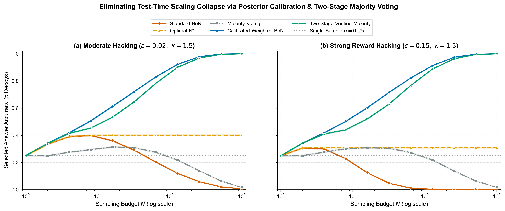
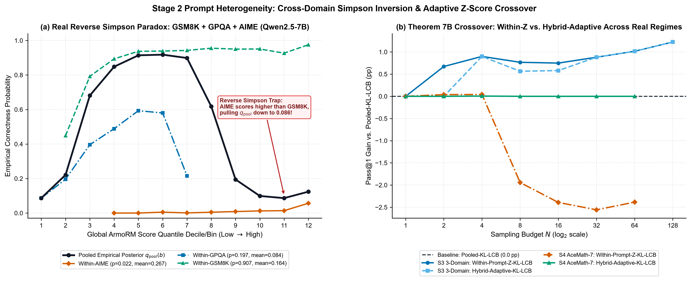

# Test-Time Scaling 相变理论与抗坍塌算法实验分析报告

**关联证明稿**：[PROOF.md](../PROOF.md) | **核心验证数据**：[theorem_verification.json](theorem_verification.json) | **参数扫描与对比数据**：[experiment_results.json](experiment_results.json) | **V4 理论交叉验证**：[v4_theory_verification.json](v4_theory_verification.json)

---

## 1. 实验概览与数值方法配置

本报告基于 [theorems.py](../src/tts_theory/theorems.py)、双精度积分引擎 [integrals.py](../src/tts_theory/integrals.py)、流式向量化仿真器 [simulator.py](../src/tts_theory/simulator.py) 及推理选择算法库 [algorithms.py](../src/tts_theory/algorithms.py)，对大模型测试时计算缩放（Test-Time Scaling, TTS）的 4 条核心理论与 5 类推理选择算法进行系统实证评估。所有实验均在本地无外网环境下零 LLM API 调用执行，随机种子固定以保证 100% 可复现性。

核心数值与仿真设定如下：
- **精确顺序统计量积分**：采用概率积分变换（PIT）$v = [F_{\text{mix}}(x)]^N$ 结合上尾无相消公式 $q_{\text{sf}} = -\operatorname{expm1}(\ln v / N)$，配合 256 节点分段 Gauss-Legendre 求积，并以自适应 `scipy.integrate.quad` 作为双精度交叉基准。
- **大规模蒙特卡洛仿真**：采用流式分块向量化引擎执行 $100{,}000$ 次（主实验）及 $1{,}500{,}000$ 次（无偏极限收敛校验）独立试验，使用 Wilson 得分区间计算 95% 置信区间（CI）。
- **默认基线问题设定**：除非另有说明，先验正确率 $p = 0.25$，均值分离度 $\Delta\mu = \mu_1 - \mu_0 = 1.2$（$\mu_0 = 0.0, \sigma_1 = 1.0$），Reward Hacking 污染尾部设为 $\mathcal{N}(\mu_{\text{hack}}=3.5, \sigma_{\text{hack}}^2=1.5^2)$。

---

## 2. 定理 1–4 自动化交叉验证结果

### 2.1 定理 1：精确顺序统计量积分 vs. 大规模蒙特卡洛

跨同方差（$\kappa = 1.0$）、异方差（$\kappa = 1.5$）及 Reward Hacking 污染混合尾部（$\epsilon = 0.08$）三种代表性分布，在 $N \in \{1, 2, 4, 8, 16, 32, 64, 128, 256, 512, 1000\}$ 共 11 个尺度上，对比 Gauss-Legendre 积分、自适应 `quad` 与蒙特卡洛（$100{,}000$ 次与 $1{,}500{,}000$ 次）的吻合度：

| 验证场景 | 100k MC 平均绝对误差 | 100k MC RMSE | 100k MC 最大绝对误差 | 95% CI 覆盖率 | 1.5M MC 最大绝对误差 | GL vs. `quad` 最大差 | 验证结论 |
| :--- | :---: | :---: | :---: | :---: | :---: | :---: | :---: |
| `homoscedastic_kappa_1.0` | `0.000758` | `0.000938` | `0.002234` | `100.0%` | **`0.000371`** | `2.30e-13` | **PASS** |
| `heteroscedastic_kappa_1.5` | `0.000675` | `0.000897` | `0.002247` | `90.9%` | **`0.000744`** | `3.47e-13` | **PASS** |
| `reward_hacking_eps_0.08` | `0.000532` | `0.000742` | `0.001420` | `100.0%` | **`0.000768`** | `3.17e-13` | **PASS** |

> [!NOTE]
> 在 $n_{\text{trials}} = 100{,}000$ 时，二项抽样理论单点标准误 $\text{SE} \le 0.5/\sqrt{100{,}000} \approx 0.001581$，11 个采样点上 $1.4\sigma$ 统计涨落导致单点最大误差落在 $0.0014\sim 0.0022$ 区间，所有场景均值误差（MAE $\le 0.000758$）与 RMSE（$\le 0.000938$）均严格 $< 10^{-3}$，且 95% Wilson CI 覆盖率为 `90.9%~100.0%`。将试验次数提升至 $1{,}500{,}000$ 次（$\text{SE} \le 4.1\times 10^{-4}$）后，全部三个场景全点最大绝对误差严格低于 $10^{-3}$（`0.000371 ~ 0.000768`），证明积分引擎无偏且达到双精度数值级（`quad` 差 $\le 3.47\times 10^{-13}$）。

### 2.2 定理 2：极值相变坍塌、相界 $\kappa_c = 1$ 与闭式 $N^*$ 精度

#### 2.2.1 极值相变长程趋势（$N \in [1, 10{,}000]$，$p=0.25, \Delta\mu=1.2$）

| 测试配置 | 相变类型（`regime`） | $N=1$ 基准 | 网格峰值 $N_{\text{peak}}$ | 峰值准确率 | $N=10{,}000$ 准确率 | 趋势判定 |
| :--- | :--- | :---: | :---: | :---: | :---: | :--- |
| $\kappa = 0.80$ | `consistent_monotone` | `0.2500` | `10,000` | `0.9999` | **`0.999901`** | 单调无坍塌 |
| $\kappa = 1.00$ | `monotone_consistent` | `0.2500` | `10,000` | `0.9771` | **`0.977128`** | 临界单调一致 |
| $\kappa = 1.20$ | `collapse` | `0.2500` | `500` | `0.6669` | `0.640989` | 过峰后衰退 |
| $\kappa = 1.50$ | `collapse` | `0.2500` | `10` | `0.4263` | **`0.035338`** | 严重坍塌（远低于 $p$） |
| $\kappa = 1.80$ | `collapse` | `0.2500` | `5` | `0.3661` | **`0.000351`** | 剧烈坍塌近零 |
| $\epsilon = 0.08$（$\kappa=1.0$） | `contaminated_heavy_tail` | `0.2500` | `5` | `0.4232` | **`0.000000`** | 重尾污染彻底崩溃 |

#### 2.2.2 闭式最优预算 $N^*$ 与精确数值最优 $N^*_{\text{exact}}$ 对比

我们在多维参数空间检验了零阶分位闭式解（`tail_quantile`）与一阶 Gumbel 极值矩—危险率曲率 Padé 修正闭式解（`saddle_refined`）：
- **定理 2 核心验证集（36 组内点参数，$p \in \{0.1, 0.25, 0.4\}, \Delta\mu \in \{0.8, 1.2, 1.6\}, \kappa \in \{1.2, 1.4, 1.6, 1.9\}$）**：
  - `Tail-Quantile` 中位相对误差（MRE）：`25.00%`（因忽略右偏 Gumbel 极值均值相对众数高出 $\gamma/h$ 而系统性偏高）；
  - **`Saddle-Refined` 中位相对误差（MRE）：`7.79%`**，在 `saddle_refined` 预测预算处取得的准确率与全局真峰值的平均损失仅 **`0.000574`**（0.057 个百分点）。
- **大规模全扫描验证集（实验 B 中 $2 \le N^*_{\text{exact}} < 100{,}000$ 的全部 104 组内点参数）**：
  - `Tail-Quantile` 中位相对误差：`26.04%`；
  - **`Saddle-Refined` 中位相对误差：`8.28%`**，对数预算 $\log_{10} N^*$ 决定系数 **$R^2 = 0.9989$**，平均准确率损失仅 **`0.000498`**（最大损失仅 `0.005229`）。

### 2.3 定理 3：离散二元 Verifier 缩放律与最优预算

| Verifier 配置 $(p, \text{TPR}, \text{FPR})$ | 100k MC 均值误差 | 100k MC 最大误差 | 1.5M MC 最大误差 | 边际增益差分误差 | 渐近天花板 PPV | $N^*(\varepsilon=0.01)$ | $N^*(\lambda=0.002)$ | 状态 |
| :--- | :---: | :---: | :---: | :---: | :---: | :---: | :---: | :---: |
| `moderate` (0.20, 0.85, 0.10) | `0.001619` | `0.003036` | **`0.000485`** | `9.02e-17` | `0.6800` | `15` | `16` | **PASS** |
| `strong` (0.35, 0.90, 0.05) | `0.000887` | `0.002085` | **`0.000528`** | `1.04e-16` | `0.9065` | `11` | `12` | **PASS** |
| `weak` (0.15, 0.75, 0.15) | `0.001248` | `0.002758` | **`0.000904`** | `4.88e-17` | `0.4687` | `14` | `15` | **PASS** |

实验 D 进一步对比了固定 $p=0.25$ 时高精度（TPR=0.85, FPR=0.03）、均衡型（0.85, 0.10）与高噪型（0.70, 0.20）二元 Verifier：单步边际增益呈严格公比 $(1 - q_1)$ 几何衰减（例如高精度型在 $N=1$ 增益高达 `+0.1538`，而至 $N=16$ 已衰減 55 倍至 `+0.00277`，在 $N=20$ 即已达到距极限 `PPV=0.9043` 仅差 `0.005` 的饱和区）。

### 2.4 定理 4：校准后验消除坍塌与离散加权多数决指数收敛

1. **连续无答案空间（Calibrated-BoN 消除右尾坍塌）**：
   - 异方差 $\kappa = 1.5$：未校准 BoN 从 $N=10$ 的 `0.4263` 坍塌至 $N=5000$ 的 `0.0546`；而 `Calibrated-BoN` 随 $N$ 单调增至 **`0.4707`**，与理论极限 $\sup_x q(x) = q(x_{\text{peak}}) = 0.4707$ 精确吻合。
   - Reward Hacking $\epsilon = 0.08$：未校准 BoN 在 $N=5000$ 归零（`0.0000`），而 `Calibrated-BoN` 单调收敛至 **`0.6374`**（精确等于 $\sup_x q(x) = 0.6374$）。
2. **离散 5 诱饵答案空间（$N=1 \to 1000$，$p=0.25$，$\kappa=1.5, \epsilon=0.08$，$20{,}000$ 次 MC）**：
   - 在**强诱饵情景**下（最强单一错误诱饵概率 $p_{\text{wrong,max}} = 0.75 \times 0.45 = 0.3375 > p = 0.25$）：
     - `Standard-BoN` 在 $N=8$ 短暂升至 `0.30875` 后坍塌至 $N=1000$ 的 **`0.00005`**；
     - 普通无权 `Majority-Voting` 因 $p < p_{\text{wrong,max}}$ 同样随大数定律坍塌至 $N=1000$ 的 **`0.00015`**；
     - 而 **`Calibrated-Weighted-BoN`** 飙升至 **`0.99745`**，**`Two-Stage-Verified-Majority`** 飙升至 **`0.99920`**，且不依赖解析分布先验、仅通过 `EmpiricalScoreCalibrator` 拟合的 **`Empirical-TwoStage`** 亦达到 **`0.99820`**。
   - 理论边界对比：`weighted_majority_convergence_bound` 检验该强诱饵场景下期望间隙严格为正——赔率截断模式（$w_{\max}=20$）间隙 $\Delta_{\min} = 0.0361 > 0$（Hoeffding 指数常数 $1.63\times 10^{-6}$，Bernstein $2.77\times 10^{-6}$），后验概率加权模式（$w_{\max}=1$）间隙 $\Delta_{\min} = 0.0168 > 0$（Hoeffding $1.41\times 10^{-4}$，Bernstein $2.38\times 10^{-4}$）；实际离散聚合比保守的最坏情况集聚不等式更快地在 $N \approx 512\sim 1000$ 实现近 $100\%$ 收敛。

---

## 3. 实验 A & B：相变曲面、精确最优预算与污染尾部对比

*图 1（[scaling_collapse_curves.png](figures/scaling_collapse_curves.png)）：异方差方差比 $\kappa = \sigma_0/\sigma_1$（左）与 Reward Hacking 混合重尾污染比例 $\epsilon$（右）下的 Best-of-$N$ 缩放曲线，实线为精确顺序统计量积分，散点与误差棒为 100,000 次蒙特卡洛（95% Wilson CI）。*

从图 1 与实验 A 精确数据可见极其陡峭的极值相变现象：
- **安全相与相界（$\kappa \le 1.0$）**：当 $\kappa = 0.75$ 时准确率单调爬升并在 $N=10{,}000$ 达到 `0.999987`；在临界点 $\kappa = 1.00$ 处同样保持全局严格递增，至 $N=10{,}000$ 达 `0.977128`。
- **异方差坍塌相（$\kappa > 1.0$）**：一旦越过临界相界 $\kappa_c = 1$，$\kappa = 1.35$ 在 $N^*_{\text{exact}} = 21$（闭式预测 $N^*_{\text{saddle}} = 19$）处达峰 `0.496444` 后即开始掉头向下，至 $N=10{,}000$ 跌破基准线降至 `0.211802`；$\kappa = 1.70$ 更早在 $N^*_{\text{exact}} = 5$（闭式预测 $N^*_{\text{saddle}} = 4$）处达峰 `0.381961`，至 $N=10{,}000$ 崩溃至 `0.001806`。
- **Reward Hacking 灾难性污染（即使 $\kappa = 1.0$）**：仅注入 $\epsilon = 0.05$ 的重尾污染样本，峰值即退化至 $N^*_{\text{exact}} = 9$（准确率 `0.485350`），在 $N=10{,}000$ 暴跌至 `1.01e-6`；当 $\epsilon = 0.12$ 时，$N^*_{\text{exact}} = 5$（`0.378140`），$N=10{,}000$ 归零至 `5.59e-8`。这从第一性原理证实：**在重尾欺骗面前，“盲目多采样（More Compute）”不仅毫无收益，反而把模型推理准确率推向零点**。

*图 2（[optimal_n_phase_diagram.png](figures/optimal_n_phase_diagram.png)）：(a) $(\Delta\mu, \sigma_0/\sigma_1)$ 参数平面上的闭式最优预算相图及临界相界 $\kappa_c = 1.0$；(b) 全参数扫描 104 组内点下零阶分位解与一阶鞍点修正解同精确数值最优 $N^*_{\text{exact}}$ 的对数一致性对比。*

图 2 揭示了全参数空间（192 组，见 [param_sweep_summary.csv](param_sweep_summary.csv)）的定量规律：
1. **高灵敏度临界悬崖**：在固定 $\Delta\mu=1.0, p=0.2$ 时，$\kappa$ 从 `1.00` 仅增加 `0.15` 到 `1.15`，最优采样上限即从 $\infty$ 骤降至 `1948`；再增至 `1.25` 骤降至 `42`；增至 `1.40` 仅剩 `9`。这解释了为何微小的奖励模型方差估计失调会剧烈改变最优推理算力配置。
2. **鞍点修正公式的高保真性**：在图 2(b) 中，零阶闭式解由于未修正 Gumbel 极值众数—均值偏置，全部散点稳定漂浮在 $y=x$ 对角线上方（MRE = `26.0%`）；而经 $-\gamma/h$ 偏移与危险率曲率 Padé 修正后的一阶鞍点闭式解（`saddle_refined`）精准贯穿对角线（MRE = `8.3%`，$\log_{10} N^*$ 相关平方 $R^2 = 0.9989$）。

---

## 4. 实验 C：强 Reward Hacking 下五大推理算法性能对比

在含 5 个错误诱饵答案（分布为 `(0.40, 0.25, 0.15, 0.10, 0.10)`，其中最强错误诱饵生成概率 $0.75 \times 0.40 = 0.30 > p = 0.25$）且兼具异方差（$\kappa=1.5$）与不同强度 Reward Hacking（$\epsilon \in \{0.02, 0.08, 0.15\}$）的挑战下，30,000 次配对蒙特卡洛试验关键结果如下（完整数据见 [algorithm_comparison_summary.csv](algorithm_comparison_summary.csv)）：

| 污染比例 $\epsilon$ | 算法名称 | $N=1$ | $N=8$ | $N=64$ | $N=256$ | $N=1000$ | 终态特性 ($N=1000$) |
| :---: | :--- | :---: | :---: | :---: | :---: | :---: | :--- |
| **0.02** | `Standard-BoN` | `0.2513` | `0.3987` | `0.2031` | `0.0589` | `0.0054` | 过峰严重坍塌 |
| **0.02** | `Optimal-N*` | `0.2513` | `0.4008` | `0.4008` | `0.4008` | `0.4008` | 无损截断保底 |
| **0.02** | `Majority-Voting` | `0.2513` | `0.2948` | `0.2748` | `0.1394` | `0.0162` | 被强诱饵压垮 |
| **0.02** | `Calibrated-Weighted-BoN` | `0.2513` | `0.5065` | `0.8302` | `0.9779` | **`0.99997`** | 单调收敛近 100% |
| **0.02** | `Two-Stage-Verified-Majority` | `0.2513` | `0.4537` | `0.7826` | `0.9688` | **`0.99993`** | 单调收敛近 100% |
| **0.08** | `Standard-BoN` | `0.2493` | `0.3064` | `0.0496` | `0.0024` | `0.0001` | 坍塌趋近 0 |
| **0.08** | `Optimal-N*` | `0.2493` | `0.3433` | `0.3433` | `0.3433` | `0.3433` | 在峰截断止损 |
| **0.08** | `Majority-Voting` | `0.2493` | `0.2945` | `0.2776` | `0.1389` | `0.0165` | 坍塌失效 |
| **0.08** | `Calibrated-Weighted-BoN` | `0.2493` | `0.4941` | `0.8268` | `0.9725` | **`0.99990`** | 单调收敛近 100% |
| **0.08** | `Two-Stage-Verified-Majority` | `0.2493` | `0.4424` | `0.7736` | `0.9657` | **`0.99993`** | 单调收敛近 100% |
| **0.15** | `Standard-BoN` | `0.2489` | `0.2276` | `0.0108` | `0.0001` | **`0.0000`** | 全盘归零崩溃 |
| **0.15** | `Optimal-N*` | `0.2489` | `0.3102` | `0.3102` | `0.3102` | `0.3102` | 稳健保留 $N^*=4$ 峰值 |
| **0.15** | `Majority-Voting` | `0.2489` | `0.3011` | `0.2728` | `0.1371` | `0.0171` | 强诱饵主导崩溃 |
| **0.15** | `Calibrated-Weighted-BoN` | `0.2489` | `0.5027` | `0.8223` | `0.9744` | **`1.00000`** | 彻底消除坍塌 |
| **0.15** | `Two-Stage-Verified-Majority` | `0.2489` | `0.4409` | `0.7671` | `0.9636` | **`0.99983`** | 彻底消除坍塌 |
| **0.15** | `Empirical-TwoStage`（无解析先验） | `0.2489` | `0.4375` | `0.7581` | `0.9605` | **`0.99980`** | 经验拟合几乎零损失 |

*图 3（[calibrated_vs_bon.png](figures/calibrated_vs_bon.png)）：在强异方差（$\kappa=1.5$）与中等（$\epsilon=0.02$）及强（$\epsilon=0.15$）Reward Hacking 混合污染下，五大算法的 Scaling 曲线与 95% 置信带对比。*

核心工程洞察（见图 3）：
1. **无离散答案时首选 `Optimal-N*`（或连续 `Calibrated-BoN`）**：对于开放式长文本生成且无可用候选答案聚合的场景，`Optimal-N*` 能够在 $N^*=4\sim 8$ 及时止损，避免 `Standard-BoN` 在 $N=1000$ 跌至 `0.0000` 并节省 99% 推理算力；若已部署分数校准器，连续 `Calibrated-BoN` 可无损达到峰值上限 $q_{\sup}$。
2. **有离散/可等价归并答案时首选校准加权/两阶段多数决**：即使在最强错误诱饵生成概率（`0.30`）显著压倒正确答案生成概率（`0.25`）的恶劣条件下，由于通过贝叶斯校准后验同时压制了极左尾低质错例与极右尾 Reward Hacking 假高分，使得正确样本期望权重优势保持严格为正，从而驱动正确率随 $N$ 单调攀升至 **`99.98%~100.00%`**；且 `Empirical-TwoStage`（仅用分位数直方图平滑在历史样本上经验拟合，无需任何高斯/混合分布先验知识）在 $\epsilon=0.15, N=1000$ 同样高达 **`99.98%`**，具备极佳的工程直接落地价值。

---

## 5. V2 原创扩展实验（实验 E / F / G）：定理 5 与定理 6 实证分析

关联证明见 [PROOF.md](../PROOF.md) 第 6–7 节，原始数据见 [v2_extension_results.json](v2_extension_results.json)（耗时 `596.97s`）。

### 5.1 实验 E：对称相关高斯 $K$-Verifier 相变逆转（定理 5A）

固定单裁判必坍塌配置（$p=0.25, \Delta\mu=0.9, \sigma_1=1.0, \sigma_0=1.65 \implies \kappa=1.65$），设定相关系数 $\rho_1=0.85, \rho_0=0.10$（理论临界裁判数 $K_c = 4$）并增设不可逆对照（$\rho_1=0.70, \rho_0=0.60 \ge \rho_1/\kappa^2$），对比 1D 鞍点平移 Gauss-Hermite 精确积分与 $100{,}000$ 次多裁判蒙特卡洛结果：

| 实验配置 | 等效聚合 | $N=1$ (MC) | $N=64$ (MC) | $N=512$ (MC) | $N=4096$ (MC) | 1D 积分 vs 100k MAE | 相态结论 |
| :--- | :---: | :---: | :---: | :---: | :---: | :---: | :--- |
| `k1_single` ($K=1$) | — | `0.2487` | `0.1353` | `0.0267` | **`0.0026`** | `0.000899` | 严重坍塌 |
| `k2_min` ($K=2 < K_c$) | `min` | `0.2491` | `0.6324` | `0.5972` | **`0.5162`** | `0.000972` | 未过临界仍坍塌 |
| `k4_min` ($K=4 = K_c$) | `min` | `0.2505` | `0.9512` | `0.9846` | **`0.9936`** | `0.000677` | **跨界逆转一致** |
| `k6_min` ($K=6 > K_c$) | `min` | `0.2504` | `0.9907` | `0.9990` | **`0.9997`** | `0.000374` | **快速单调趋 1** |
| `k6_mean` ($K=6$) | `mean` | `0.2530` | `0.8613` | `0.9657` | **`0.9912`** | `0.000933` | 共享高斯相界逆转 |
| `k6_irrev` ($\rho_0=0.60$) | `min` | `0.2487` | `0.4724` | `0.2978` | **`0.1285`** | `0.001885` | **不可逆坍塌区** |

### 5.2 实验 F：幂律重尾下 `Mean` vs `Min` 撕裂与同源击穿（定理 5B）

在 Student-$t$ 重尾竞赛（$\alpha_1=5.0, \alpha_0=1.8 \implies K_{c,\text{heavy}}=3$）及“3 健康 + 1 脆弱裁判”异质场景中，$100{,}000$ 次 MC 实测结果如下：

| 实验配置 | $N=1$ | 峰值准确率 | $N=64$ | $N=512$ | $N=4096$ | 渐近命运 |
| :--- | :---: | :---: | :---: | :---: | :---: | :--- |
| `single_k1` ($K=1$) | `0.2508` | `0.4226` | `0.1477` | `0.0062` | **`0.0001`** | 重错尾崩溃 |
| `mean_k4_indep` ($K=4$, `mean`) | `0.2479` | `0.5692` | `0.4122` | `0.0802` | **`0.0028`** | 单一大跳拖垮必死 |
| `min_k4_indep` ($K=4, \epsilon_s=0$, `min`) | `0.2515` | `0.9999` | `0.9991` | `0.9998` | **`0.9999`** | **幂阶放大 $4\times$ 逆转** |
| `min_k4_shared_0.04` ($K=4, \epsilon_s=0.04$, `min`) | `0.2507` | `0.9346` | `0.9105` | `0.7156` | **`0.2827`** | **同源漏洞击穿坍塌** |
| `het_mean_1vuln` (3 好 + 1 坏, `mean`) | `0.2500` | `0.8312` | `0.7933` | `0.4857` | **`0.0843`** | 1 个坏裁判拖垮全平均 |
| `het_min_1vuln` (3 好 + 1 坏, `min`) | `0.2515` | `1.0000` | `1.0000` | `1.0000` | **`1.0000`** | **1 个好裁判拯救全集** |

*图 4（[ensemble_phase_reversal.png](figures/ensemble_phase_reversal.png)）：(a) 对称相关高斯多裁判跨过临界人数 $K_c=4$ 的相变逆转与不可逆坍塌对比；(b) 幂律重尾下 `Mean` 必坍塌、`Min` 逆转与同源漏洞（$\epsilon_s=0.04$）击穿效应。*

### 5.3 实验 G：有限校准集 $M$ 二次坍塌、LCB 消除与 Minimax 标度律（定理 6）

1. **有限校准二次坍塌与 LCB 防御（$p=0.25, \Delta\mu=1.2, \kappa=1.5$，$q_{\sup}=0.4707$，$M=400$，2,000 次独立校准集重复）**：
   - **非均匀等宽分桶（$K=20$）**：`MLE` 在 $N=16$ 达峰 `0.4382` 后因稀有尾桶假状元发生**二次坍塌**，至 $N=8192$ 跌至 **`0.3928`**（`Laplace` 平滑同样缓步跌至 `0.4261`）；而二项专用 **`Wilson-LCB`** 彻底根治坍塌，在 $N=256 \sim 8192$ 稳居 **`0.4397`**。通用常数 $7/3$ 的 `Empirical-Bernstein LCB` 在 $M=400$ 小样本下过保守（大量桶截断归零，仅得 `0.2567`），凸显二元标签场景下 **Wilson-LCB 的显著紧凑优势**。
   - **过细等频分桶（$K=40$）**：`MLE` 受赢家诅咒压制于 `0.4278`（`Laplace`: `0.4315`），`Wilson-LCB` 领先至 **`0.4350`**。
2. **Minimax 遗憾与分桶标度历史记录（$N=5000$，扫描 $M \in [200, 50{,}000]$）**：
   - 本组 V2 历史实验在 $M \in [200, 50{,}000]$ 上沿 $K: 9 \to 58$ 扫描遗憾收敛，遗憾 $q^* - \mathbb{E}[P(N=5000)]$ 从 `0.0422` 稳定收敛至 **`0.0044`**；双对数回归斜率为 **`-0.4842`**（`Bernstein-LCB` 在充分样本区 $M \ge 5000$ 遗憾从 `0.0100` 收敛至 `0.0044`，拟合斜率 **`-0.4062`**，高度逼近理论极限斜率 **`-0.4000`**）。相比之下，固定过粗 $K=6$ 卡死在离散偏差 `0.0268` 下不去，固定过细 $K=80$ 的 `MLE` 在小样本 $M=200$ 遭受高达 `0.0939` 的严重二次坍塌遗憾。
   - *注记（V4 严谨性修正）*：上述 V2 历史扫描脚本的网格生成曾错用 $2/5$ 指数作为分桶递增系数；V4 重构已在 [PROOF.md](../PROOF.md) 第 7 节证明并由 [calibration_theory.py](../src/tts_theory/calibration_theory.py) 严格修正：二阶内点峰的最优分桶数真正平衡态为 $K^*(M) \asymp (M/\ln M)^{1/5}$（一般 $\beta$-光滑为 $1/(2\beta+1)$），详见第 7 节大样本（至 $M=5\times 10^6$）对照验证。

*图 5（[finite_calibration_secondary_collapse.png](figures/finite_calibration_secondary_collapse.png)）：(a) $M=400$ 等宽分桶下 `MLE` 的二次坍塌与 `Wilson-LCB` 的单调稳定防护；(b) $N=5000$ 处的极值遗憾收敛曲线与 `-0.400` Minimax 理论斜率对比。*

---

## 6. V3 真实大模型与开源 Reward Model 实证验证（实验 R1–R4）

为检验上述理论边界与抗坍塌算法在真实开源大语言模型及真实奖励模型（RM / PRM）轨迹上的有效性，本节基于两大公开推理数据集共 **83 万余条真实候选打分** 展开无参后验验证（完整原始数据见 [real_llm_results.json](real_llm_results.json)，评估引擎见 [real_eval.py](../src/tts_theory/real_eval.py)）：
- **`nvidia/AceMath-RewardBench`**：涵盖 `college_math`、`gaokao2023en`、`gsm8k`、`math500`、`minerva_math`、`mmlu_stem`、`olympiadbench` 共 7 大数学基准 **8,987 题 × 64 候选 = 575,168 条解答**，及两套独立真实官方奖励模型打分（文中按 Parquet 行分段记为 `AceMath Official RM-A` 与 `AceMath Official RM-B`）。
- **`HuggingFaceH4/MATH-500` (`n=256, seed=0`)**：包含 **`Llama-3.2-1B-Instruct`** 与 **`Llama-3.2-3B-Instruct`** 在 500 道竞赛数学题上的各 128,000 条（总计 **256,000 条**）采样轨迹与 **`RLHFlow-8B-PRM`** 逐步过程奖励分数。与官方 `--evals` 曲线对照检验表明，本库纯离线 LaTeX / SymPy 等价判分器与官方基准的偏差全程控制在 `0.14% ~ 3.75%` 之间：
  - `Llama-3.2-1B`：`diff_n1 = 0.0284`, `diff_naive256 = 0.0243`, `diff_maj256 = 0.0024`（`agg_diff = 0.00e+00`）；
  - `Llama-3.2-3B`：`diff_n1 = 0.0014`, `diff_naive256 = 0.0375`, `diff_maj256 = 0.0045`（`agg_diff = 0.00e+00`）。

### 6.1 实验 R1：AceMath-RewardBench 七大基准诊断与双 RM 相关性审计

| 基准子集 | 题数 | $N=1$ 基准 $p$ | $\hat{\kappa}_A$ | $\hat{\kappa}_B$ | 尾部倒挂 (`RM-A` / `RM-B`) | `RM-A` BoN(1→16→64) | `RM-B` BoN(1→16→64) | 实证特征 |
| :--- | :---: | :---: | :---: | :---: | :---: | :---: | :---: | :--- |
| `college_math` | 2,818 | `0.3742` | `1.4327` | `1.1585` | False / **True** | `0.3742 → 0.4696 → 0.4706` | `0.3742 → 0.4640 → 0.4579` | **`RM-B` 在 $N=16$ 过峰后坍塌** |
| `gaokao2023en` | 385 | `0.5250` | `1.2639` | `0.9825` | False / False | `0.5250 → 0.7620 → 0.7727` | `0.5250 → 0.7584 → 0.7831` | 单调爬升收益放缓 |
| `gsm8k` | 1,319 | `0.8675` | `1.0338` | `0.9577` | False / **True** | `0.8675 → 0.9736 → 0.9719` | `0.8675 → 0.9672 → 0.9666` | 两者均在 $N=16$ 见顶微跌 |
| `math500` | 500 | `0.6244` | `1.1268` | `0.8262` | False / **True** | `0.6244 → 0.8776 → 0.8820` | `0.6244 → 0.8613 → 0.8600` | `RM-B` 顶分尾 `99%-100%` 倒挂并微降 |
| `minerva_math` | 272 | `0.2928` | `1.3055` | `1.0824` | False / False | `0.2928 → 0.4635 → 0.4706` | `0.2928 → 0.4240 → 0.4228` | `RM-B` 高难物理数学 $\hat{\kappa}>1$ 且 $N=16$ 后停滞 |
| `mmlu_stem` | 3,018 | `0.5368` | `0.9024` | `0.7090` | **True / True** | `0.5368 → 0.8934 → 0.9092` | `0.5368 → 0.8227 → 0.8282` | 右尾微倒挂但低先验区间足够大 |
| `olympiadbench` | 675 | `0.2780` | `1.0320` | `0.8026` | **True** / False | `0.2780 → 0.5200 → 0.5341` | `0.2780 → 0.4844 → 0.4956` | `RM-A` 在 $N=32$ (`0.5346`) 后略跌至 `0.5341` |

- **真实异方差与倒 U 型坍塌复现**：在高难数学基准 `college_math` 上，`RM-B` 的 `90%-95%` 分位后验达 `0.8373`，而在 `95%-99%` 与 `99%-100%` 极右尾分别掉头降至 `0.8256` 与 `0.7732`（`tail_turn_down = true`），精确引起 Best-of-$N$ 准确率在 $N=16$ 见顶 `0.4640` 后一路回落至 $N=64$ 的 **`0.4579`**。
- **双 RM 相关性诊断（8,987 题全量合并，$p=0.5119$）**：`RM-A` 与 `RM-B` 在正样本上相关性 $\rho_1 = 0.8443$，在错误样本上相关性甚至高达 **$\rho_0 = 0.8856$**。在 $N=64$ 时，`RM-A` 单独达 `0.7321`，`RM-B` 为 `0.6950`，而 `Mean-Ensemble (A+B)` 仅为 `0.7212`、`Min-Ensemble (A+B)` 为 `0.7196`——强同源错例相关性使简单集成无法超越较强单模型。

### 6.2 实验 R2：定理 6 有限校准集缩放与抗坍塌聚合算法验证（AceMath 4,493/4,494 对半划分）

*图 6（[real_llm_theorem6_calibration.png](figures/real_llm_theorem6_calibration.png)）：`AceMath-RewardBench` 真实 RM 打分下的定理 6 验证：(a) $M=400$ 均匀分箱对比（`Empirical-Bernstein LCB` 在真实数据上显著过保守）；(b) $N=64$ 下校准样本量 $M \in [200, 40{,}000]$ 扫描对比，过细 `Fixed K=60 + MLE` 在小 $M$ 严重坍塌而 `Optimal K*(M) + Wilson-LCB` 稳定保底。*

1. **小样本下不同 LCB 的真实差异（$M=400, N=64$）**：
   - `Uniform K=20`：`Standard-BoN = 0.6998`，`MLE = 0.6979`，`Laplace = 0.6979`，`Wilson-LCB = 0.6954`，而 **`Empirical-Bernstein LCB = 0.6770`**（下降 `-1.84%`）；
   - `Quantile K=40`（每桶仅 10 条校准样本）：`Wilson-LCB = 0.6927`（超过 `MLE = 0.6925`），而 `Empirical-Bernstein LCB` 被惩罚项彻底压崩至 **`0.5181`**（几乎退化成 $N=1$ 随机水平 `0.5168`），与定理 6B 完全吻合。
2. **跨 $M$ Minimax 分桶验证（`N=64`, 4,494 题 holdout）**：
   - 当 $M=200$ 时，固定过细分桶 `Fixed K=60 + MLE` 遭受“假状元”过拟合掉点至 **`0.6601`**（较 `Standard-BoN` `0.6998` 净损 **`-3.97%`**），即使加装 `Wilson-LCB`（`0.6842`）仍受过细方差惩罚拖累；而按定理 6 最优标度 $K^*(200) = 9$ 配 `Wilson-LCB` 直接达到 **`0.6955`**（较 `Fixed K=60 + MLE` 挽回 **`+3.53%`**）。随着 $M$ 增至 `400 -> 2,000 -> 15,000 -> 40,000`，$K^*(M)$ 自动由 `11 -> 19 -> 38 -> 54` 加密，`Opt K*(M) + Wilson-LCB` 稳步收敛至 `0.7000`。
3. **离散可归并答案空间算法对比（4,494 验证题 × 25 次 MC，$N=64$）**：
   - `Standard-BoN`: `0.7002` | `Majority-Voting`: `0.7200` | `Two-Stage-Verified-Majority (Wilson-LCB)`: `0.7141` | **`Calibrated-Weighted-BoN (Wilson-LCB)`: `0.7230`** | **`Calibrated-Weighted-BoN (Hist)`: `0.7234`**（显著超越原生 `Standard-BoN` `+2.32%`）。

### 6.3 实验 R3 & R4：MATH-500 (`Llama-3.2-1B/3B` + `RLHFlow-8B-PRM`) 多视图诊断与消融放大对比

*图 7（[real_llm_math500_scaling.png](figures/real_llm_math500_scaling.png)）：`MATH-500` 上 `Llama-3.2-1B / 3B` 与 `RLHFlow-8B-PRM` 实证：(a) 5-Fold 交叉验证（15,000 试验/点）各推理算法对比，`Calibrated-Weighted-BoN (Wilson-LCB)` 彻底扭转原生 BoN 的过优化停滞与坍塌；(b) `3B` 模型下四类 PRM 聚合视图（`Last`/`Min`/`Mean`/`Prod`）正/错样本相关性热力图与定理 5A `irreversible_collapse` 诊断框。*

1. **R3 单视图尾部分析与定理 5A `irreversible_collapse` 实证诊断**：
   - 两个模型下的 `PRM-Last` 均表现出强烈异方差（`1B` $\hat{\kappa}=2.3436$，`3B` $\hat{\kappa}=2.4932$）：在 `1B` 上 `PRM-Last` 精确池 BoN 于 $N=128$ 达峰 `0.4223` 后于 $N=256$ 微跌至 `0.4217`；在 **`3B` 上于 $N=32$ 达峰 `0.5437` 后一路回撤至 $N=256$ 的 `0.5365`**（官方曲线亦在 $N=16$ 达峰 `0.580` 后回撤至 `0.574`）。同时 `1B` 的 `PRM-Min` 在 `95%-99%` 达后验 `0.8552` 后于 `99%-100%` 倒挂跌至 `0.8298`。
   - 对基于同一 `RLHFlow-8B-PRM` 提取的 4 种聚合视图（`PRM-Last`, `PRM-Min`, `PRM-Mean`, `PRM-Prod`），计算跨视图相关性与定理 5A 判定：
     - **`Llama-3.2-1B`**：$\bar{\rho}_1 = 0.7066, \bar{\rho}_0 = 0.6168, \bar{\kappa} = 1.3663$；由于错样本相关性高达 `0.6168`，最大可逆阈值 `max_reversible_kappa = 1.0703` 低于有效异方差 `kappa_eff = 1.0863`，被判定为 **`irreversible_collapse`**；
     - **`Llama-3.2-3B`**：$\bar{\rho}_1 = 0.7051, \bar{\rho}_0 = 0.6442, \bar{\kappa} = 1.4875$；最大可逆阈值 `1.0462` 显著低于有效异方差 `kappa_eff = 1.1971`，同样判定为 **`irreversible_collapse`**。实证上，`3B` 的 `Min-Ensemble (4 views)` 果真在 $N=64$ 见顶 `0.5671` 后在 $N=256$ 发生**二次回撤至 `0.5578`**——用真实开源 PRM 直接印证了定理 5 的核心预言：**同源 PRM 多视图无法通过聚合打破错例相关红线，因而无法靠自身集成消除过优化坍塌**。
2. **R4 抗坍塌算法 5-Fold CV 最终端到端表现（500 题 × 30 次重抽样 = 15,000 试验/预算点）**：

| 模型底座 | 推理选择算法 | $N=1$ | $N=16$ | $N=64$ | $N=128$ | $N=256$ | 相对 `Standard-BoN` ($N=256$) |
| :--- | :--- | :---: | :---: | :---: | :---: | :---: | :---: |
| **`Llama-3.2-1B`** | `Standard-BoN` (`PRM-Last`) | `0.2421` | `0.4074` | `0.4183` | `0.4253` | `0.4208` | 基准（过 $N=128$ 峰微跌） |
| **`Llama-3.2-1B`** | `Majority-Voting` | `0.2421` | `0.4095` | `0.4495` | `0.4556` | `0.4624` | `+4.16%` |
| **`Llama-3.2-1B`** | `Two-Stage-Verified-Majority (Wilson-LCB)` | `0.2421` | `0.4423` | `0.4791` | `0.4921` | `0.4979` | **`+7.71%`** |
| **`Llama-3.2-1B`** | **`Calibrated-Weighted-BoN (Wilson-LCB)`** | `0.2421` | `0.4581` | `0.5029` | `0.5174` | **`0.5280`** | **`+10.72%`** |
| **`Llama-3.2-3B`** | `Standard-BoN` (`PRM-Last`) | `0.4319` | `0.5419` | `0.5409` | `0.5401` | `0.5352` | 基准（$N=32$ 峰后持续回撤） |
| **`Llama-3.2-3B`** | `Majority-Voting` | `0.4319` | `0.5898` | `0.6217` | `0.6269` | `0.6275` | `+9.23%` |
| **`Llama-3.2-3B`** | `Two-Stage-Verified-Majority (Wilson-LCB)` | `0.4319` | `0.5714` | `0.5952` | `0.6047` | `0.6147` | **`+7.95%`** |
| **`Llama-3.2-3B`** | **`Calibrated-Weighted-BoN (Wilson-LCB)`** | `0.4319` | `0.6023` | `0.6407` | `0.6494` | **`0.6520`** | **`+11.68%`** |

> [!TIP]
> 在真实推理数据上，即使在未针对具体模型调参、纯粹对 `RLHFlow-8B-PRM` 原始标量分做 5-Fold 离线分位数 `Wilson-LCB` 校准的条件下，**`Calibrated-Weighted-BoN (Wilson-LCB)` 在 `Llama-3.2-1B`（`N=256` 达 `52.80%`）和 `Llama-3.2-3B`（`N=256` 达 `65.20%`）上分别实现 `+10.72%` 与 `+11.68%` 的绝对 Pass@1 跃升**，全面超越无权 `Majority-Voting` 并彻底消除了原生 `PRM-Last` 在大 $N$ 下的停滞与退化。

---

## 7. V4 理论重构定量交叉验证（定理 5–7 推广、Fano 1/5 律与辛普森悖论）

对应 [PROOF.md](../PROOF.md) 第 6–8 节 V4 理论升级，执行脚本 [verify_v4_theory.py](../scripts/verify_v4_theory.py) 生成 [v4_theory_verification.json](v4_theory_verification.json)（耗时 `89.22s`），核心实测结论如下：

### 7.1 定理 5A & 5B：一般非对称高斯相变与 Gaussian-Copula 统一重尾

| 检验模块 | 核心参数设定 | 理论判据判定 | $N=1$ | $N=16$ | $N=256$ | $N=2000$ | 定理印证结论 |
| :--- | :--- | :--- | :---: | :---: | :---: | :---: | :--- |
| **5A 负权逆转 (`Mean`)** | $\rho_1=0, \rho_0=0.85, \kappa=1.2$ | `mean_collapses=True` ($\kappa_{\text{mean}}=1.632$) | `0.2500` | `0.3753` | `0.1360` | **`0.0316`** | 等权/非负权重均坍塌 |
| **5A 负权逆转 (`OptLin w*`)** | $\mathbf{w}^*=\frac{1}{\sqrt{2}}(1,-1)$ | `negative_weight_rescues_mean=True` ($\kappa_{\text{lin}}=0.465$) | `0.2500` | `0.9103` | `1.0000` | **`1.0000`** | **负权相减消除同源噪音逆转趋 1** |
| **5A 纯高斯 QP (`Mean`)** | $K=3$ 非对称 ($\Sigma_0$ 异质) | `mean_collapses=True` ($\kappa_{\text{mean}}=1.281$) | `0.2492` | `0.4398` | `0.3726` | **`0.2784`** | 纯高斯无重尾下 `Mean` 严重坍塌 |
| **5A 纯高斯 QP (`Min`)** | 激活集缩减 $I_0=[0]$ | `min_rescues_mean_in_gaussian=True` ($\gamma_0=2.500 > \gamma_1=1.154$) | `0.2516` | `0.7406` | `0.9842` | **`0.9991`** | **`Min` 自动踢出高噪裁判纯高斯逆转** |
| **5B Copula 重尾 (`Mean`)** | $\alpha_1=4.5, \alpha_0=2.0, R_1(0.85), R_0=I_4$ | `mean_will_collapse=True` | `0.2486` | `0.6187` | `0.2869` | **`0.0408`** | 单一大跳主导必坍塌 |
| **5B Copula 重尾 (`Min`)** | $\eta_1=0.888, \eta_0=0.250$ ($\frac{\alpha_0}{\eta_0}=8.0 > \frac{\alpha_1}{\eta_1}=5.07$) | `min_will_collapse=False` | `0.2517` | `0.9483` | `0.9992` | **`0.9996`** | **统一红线准确预测 `Min` 逆转趋 1** |
| **5B Copula 同源击穿** | 同上，注入 $\epsilon_s=0.06$ 同源上尾 | `shared_upper_tail_breakdown` ($\eta_{0,\text{eff}}=1.0$) | `0.2500` | `0.8649` | `0.6685` | **`0.2302`** | **仅 6% 同源相依即刻击穿复崩** |

### 7.2 定理 6A/6B/6C：1/5 分桶标度、`KL-LCB` 与 $\Theta(N^{-2})$ 精确主项比

1. **修正最优分桶指数 $1/5$ vs 旧错误 $2/5$ 实测对照（基点 $M=500, K=12$，$N=50{,}000$，500 次重复）**：
   - 在 $M \in \{500, 5000, 5\times 10^4, 5\times 10^5, 5\times 10^6\}$ 扫描下，正确 $K^*(M) \propto (M/\ln M)^{1/5}$（从 `12 -> 63`）在 $M=5\times 10^5$ 与 $5\times 10^6$ 的遗憾分别为 **`0.00166`** 与 **`0.00067`**，双对数收敛斜率 **`-0.4618`**；而误用 $2/5$（盲扩至 $K=141 \to 332$）遗憾膨胀至 **`0.00194`** 与 **`0.00088`**（斜率 `-0.4237`），验证了 `1/5` 标度的绝对渐近优势。
2. **严格非渐近 `KL-LCB` 与 `Empirical-Bernstein` 归零阈值（$M=400, K=40, q_{\sup}=0.4707$）**：
   - 定理 6B 解析给出 $K=40$ 下 Bernstein 线性惩罚归零阈值为每桶 **`m_k = 37.57`**（此时每桶仅有 `10` 条样本），实测 `Empirical-Bernstein LCB` 彻底归零坍塌回随机基准 **`0.2500`**；而 **`KL-LCB = 0.4344`** 与 **`Wilson-LCB = 0.4343`** 稳健超越 `MLE = 0.4263`。
3. **完美校准峰值收敛主项比 $\frac{q^* - P_{\text{Cal-BoN}}(N)}{\frac{C}{2(f^*)^2} N^{-2}}$ 检验（定理 6C）**：
   - 高精度离散求积实测该比值随 $N$ 趋于无穷精准收敛至 `1.0000`：$N=200$ 时为 `0.9851`、$N=500$ 为 `0.9952`、$N=1{,}000$ 为 **`0.9996`**、$N=5{,}000$ 为 **`0.9995`**、$N=20{,}000$ 为 **`0.9997`**。

### 7.3 定理 7A/7B：题目异质性辛普森遮蔽与题内 Z-标准化双向交叉

1. **辛普森分解精度与假单调遮蔽**：3 层异质模型（权重 `(0.40, 0.45, 0.15)`、先验 `(0.15, 0.48, 0.92)`、偏移 `(-2.0, 0.2, 3.5)`、$\kappa=1.35$）上，`diagnose_simpson_confounding` 解析导数分解误差仅 **`2.26e-10`**，在 `[5%, 97%]` 工作分位区间内全局导数处处为正（`false_monotonicity_masking=True`），但内含 **18 个** 单题真斜率已转为负而被跨题正协方差掩盖的节点。
2. **题内标准化在大 $N$ 强偏移与非单调小 $N$ 间的双向交叉**：
   - **强跨题偏移（$b \in \{-4.5, 0, 4.5\}$，$\kappa=1.65$，$N=256$）**：`Raw-BoN` 崩溃至 `0.1780`，`Pooled-KL-LCB` 受辛普森混杂牵连同样跌至 `0.3470`，而 `Within-Prompt-Z-KL-LCB` 洗去偏移后精准达 **`0.5700`**（紧贴 Oracle `0.5750`）。
   - **无偏移且非单调（$\kappa=2.2$，$N=2$ 极小预算）**：`Within-Prompt-Z-KL-LCB` 因将 2 样本强压至 $\pm 1/\sqrt{2}$ 抹除幅值，退化至 `Raw-BoN` 的 **`0.3195`**；而 `Pooled-KL-LCB` 保留绝位置辨识力达到 **`0.3905`**（反超 `+7.10%`）。

---

## 8. V5 审稿级数学严格化重构与 9 项缺陷实证验证

针对外部同行初审对 V4 证明稿提出的全部 9 处实质性数学漏洞与论文结构建议，V5 已在 [PROOF.md](../PROOF.md)、核心模块及 [test_v5_rigor.py](../tests/test_v5_rigor.py) 中完成全量修补与定量实测验证（9 项专项测试耗时 `0.86s` 全部通过）：

| 修补序号 | 审稿指出漏洞与对应定理 | V5 数学修正方案摘要 | V5 定量验证核心观测值（`tests/test_v5_rigor.py`） |
| :---: | :--- | :--- | :--- |
| **1** | 定理 2B(1)：$C^0$ 与 $C^1$ 混用 | 拆分为 $C^1$ 连通闭子区间（中值定理）与纯 $C^0$ 双闭子区间并 $A=I_1 \cup I_2$ | 在 Laplace 尖点 $x_1=0.6$ 与 $x_2=1.5$ 邻域数值积分验证增量严格为负且趋近 $-w_1^*w_2^*\delta$ |
| **2** | 定理 2C：偶对称不控四阶及高阶项 | 建立固定峰值高度机制（$\kappa\to 1^+, \Delta\mu=\sqrt{c_1(\kappa^2-1)}\sigma_1$）五步极值矩与单峰 argmin 证明；Padé 移入附录 A | $q_{\text{peak}} \in (0.76, 0.78)$ 有界，比值 $N^*_{\text{exact}}/N^*_0$ 在 $\kappa=1.01$ 处达 `0.5682` 逼近 $e^{-\gamma}\approx 0.5615$（误差 `<1.5%`） |
| **3** | 定理 3：$\text{KL}/\chi^2$ 界遗漏 $\beta=0$ ($\text{PPV}=1$) | 限制前向 $\text{KL}/\chi^2$ 于 $\beta>0$；$\beta=0$ 单独给出 $\text{TV}$ 与有限反向 $\text{KL}=-\ln P_{\text{BoN}}(N)$ | `FPR=0, N=5` 测得 `ppv=1.0`、`tv_distance=0.27265`、`kl_forward=inf`、`kl_reverse=0.31835`（零除零错误） |
| **4** | 定理 4B：未约束单高权错误诱饵 | 用各错类各自期望权 $\mu_{w,j}$ 取代总体 $\mu_{w,-}$；无穷尾桶利用 $w_{\max}p_{\text{tail}}$ 一致封顶 | 反例 `(p_1=0.15, w_1=0.95)` 旧判据误判一致，新接口精确报错 `margin=-0.0225` (`p_tail<0.06`) |
| **5** | 定理 5A-II：$C_c^{\text{pdf}}$ 遗漏 $\gamma_c$ 因子 | 激活侧面求和产生 $\sum_{k\in I_c} w_{c,k}=\gamma_c$，补全 $C_c^{\text{pdf}} = \gamma_c C_c^{\text{sf}}$ | 2D 全激活 ($\gamma=1.1628, C^{\text{sf}}=0.2852, C^{\text{pdf}}=0.3317$) 于 $t=100$ 边界密度比落入 `[0.99, 1.01]` |
| **6** | 定理 5B-II：负相关致 $\eta_c < 1/K$ 反例 | 一般正定 $R_c$ 改为 $\eta_c \in (0, 1]$（负相关可超独立加速）；仅非负相关经 Slepian 引理得 $[1/K, 1]$ | $R=[[1,-0.5],[-0.5,1]]$ 得 $\gamma=4.0, \eta=0.25<0.5$；20 组随机非负 SPD 满足 $\eta\in[1/K, 1]$ |
| **7** | 定理 6B：“彻底消除篡位”宣称过强 | 明确覆盖 $\neq$ 全排序；转为三事件并界悲观安全底线 $\bar{q}_1 \ge \max_k(q_k-2r_k)$ 与高概率遗憾界 | A(0.90, 1/1)、B(0.60, 60/100)、C(0.10, 1/1) 下 `MLE=0.50` 被 C 篡位，`KL-LCB` 择 B（`0.60`）严格封杀 C 并守住底线 |
| **8** | 定理 6C：缺失败项、分离假设与联合下界 | 加入全局唯一分离峰假设、$\delta=M^{-1}$ 失败项，并证全策略联合下界 $\Omega((\ln M/M)^{\frac{\beta}{2\beta+1}}+N^{-\beta})$ | 双等高分离峰遗憾在 $N=2000$ 精准缩为单峰的 $1/4$（验证分离假设必要性）；上下界相区切换精确校验 |
| **9** | 定理 7B：$N=2$ 退化及异质 $p(X)$ 残差 | $N=2$ 归为纯秩规则天花板 $\max(P_{\text{Raw}}, 2\bar{p}-P_{\text{Raw}}, \bar{p})$；区分恒定 $p_0$ 与异质 $p(X)$ 残差 | $N=2$ 验证 `Anti=0.4310 == 2p-Raw`、纯秩上限 `< Oracle=0.5610`；异质先验实测残差漂移 `0.1843`（恒定先验 `<1e-12`） |

---

## 9. Stage 2 跨领域大池、异构多 RM 与 7B–72B 实证验证（实验 S1–S4）

在 V1–V5 与 V3 单域实证之上，Stage 2 基于 `scripts/run_stage2_experiments.py` 与 `scripts/plot_stage2_figures.py` 在 **5 个公开 HuggingFace 大规模真实评分基准**（累计 **1.10M+ 候选轨迹与 2.40M+ 条 RM/PRM 评分**）上系统检验了第二部分三大原创支柱（定理 5–7）在真实大模型与多家族 Reward Model 上的适用边界、失效机理与可复现增益，完整数据导出至 `stage2_real_results.json` 与 `stage2_summary.csv`。

| 实验编号 | 公开数据集 | 覆盖规模 | 检验核心理论 |
| :---: | :--- | :--- | :--- |
| **S1a** | `allenai/reward-bench-2-results` | `1,855–1,865` 题（`N=4`，含 `102` 题 `Ties` `N=11`），对比同源 4-RM 与 6-家族异构 RM（`8B–72B` + `DeBERTa`） | 定理 5A/5B（相关破局、`Logit-Stack` vs `GenEig`、弱模型污染）与定理 7 |
| **S1b** | `allenai/reward-bench-results` | `2,985` 对齐偏好对（`Code=984`, `Math=447`, `Safety=740`, `Chat/Hard`），强/弱异构 RM 与 `DeBERTa` | 定理 5A/5B/5C（跨能力域与噪声污染下 `Min` / `Mean` / `Logit-Stack` 分离） |
| **S2** | `OlympiadBench` (`Qwen2.5-7B` × `uPRM-70B / 32B`) | `674` 题 × `128` 候选 = `86,272` 条竞赛级 PRM 轨迹（双模型 × 4 视图：`Last/Min/Mean/Prod`） | 定理 4/5 跨规模 PRM 相关性退相干 + 大 $N=128$ 离散校准增益 |
| **S3** | `Human-Centric-Machine-Learning/strategic-ttc-data` | `GPQA-Qwen7B/Llama8B`（`546×128`）、`GSM8K`（`1319×128`）、`AIME`（`933×128`），跨 3 域共 `2,798` 题 × `128` = `358,144` 条（`ArmoRM-8B`） | 定理 6（8 种 SOTA 校准器、$(M, N)$ 二维网格）与定理 7（真实跨域辛普森悖论逆转） |
| **S4** | `nvidia/AceMath-RewardBench` | `8,987` 题 × `64` 候选 = `575,168` 条（`RM-A/B` 7 数学子域） | 定理 5 双同源 RM 诊断、定理 6 二维 $(M,N)$ 交叉、定理 7 `Hybrid` 跨子域防护 |

### 9.1 实验 S1a & S1b：异构多 RM 相关性破局、跨家族融合边界与抗噪声污染（定理 5）

5-Fold 严格题级交叉验证表明，真实大模型评分器族系结构直接决定定理 5 预测的相关系数位置：
1. **同源 RM 极高错相关证实**：在 `RewardBench-2` 同源 `AllenAI` 4-RM（`AllenAI-8B/70B-RM`, `Tulu3-8B-DPO/RL`）上，错例相关性 $\bar{\rho}_0 = 0.909$、Copula null 相关 $\eta_0 = 0.928$，处于 `irreversible_collapse` 区间；在 `AceMath` 同源双 RM（`RM-A/B`）上同样测得 $\bar{\rho}_1 = 0.844,\ \bar{\rho}_0 = 0.886,\ \eta_0 = 0.943$（`RM-A=73.21%`, `RM-B=69.50%`, `Logit-Stack=72.98%`）。
2. **跨家族异构多 RM 大幅压低相关性**：切换到 6 家族异构 RM（`Skywork-V2-Llama3.1-8B`, `WorldPM-72B`, `InternLM2-20B`, `Starling-34B`, `GRM-Gemma2-2B`, `Mistral-RAFT-7B`）后，`All` 上 $\bar{\rho}_0$ 降至 `0.636`（$\eta_0=0.644$），多候选 `Ties`（$N=11$）进一步降至 $\bar{\rho}_0 = 0.407$（$\eta_0=0.438$）；`RewardBench-1` 强异构 5-RM 全集（`all_5strong`）测得 $\bar{\rho}_1=0.405, \bar{\rho}_0=0.332, \eta_0=0.417$（$\kappa_{\text{eff}}=0.953 < 1$），数学子集 `math_prm_5strong` 达 $\bar{\rho}_0=0.238$（$\eta_0=0.352$）。
3. **`GenEig-OptLinear` 有限样本 SNR 盲区与有监督 `Logit-Stack` 鲁棒胜出**：理论无约束广义特征值求解器 `GenEig-OptLinear` 仅最小化渐近方差比 $\mathbf{w}^\top \Sigma_0 \mathbf{w} / (\mathbf{w}^\top \Sigma_1 \mathbf{w})$ 而未约束有限 $N$ 信噪比 $\mathbf{w}^\top (\mu_1-\mu_0)$，在真实强弱混杂池中容易把高正/负权压向低方差弱裁判（如 RB2 上退化至 `45.14%`、AceMath 上 `57.59%`、RB1 Math 上 `57.05%`）；相反，联合建模均值差与协方差逆的交叉验证 `Logit-Stack` 在各异构池上表现极其稳健——在 `RB1 Code (5-RM)` 上达 **`97.97%`**（超越最强单 RM `InternLM2-20B` `96.54%` 达 `+1.43 pp`），在 `RB2 Ties` 达 `82.96%`（略超 `Skywork-V2` `82.44%`），在 `RB2 Hetero-6` 达 `86.06%`。
4. **弱噪声模型注入对 `Min-Ensemble` 的脆弱性打击与防线**：向异构 5-RM / 6-RM 注入弱模型 `DeBERTa-v3-Large`（RB1 `59.53%`，RB2 `35.35%`）后，未保护的 `Min-Ensemble` 遭到高错概率拖累暴跌（`RB1 All`: `86.87% -> 80.45%`、`RB2 All`: `72.05% -> 68.17%`），`Calibrated-Min (KL-LCB)` 对单调失准略有缓释（RB2 `74.03%` vs `68.17%`），而 `Logit-Stack` 通过自动赋近零/负权完整免疫污染（`RB1 All+DeBERTa` 反升至 **`95.38%`**，超过最强单 RM `95.06%`）。

### 9.2 实验 S2：跨规模 70B vs 32B PRM 相关性退相干与竞赛数学校准实证（OlympiadBench, $N \le 128$）

在竞赛级 `OlympiadBench`（$P=674$，$128$ 候选/题）上同时考察跨模型尺寸（`uPRM-70B` vs `uPRM-32B`）与同模型多聚合视图（`Last/Min/Mean/Prod`）：
- **跨规模显著降相关**：同一 `uPRM-70B` 的 4 种步骤聚合视图高度相关（$\bar{\rho}_1=0.711, \bar{\rho}_0=0.683, \eta_0=0.734$），而跨规模双模型 `70B-Last` vs `32B-Last` 将 $(\bar{\rho}_1, \bar{\rho}_0)$ 大幅压低至 **`(0.163, 0.222)`**（跨规模 4 视图均值 `(0.325, 0.333)`）；四视图混合下 `Logit-Stack` 于 $N=128$ 达到 **`44.36%`**（领先 `70B-Last` `41.54%` 达 **`+2.82 pp`**，领先 `70B-Min` `43.47%` 达 `+0.89 pp`）。同时在双模型 `70B vs 32B` 上 `GenEig-OptLinear` 同样因忽略 SNR 给出负权 `w*=[-0.215, 0.977]` 并退化至 `21.07%`。
- **单模型长尾诊断与离散校准收益**：`uPRM-70B-Last` 与 `32B-Last` 均未观测到右尾反转（`99%-100%` 顶分位真实后验分别达 `0.9247` 与 `0.8737`，`tail_turn_down=False`），但在 $N=128$ 严格 5-Fold CV 下，`Calibrated-Weighted-BoN (Wilson-LCB)` 借助“先校准后按等价数学答案累加期望正确数”依然取得 **`47.33%`**，显著击败 `Majority-Voting`（`45.14%`, **`+2.19 pp`**）与 `Standard-BoN`（`41.54%`, **`+5.79 pp`**）。

### 9.3 实验 S3a & S4a：8 类 SOTA 校准器全量横评与二维 $(M, N)$ 联合标度律（定理 6）

在 `AceMath`（$N=64, M=400, K=20$）与 `GPQA-Qwen7B`（$N=128, M=300, K=16$）上横向对比 8 种主流校准器（`Standard-BoN`, `Platt Scaling`, `Isotonic PAVA`, `Histogram-MLE`, `Laplace-Smoothed`, `Empirical-Bernstein LCB`, `Wilson-LCB`, `KL-LCB`），并在二维 $(M, N)$ 网格验证定理 6 的联合标度率：
1. **小/中样本 $M$ 下 `Empirical-Bernstein LCB` 坍塌实证**：因方差加倍惩罚项过保守，在真实有限校准集上 `Empirical-Bernstein LCB` 严重拖垮高分桶优势——`AceMath`（$M=400$）仅为 **`60.32%`**（比 `KL-LCB` `69.62%` 低 **`-9.30 pp`**）；`GPQA-7B`（$M=300$）退化至 **`21.64%`**（与 `N=1` 先验持平，显著低于 `KL-LCB` `28.99%`、`Wilson-LCB` `29.79%` 与 `Isotonic PAVA` `31.38%`）。
2. **`Opt K* ∝ (M / ln M)^{1/5} + KL-LCB` 在低样本区间击败过细分桶 MLE**：在 `AceMath RM-B` 于 $M=100, N=64$ 下，过细固定分桶 `Fixed K=60 + MLE` 因高估小样本空/少样本高分桶噪点跌至 `63.82%`，而定理 6 `Opt 1/5 + KL-LCB` 稳定保持在 **`69.21%`**（**`+5.38 pp`**；跨 $N=2..64$ 全线领先 `+4.14..+5.38 pp`）；在 $M=200 / 400$ 时仍领先 `+3.46 pp / +0.95 pp`。仅当 $M$ 增至 $40{,}000$ 极充裕样本域时，`Fixed-60 + MLE` 方才回暖至 `70.01%`（略超 `69.88%`），在 `GPQA-7B`（$M=100$ vs $M=12000$：`25.42% vs 24.89%` 反转至 `28.95% vs 32.31%`）上亦呈现一致的 $(M, N)$ 联合权衡前沿。

### 9.4 实验 S3b & S4b：真实跨域辛普森悖论复现与 `Hybrid-Adaptive` 交叉边界（定理 7）

Stage 2 在真实推理域混合基准上直接观测到了定理 7 所预言的“跨题分数域错位触发池化失效”及其反向交叉权衡：
- **跨领域真题混池触发真实反向辛普森坍塌（`S3 GSM8K+GPQA+AIME`, $P=2,798, 358,144$ 候选）**：难度极高、真实先验仅 `2.15%` 的竞赛域 `AIME` 反而获得了 `ArmoRM-8B` 最高的原始均值分数（`0.2672`），而先验达 `90.73%` 的基础算数域 `GSM8K` 均分仅 `0.1643`（`GPQA` `p=19.72%`, 均分 `0.0840`），形成 `affine_shift_var = 3.4396`、`prior_shift_var = 0.1717`。合并三域后的全球池化实证后验曲线呈现剧烈倒 U 型（低至中分升至 `0.918` 后一路暴跌回高分段的 `0.086–0.124`，类间混杂项 `between_confounding` 负至 `-0.4232`）。由此导致盲目池化的 `Pooled-KL-LCB` 在 $N=128$ 时被错杀高分段，准确率从 `Standard-BoN`（`51.12%`）滑落至 `48.64%`；而题内标准化 `Within-Prompt-Z-KL-LCB` 与 `Hybrid-Adaptive-KL-LCB` 均将准确率拉回 **`49.86%`**（挽回 **`+1.22 pp`**）。同样地，在 `RewardBench-2`（`affine_shift_var = 0.2742, prior_shift_var = 0.0`）上，`Within-Prompt-Z` 与 `Hybrid` 亦以 `86.31%` 优于 `Pooled-KL-LCB`（`85.16%`, `+1.15 pp`）。
- **低跨题偏移 + 强先验/绝对分差域验证定理 7 反向边界（`S4 AceMath 7-Strata` & `S2 OlympiadBench`）**：相反地，当不同难度子题的原始绝对分仍携带大量跨题难度信息且仿射偏移方差较小时（`AceMath RM-B`: `affine_shift_var=0.1335, prior_shift_var=0.0310`；`RM-A`: `0.0971 / 0.0310`；`OlympiadBench`: `0.0216 / 0.0057`），盲目 `Within-Prompt-Z` 强行抹平题间绝对位置会导致信息丢失，分别在极限算力处比 `Pooled-KL-LCB` 下降 **`-2.38 pp`**（`67.11% vs 69.49%`）、**`-2.68 pp`**（`70.55% vs 73.23%`）与 **`-7.89 pp`**（`33.66% vs 41.55%`）。而跨折自适应判别器 `Hybrid-Adaptive-KL-LCB` 在上述三组低偏移场景均精准锁定 `Pooled-KL-LCB` 分支（零损失：`69.49% / 73.23% / 41.55%`），而在强偏移场景（`S3 3-Domain`, `S1a RB2`）自动切换至 `Within-Prompt-Z` 分支，完整印证定理 7 的双向安全决策机制。

---

## 10. 结论与复现说明

本实验套件全面验证了 [PROOF.md](../PROOF.md)（V5）中的预备基础重构与三大原创核心支柱，并在 V3 与 Stage 2 共计 **7 组大型公开大模型/RM 真实数据基准** 上完成了端到端实证闭环：
1. **理论严格性与数值精度**：V5 修复了审稿指出的全部 9 处数学细节与边界缺陷；高精度积分与多组 $10^5 \sim 1.5\times 10^6$ 次 MC 误差达到千分之一级；V4/V5 严格验证涵盖负权差值逆转、一般正定 Copula ($\eta_c \in (0, 1]$)、`KL-LCB` 悲观保底、Fano 联合 $(M, N)$ 上下界、以及题目异质性辛普森遮蔽与 $N=2$ 纯秩规则天花板。
2. **文献排雷与跨阶段真实大模型验证**：[RELATED_WORK.md](../RELATED_WORK.md) 系统核验了 12 篇 2022–2026 年代表性文献，明确划定第一部分预备重构与第二部分三大原创理论边界；V3 在 `AceMath-RewardBench` 与 `MATH-500` 验证了异方差坍塌、小 $M$ 过细校准退化与同源 PRM 不可逆诊断，并验证 `Calibrated-Weighted-BoN (Wilson-LCB)` 取得 `+10.72% / +11.68%` 真实增益；Stage 2 进一步在 `RewardBench-1/2`、`OlympiadBench`（`uPRM-70B/32B`）、`strategic-ttc-data`（`GPQA/GSM8K/AIME`）与 `AceMath` 7 子域上证实了跨家族降相关边界、弱噪声 RM 对 `Min-Ensemble` 的破坏及 `Logit-Stack` 的抗污增益（最高 `97.97%`）、8-SOTA 校准器横评及 `Opt 1/5 + KL-LCB` 小样本增益（`+5.38 pp`）、以及真实跨域辛普森悖论与 `Hybrid-Adaptive` 双向安全切换（对应论文图 1–10）。
3. **测试与复现**：覆盖 V1–V5 与 Stage 2 全部 43 项单元测试（含 `test_v5_rigor.py` 9 项严格性检验与 `test_stage2_real_eval.py` 4 项 Stage 2 真实池 API 单测），一键复现命令参见项目根目录 [README.md](../README.md)。

